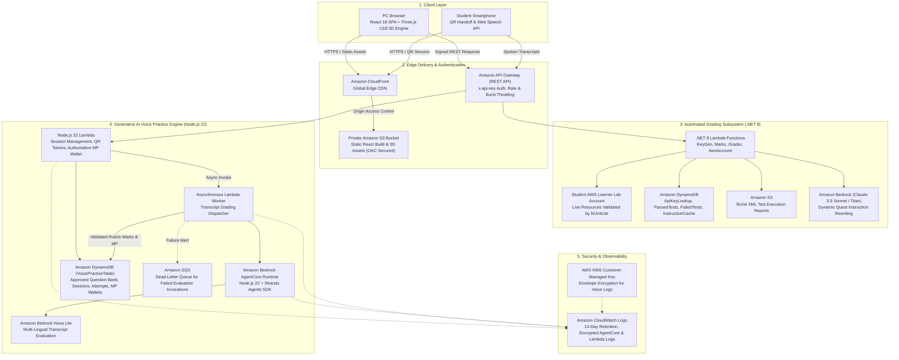
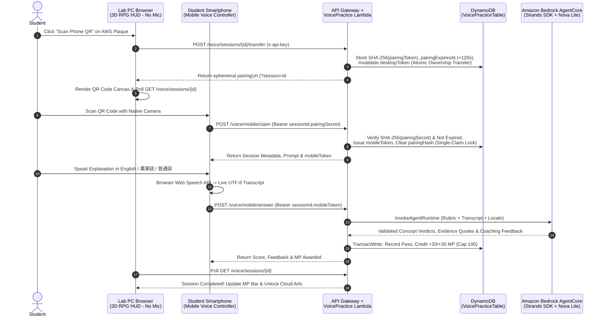

# The Legend of AWS Warrior V2 (Part 1): Gamifying Cloud Architecture & Oral Interview Prep in a 3D Action RPG

**By Cyrus Wong**  
*AWS Community Hero | Programme Leader of Higher Diploma in Cloud and Data Centre Administration (IT114115), Hong Kong Institute of Information Technology (HKIIT)*

> **Series Navigation**:
> - **Part 1 (This Post)**: *The Pedagogy, Gamification, Mobile QR-Code Handoff & 3D Action RPG Experience*
> - **[Part 2](BLOG_POST_V2_PART2.md)**: *Building a Zero-Hallucination AI Oral Examiner with Amazon Bedrock AgentCore, Strands Agents SDK & Zero-Trust Serverless Architecture*

---

## 1. Introduction: From Automated Lab Grader to Generative AI Oral Training World

When we first launched **The Legend of AWS Warrior (V1)** (featured on the [AWS Public Sector Blog](https://aws.amazon.com/blogs/publicsector/gamifying-lab-tutorials-automated-marking-system-the-legend-of-aws-warrior/)), our mission at the Hong Kong Institute of Information Technology (HKIIT) was to solve a fundamental bottleneck in cloud education: **manual lab grading does not scale.** 

By coupling a browser-based RPG with a serverless .NET automatic grading backend powered by **NUnitLite**, students in our **Higher Diploma in Cloud and Data Centre Administration (IT114115)** programme could provision real infrastructure in their own AWS Learner Lab accounts—configuring IAM roles, VPCs, S3 buckets, and EC2 instances—and receive instant, deterministic verification inside a game.

### The Pedagogical Gap: Why "Hands-On" Alone Wasn't Enough

After running V1 across hundreds of students, we noticed a critical industry gap during mock technical interviews and graduate placements:

1. **Students could click through labs, but struggled to *speak* cloud architecture**: A student might score 100% on an S3 lifecycle lab task, yet freeze during a Cloud Engineer job interview when asked: *"Can you explain why you chose S3 Glacier Flexible Retrieval over Glacier Deep Archive, and how S3 Object Lock protects against ransomware?"*
2. **Language barriers in technical articulation**: In Hong Kong and across Asia, students often think in Cantonese or Mandarin while using English AWS terminology. They needed a low-stress, repeatable environment to practice explaining cloud concepts aloud in **English (`en-US`)**, **Cantonese (`zh-HK`)**, and **Mandarin (`zh-CN`)** before facing a human interviewer.
3. **Why build a game? Because Fun is the Key to Learning**: A common question educators ask is, *"Why build a 3D action RPG instead of a standard voice-recording web form?"* Because **students learn best when they are having fun.** Asking a student to repeat an oral architecture answer five times into a web form feels like a chore; asking them to speak an S3 architecture explanation so they can charge up **Magic Power (MP)** to unleash an anime-inspired **Aurora Excalibur** or **Hyperscale Rumbling** super attack against a dungeon boss turns oral interview prep into an addictive gameplay loop.
4. **The Physical Classroom Bottleneck (Lab PCs Have No Microphones)**: In university and college computer laboratories, students sit at institutional desktop PCs that **do not have built-in microphones**, and institutions cannot practically supply or sanitize shared headsets for hundreds of students every day. If oral practice required a desktop microphone, students simply could not use it during lab classes. We needed a frictionless way for a student playing the 3D RPG on a mic-less lab PC to use their own **smartphone as an instant wireless voice controller**—without logging in or typing long URLs.

Enter **The Legend of AWS Warrior V2**—a complete generational leap that transforms the game from a single-room grader into a **four-region 3D open-world Action RPG** powered by **Amazon Bedrock AgentCore**, **Strands Agents SDK (`@strands-agents/sdk`)**, **Amazon Nova 2 Lite (`us.amazon.nova-2-lite-v1:0`)**, and **19 Anime × AWS Cloud Arts**.

---

## 2. End-to-End Serverless & Generative AI System Architecture

AWS Warrior V2 is 100% serverless, built with **AWS SAM (`template.yaml`)**, and split into two isolated, cooperating domains:
1. **The Core Lab Grader (.NET 8 Lambda + NUnitLite + DynamoDB)**: Evaluates live AWS resources inside student AWS accounts.
2. **The Generative AI Voice Practice & RPG Progression Engine (Node.js 22 Lambda + Amazon Bedrock AgentCore + Strands Agents SDK + Amazon Nova 2 Lite)**: Evaluates spoken architectural explanations, manages cross-device QR sessions, and drives the authoritative MP combat economy.




---

## 3. 302 Discoverable AWS Service Landmarks & Dual Voice Modes

### 3.1 302 Discoverable AWS Service Landmarks
Across the four open-world realms, every one of the **302 official AWS services** features a 3D service plaque complete with official AWS architecture icons. 

Approaching a plaque and clicking opens the **AWS Service Discovery Dialog**, presenting:
1. The service's canonical identity, icon, and practical real-world architecture examples.
2. Direct links to official AWS documentation.
3. Access to **Voice Practice** activities in English, Cantonese, and Mandarin.

```
┌────────────────────────────────────────────────────────────────────────┐
│                        AWS SERVICE DISCOVERY                           │
│                      [Amazon S3 Glacier Flexible]                      │
├────────────────────────────────────────────────────────────────────────┤
│ Official Description: Low-cost cold storage for archive data with      │
│ retrieval times from minutes to hours. Ideal for backup archives.      │
│                                                                        │
│ Available Voice Practice:                                              │
│ [1] Graded Read-Aloud: "Archive Retrieval & Lifecycle Transitions"     │
│ [2] Architectural Q&A: "Why Glacier Flexible over Instant Retrieval?" │
│                                                                        │
│ Language: [ English (US) ▼ ] [ 廣東話 (HK) ] [ 普通話 (CN) ]          │
│                                                                        │
│   ┌────────────────────────┐      ┌────────────────────────┐           │
│   │   [Speak on this PC]   │  OR  │   [📱 Scan Phone QR]   │           │
│   └────────────────────────┘      └────────────────────────┘           │
└────────────────────────────────────────────────────────────────────────┘
```

### 3.2 Dual Learning Modes: Read-Aloud & Architectural Q&A

To scaffold student confidence from beginner terminology familiarity to open-ended architectural reasoning, V2 provides two distinct voice assessment modes:

| Dimension | Mode 1: Graded Read-Aloud (`graded_read_aloud`) | Mode 2: Architectural Q&A (`graded_question_answer`) |
| :--- | :--- | :--- |
| **Pedagogical Goal** | Build confidence speaking AWS service terminology and core definitions aloud. | Train interview-style architectural explanation in the student's own words. |
| **Student Prompt** | Authored passage displayed on screen in English, Cantonese, or Mandarin. | Open-ended scenario question without showing the reference answer. |
| **AI Grading Rubric** | **Transcript Coverage** (`0–70` pts) + **Content Fidelity** (`0–30` pts) = `0–100` score (judging text meaning only, never voice/pronunciation). | Weighted multi-concept rubric (`concepts[]` summing to `100` pts) + mandatory verbatim transcript evidence. |
| **Pass Threshold** | Score $\ge 60$ | Score $\ge 60$ (derived strictly from server-summed `met` concept weights). |
| **MP Reward & Cooldown** | **`+5 / +10 / +15 MP`** (`60–74` / `75–89` / `90–100`) on first pass; enters a **7-day service cooldown**. | **`+10 / +20 / +30 MP`** (`60–74` / `75–89` / `90–100`) on first pass per unique question; rotatable across the question bank. |

### 3.3 Privacy-First Browser Speech-to-Text: Why the AI Grades *Meaning*, Never Voice or Pronunciation
A critical architectural distinction in AWS Warrior V2 is that **raw voice audio is never sent to AWS or to the AI agent**:
1. **100% Client-Side Speech-to-Text (`SpeechRecognition` / `webkitSpeechRecognition`)**: The desktop or mobile browser converts the student's speech into a UTF-8 text transcript locally on the device. Raw audio never leaves the student's browser or smartphone.
2. **How the AI Agent Evaluates Without Hearing Your Voice**: Because the AI agent on Amazon Bedrock AgentCore only receives the **text transcript** (never audio waveforms), it physically cannot hear pronunciation, accent, tone, or speaking speed.
3. **Two-Layer Anti-Bias & STT-Tolerance Guardrail (Prompt + Regex Validation)**: In [`src/VoiceAgent/agent.mjs`](file:///home/developer/Documents/The-Legend-of-AWS-Warrior/src/VoiceAgent/agent.mjs#L12-L14), we enforce both a strict system prompt directive and a programmatic `forbiddenVoiceClaim` output validator (`validateReadingGrade`, `validateAnswerGrade`, `validateEvaluation`) that rejects and retries any model response that attempts to comment on voice, pronunciation, or accent:
   ```javascript
   // src/VoiceAgent/agent.mjs
   const forbiddenVoiceClaim = /\b(?:pronunciat\w*|mispronounc\w*|your\s+voice|voice\s+(?:is|was|quality|tone|clarity|inaccurate|accurate)|accent|intonation|enunciat\w*)\b|發音|讀音|咬字|聲線|語調|口音|发音|读音/iu;
   const validFeedback = (value, limit = 1600) => text(value, limit) && !forbiddenVoiceClaim.test(value);
   ```
   When the AI provides feedback on an incomplete attempt, it comments strictly on **which AWS concepts or passage ideas were covered or missing in the captured transcript**—never on how the student's voice sounded.

---

## 4. Solving the "Lab PC Has No Mic" Bottleneck: Ephemeral Mobile QR-Code Handoff

In a physical computer lab at HKIIT, 40 students sit side-by-side at institutional desktop PCs that **have no microphones attached**. Asking students to bring their own headsets or log into their academic credentials on a mobile browser just to answer a 30-second voice question would destroy gameplay momentum.

We solved this with an **Ephemeral Capability-Token QR Handoff** ([`src/VoicePractice/domain.mjs`](file:///home/developer/Documents/The-Legend-of-AWS-Warrior/src/VoicePractice/domain.mjs#L420-L530)):




### Key Security Properties of the QR Handoff
1. **No API Key Exposure on Mobile**: The QR URL (`https://<cloudfront-domain>/voice-mobile.html?session=<id>#token=<secret>`) never contains the student's `x-api-key`.
2. **Hashed Capability Secrets**: Raw tokens are never stored in DynamoDB—only their `SHA-256` digests (`pairingHash`, `mobileHash`, `desktopHash`).
3. **2-Minute Pairing Window & Single-Claim Lock**: The pairing token expires strictly 120 seconds after generation (`PAIRING_TTL_SECONDS = 120`). The moment the phone calls `/voice/mobile/claim`, a conditional DynamoDB update atomically clears `pairingHash` and issues a dedicated `mobileToken`, preventing a second device from hijacking the QR code.
4. **Desktop Revocation**: Transferring a session to a smartphone immediately invalidates `desktopHash`, ensuring only one active device can submit answers for that session.

---

## 5. The 3D RPG World & Anime × AWS Cloud Arts

### 5.1 Four Open Realms, AZ Outage Alerts & Timed Shield Parries

AWS Warrior V2 expands from the single dungeon room of V1 into a rich, four-region open world rendered in Three.js (`r118`):

```
┌────────────────────────────────────────────────────────────────────────┐
│                          THE CLOUDLANDS WORLD                          │
├───────────────────────────┬────────────────────────────────────────────┤
│ 1. Cloudlands Village     │ • Central hub with 6 repairable buildings  │
│    (Primary Hub)          │ • Market, hidden treasure caches, flags    │
├───────────────────────────┼────────────────────────────────────────────┤
│ 2. Frostpeak Highlands    │ • Tailwind Buff: +12% movement speed       │
│    (Snow Biome)           │ • Home of the Glacial Frostpeak Titan      │
├───────────────────────────┼────────────────────────────────────────────┤
│ 3. Sunspire Desert        │ • Sunspire Oasis Buff: +2 HP/s regen       │
│    (Dune Biome)           │ • Aerial Sunspire Wyverns & Sand Overlord  │
├───────────────────────────┼────────────────────────────────────────────┤
│ 4. The Forgotten Vault    │ • Compute Overclock: +15% attack speed     │
│    (9-Room Dungeon)       │ • Central chamber boss: Vault Nightlord    │
└───────────────────────────┴────────────────────────────────────────────┘
```

- **Dynamic Availability Zone Outage Alerts**: Periodically, an **AZ Outage Alert** flashes an amber perimeter on the minimap with a **45-second countdown**. Racing into the degraded zone and defeating 2 monsters restores the AZ and triggers a **High Availability Surge** (+20% movement speed, +20% attack speed, and +20 HP recovery for 20s).
- **15 Melee Weapons & 5 Shields with Timed Perfect Parry**: Pressing `R` within **0.25 seconds** of an incoming monster strike executes a **Timed Perfect Parry**—deflecting 100% of damage and staggering the attacker.

---

### 5.2 The 5 Base Cloud Arts (`3`–`7`)

Passing voice practice awards **Magic Power (MP)**. Players spend MP via keys `3`–`7` to cast AWS-themed spells. Selecting multiple arts unlocks high-tier anime transformations with bilingual top-center banners and spoken male Cantonese battle cries.

```
┌────────────────────────────────────────────────────────────────────────┐
│                        AURORA EXCALIBUR                                │
│                       誓約勝利・極光聖劍                               │
│              [Amazon Aurora Global Database × Fate]                    │
└────────────────────────────────────────────────────────────────────────┘
```

| Key | Cloud Art | AWS Service Theme | MP / Cooldown | Combat Mechanics |
| :---: | :--- | :--- | :---: | :--- |
| **`3`** | **Event-Driven λ<br>瞬式・事件雷切** | AWS Lambda | `12 MP` / `12s` | Instant lightning chaining up to 120 units across 3 targets (`100%`, `50%`, `25%` damage). |
| **`4`** | **Auto Scaling Army<br>影分身・彈性軍勢** | EC2 Auto Scaling | `15 MP` / `20s` | Summons 5 animated shadow clones that advance forward, striking 3 times each. |
| **`5`** | **Scalable Storage<br>金剛招來・雲端寶庫** | Amazon S3 | `20 MP` / `45s` | Erupts 6 radiant orbital vault pillars pulsing AoE damage plus a detonation finale. |
| **`6`** | **Private Cloud Barrier<br>結界術・私有雲界** | Amazon VPC | `15 MP` / `25s` | 12-unit protective dome for 8s; halves incoming damage and knocks back intruders. |
| **`7`** | **Cross-Region Recovery<br>終式・跨區復甦** | Disaster Recovery | `25 MP` / `60s` | Instantly heals 35% HP; plants an anchor that catches lethal hits and teleports you to safety. |

---

### 5.3 Awakening Combo Arts (2, 3, and 4 Arts)

| Tier | Combo Art & Bilingual Banner | AWS Theme | Anime Inspiration & Combat Effect |
| :---: | :--- | :--- | :--- |
| **Tier 1** | **`Fargate Blade Barrage`<br>千刃・容器萬解** | AWS Fargate & ECS | *Bleach (Senbonzakura) / Fate (Gate of Babylon)* — Opens 5 golden container portals firing 18 glowing blades across 75 units in 3 volleys (`2.2×` Power per volley). |
| **Tier 1** | **`Dynamo Singularity`<br>赫式・毫秒爆裂** | Amazon DynamoDB | *Jujutsu Kaisen (Hollow Purple 虛式「茈」)* — Fuses Blue and Red orbs into an 18-unit Hollow Purple singularity projectile traveling 115 units (`3.4×` Power × 4 waves). |
| **Tier 1** | **`ALB Almighty Push`<br>神羅・負載天徵** | Elastic Load Balancing | *Naruto (Shinra Tensei 神羅天征)* — Warrior floats into the sky releasing a 360° gravity sphere and 16 radial spikes across 32 units (`3.0×` Power). |
| **Tier 1** | **`CloudWatch Omniscience`<br>天照・全知之眼** | CloudWatch & X-Ray | *Naruto (Amaterasu 天照)* — Erupts 24 pitch-black flame pillars and a Sharingan mandala with an X-Ray scanning beam pulsing 6 times over 7s (`1.8×` Power + slow). |
| **Tier 1** | **`CloudFront Edge Flash`<br>炎呼吸・邊緣瞬閃** | Amazon CloudFront | *Demon Slayer (Thunderclap & Flash × Rengoku)* — Twin dragon helices along 8 Edge-PoP fire pillars across a 65-unit corridor for 3 rapid slashes (`3.2×` Power each). |
| **Tier 1** | **`Bedrock Titan Meteor`<br>天礙震星・基岩星隕** | Amazon Bedrock | *Naruto (Tengai Shinsei 天礙震星)* — Drops twin colossal meteors from a sky portal 22 units ahead, dealing `9.0×` Power across a 26-unit radius. |
| **Tier 2** | **`EKS Susanoo Mecha`<br>須佐能乎・容器魔神** | Amazon EKS | *Naruto (Complete Body Susanoo 完成体・須佐能乎)* — Manifests a 24-unit cyan Susanoo colossus cleaving 4 times across 42 units (`4.2×` Power + knockback per cleave). |
| **Tier 2** | **`Step Functions Malevolent Shrine`<br>伏魔御廚子・無伺服器斬界** | AWS Step Functions | *Jujutsu Kaisen (Malevolent Shrine 伏魔御廚子)* — Summons a dark-crimson Torii shrine unleashing 8 omnidirectional slash waves across 38 units over 4.5s (`2.8×` Power + slow). |
| **Tier 2** | **`Lake Formation Planetary Devastation`<br>地爆天星・資料湖封印** | AWS Lake Formation | *Naruto (Chibaku Tensei 地爆天星)* — Launches a black gravity core upward, ripping 18 massive earthen boulders into a floating planetoid (`8.5×` Power AoE crush). |
| **Tier 2** | **`EBS Snapshot Time Rewind`<br>時空回溯・快照結界** | Amazon EBS Snapshots | *JoJo's Bizarre Adventure / Bleach* — 34-unit golden celestial clockwork astrolabe with counter-rotating hands pulsing 4 time-shockwaves (`3.4×` Power each). |
| **Tier 3** | **`Aurora Excalibur`<br>誓約勝利・極光聖劍** | Amazon Aurora Global DB | *Fate/Stay Night (Excalibur 約束された勝利の剣)* — Points a 92-unit light beam to the sky gathering photon rings, then cuts down with a colossal holy sword into a 110-unit Excalibur beam (`4` ticks of `4.8×` Power). |
| **Tier 3** | **`SageMaker Infinite Void`<br>無量空處・全知星圖** | Amazon SageMaker | *Jujutsu Kaisen (Unlimited Void 無量空處)* — 44-unit cosmic black dome with an event-horizon accretion disk and 24 orbiting stars (`3.2×` Power × 6 bursts + `6.0×` finale). |

---

### 5.4 The Cataclysmic 5-Art Super Attacks (87 MP, 50% / 50% Chance)

Selecting all 5 Cloud Arts (`3`–`7`) transforms the cast button into a **50/50 randomized cataclysmic execution formation** spanning a **128-unit radius**:

```
                               ┌─────────────────────────────────┐
                               │   5 ARTS SELECTED: [3][4][5][6][7]   │
                               │        COST: 87 MP / 60s CD     │
                               └────────────────┬────────────────┘
                                                │
                                       50% / 50% RANDOM CHANCE
                                                │
                    ┌───────────────────────────┴───────────────────────────┐
                    ▼                                                       ▼
       [MODE 1: GLOBAL DEPLOYMENT]                             [MODE 2: HYPERSCALE RUMBLING]
             全域部署                                                 地鳴・超大規模踏境
  • AWS Geographic Breadth (Multi-Region)                 • AWS Compute Depth (Hyperscale Datacenters)
  • 4 Cardinal Cloud Avatars (6x Player Size)             • Attack on Titan (The Rumbling 地鳴)
  • 24 Sky-to-Ground Judgement Pillars                   • Founding Titan Skeletal Spine & Ribcage
  • 3 Execution Shockwaves across 128 Units               • Ring of 7.5x Colossal Titans in Steam
  • Defeats all regular monsters & bosses on wave contact • 3 Execution Shockwaves across 128 Units
```

1. **`Global Deployment` / 全域部署** (AWS Global Multi-Region Infrastructure):
   - Summons 4 giant Cloud Avatars (6× player size) facing outward in the cardinal directions (North, South, East, West) and erupts 24 sky-to-ground judgement pillars, representing the global multi-region resilience of AWS.
2. **`Hyperscale Rumbling` / 地鳴・超大規模踏境** (AWS Hyperscale Compute Infrastructure):
   - Combines *Attack on Titan* (The Rumbling `地鳴`) with AWS's planet-scale datacenter fleet—erecting the Founding Titan's skeletal spine and marching an advancing ring of 7.5× crimson Colossal Titans across 128 units in scalding steam.

---

## 6. Continue to Part 2: Under the Hood of the Zero-Trust AI Engine

Now that you have seen how speaking AWS architecture into a smartphone fuels high-tier anime super attacks on a lab PC, a critical engineering question arises:

> **How do we prevent students from jailbreaking the AI grader, hallucinating quotes, or stealing Magic Power (MP)? And why does our architecture place an AWS Lambda "Referee" between API Gateway and Amazon Bedrock AgentCore Runtime?**

In **[Part 2: Building a Zero-Hallucination AI Oral Examiner with Amazon Bedrock AgentCore & Strands Agents SDK](BLOG_POST_V2_PART2.md)**, we dive into the Node.js 22 source code, our **Strands Agents SDK (`@strands-agents/sdk`)** integration, two-phase NFKC substring verification, single-table DynamoDB transactions, and dual-stack CloudFormation/SAM DevOps.
