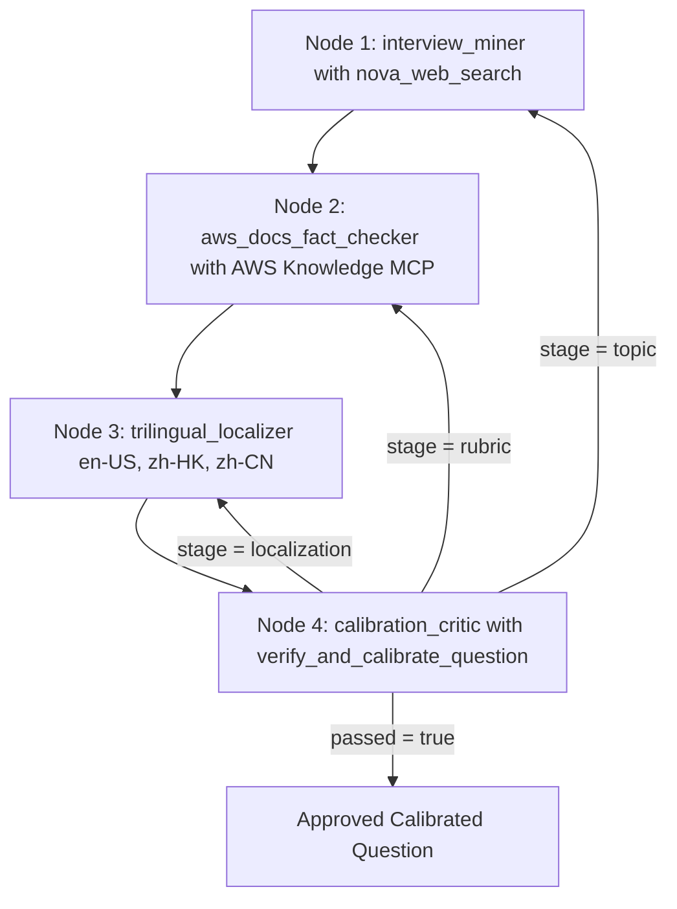

## The Legend of AWS Warrior V2 (Part 3 - Gen Question): Autonomous AWS Question Bank Generation with Loop Engineering, Strands Multi-Agent Graphs, Harness Plugins and Live OpenTelemetry Tracing

**By Cyrus Wong**
*AWS AI Hero | AWS AI User Group Hong Kong Leader | Programme Leader of Higher Diploma in Cloud and Data Centre Administration (IT114115), Hong Kong Institute of Information Technology (HKIIT)*

> 3-Part Technical Blog Series: [Part 1 covers the Game and Pedagogy](https://github.com/wongcyrus/The-Legend-of-AWS-Warrior/blob/main/BLOG_POST_V2_PART1.md), [Part 2 covers the AWS Serverless and AgentCore Design](https://github.com/wongcyrus/The-Legend-of-AWS-Warrior/blob/main/BLOG_POST_V2_PART2.md), and Part 3 covers Autonomous Question Generation with Strands Multi-Agent Graphs.

---

## 1. Introduction: The Question-Bank Scaling and Freshness Dilemma

In **[Part 1 - The Game](https://github.com/wongcyrus/The-Legend-of-AWS-Warrior/blob/main/BLOG_POST_V2_PART1.md)** and **[Part 2 - The AWS Design](https://github.com/wongcyrus/The-Legend-of-AWS-Warrior/blob/main/BLOG_POST_V2_PART2.md)**, we established why **Architectural Q&A** in **The Legend of AWS Warrior V2** never improvises questions at runtime:

- Every Q&A session is strictly backed by a predefined, `status: approved` question in DynamoDB (`PK = QUESTION_BANK`) containing trilingual prompts (`en-US`, `zh-HK`, `zh-CN`), 2-3 atomic concepts whose weights sum to `100`, known misconceptions, acceptable answers, and a reference answer.
- However, manually writing, translating, and calibrating questions across **302 AWS service landmarks**—and keeping them accurate as AWS evolves—faces three major hurdles:
  1. **Community Interview Questions Frequently Go Stale**: Popular online AWS interview questions often repeat outdated claims (such as claiming S3 buckets are eventually consistent for new objects, or that S3 buckets are unencrypted by default, when AWS enabled strong read-after-write consistency and default SSE-S3 / Block Public Access years ago).
  2. **Ungrounded Rubrics Fail Live Student Grading**: A rubric that looks reasonable on paper might be phrased too narrowly for our Two-Phase `NFKC` substring verifier (`grade_answer`), causing a genuinely good spoken English or Hong Kong Cantonese code-switched student answer to score below `80%`, or allowing a misconception answer to pass (`60%` or higher).
  3. **Multi-Slot Topic Duplication**: If you ask an LLM to generate 2 or 3 questions for Amazon S3 or Amazon RDS, it naturally gravitates toward the exact same headline topic unless a deterministic semantic deduplicator forces it onto an orthogonal architectural scenario.

To solve all three without human bottleneck, we built an autonomous, self-calibrating **4-Agent Question Generator and Refresher** ([src/VoiceAgent/question-generator.mjs](https://github.com/wongcyrus/The-Legend-of-AWS-Warrior/blob/main/src/VoiceAgent/question-generator.mjs) and [src/VoicePractice/question-generator.mjs](https://github.com/wongcyrus/The-Legend-of-AWS-Warrior/blob/main/src/VoicePractice/question-generator.mjs)) powered by **Loop Engineering**, **`@strands-agents/harness` (`^0.3.3`)**, **`@strands-agents/sdk` (`^1.23.0`)**, **Amazon Nova Web Grounding (`nova_grounding`)**, the live **AWS Knowledge MCP Server (`https://knowledge-mcp.global.api.aws`)**, and **Native Strands OpenTelemetry (`@strands-agents/sdk/telemetry`)**.

---

## 2. What "Loop Engineering" Actually Means (And What It Does Not Mean)

A common misconception is that **Loop Engineering** simply means wrapping an LLM API call inside an imperative `for` or `while` retry loop in application code. **That is not Loop Engineering.**

In modern AI systems engineering, **Loop Engineering** is the third foundational layer above **Prompt Engineering** and **Context Engineering**:

| Engineering Layer | Core Question | Primary Focus | Analogy |
| - | - | - | - |
| **1. Prompt Engineering** | *"What should we say to the model?"* | Crafting role definitions, instructions, and output schemas for a single model call. | Playing a single move in chess. |
| **2. Context Engineering** | *"What does the model need to know and access?"* | Curating the workspace: prior questions (`avoidQuestions`), MCP tool schemas, context offloading (`ContextOffloader`), and conversation history. | Preparing the board and pieces. |
| **3. Loop Engineering** | *"How does the system autonomously act, verify, self-correct, and terminate?"* | Architecting the closed-loop control system (**Perceive -> Reason -> Act -> Observe -> Verify -> Self-Correct or Terminate**) with deterministic verifiers, stateful memory continuity, and hard multi-layer resource bounds. | Building the autonomous chess engine. |

### The 5 Pillars of True Loop Engineering in Our Question Generator

1. **Model-Driven Action and Observation**: Instead of hardcoding web searches or documentation lookups in imperative code, each specialist Strands agent autonomously decides when to call `nova_web_search` or `aws___search_documentation` / `aws___read_documentation`, inspects the returned citations, and decides whether to read deeper before synthesizing its JSON output.
2. **Deterministic Verifiers and Guardrails**: Agents never grade their own homework by "vibes." Every iteration is checked by deterministic verifiers: node-level JSON syntax (`GoalLoop`), schema and weight invariants (`validateQuestion`), stopword-filtered Jaccard semantic overlap checks (`findDuplicateOrOverlappingQuestion`), Cantonese/Mandarin script hygiene, and parallel live grading of 3 synthetic student transcripts (`verifyAndCalibrate`).
3. **Structured Error Feedback Into Stateful Memory**: When verification fails, the pipeline does not wipe memory and start over blindly. Every graph node sets `preserveContext: true`, and the Assurance Plane injects a structured critique (`{ previousAttemptCritique, failureStage, targetNode, cycle }`) into the exact responsible node.
4. **Verifiable Goal Termination**: Both the inner node `GoalLoop` and the outer `Graph` terminate immediately once their verifiable goal predicate (`passed: true` / `invocationState.calibratedResult !== null`) is satisfied.
5. **Bounded Multi-Layer Governance (Zero Infinite Loops)**: Hard turn caps across every loop layer guarantee that no runaway tool call or graph cycle can ever loop forever.

---

## 3. Dual-Level Loop Architecture with `@strands-agents/harness` and `@strands-agents/sdk`

Our question generator (`createQuestionGenerator`) implements **two nested levels** of native Strands loops—with zero imperative `for`/`while` retry loops around the graph:




### 3.1 Level 1: The Inner Agent Loop (`createHarness` + `GoalLoop` + `ContextOffloader`)

In [src/VoiceAgent/question-generator.mjs](https://github.com/wongcyrus/The-Legend-of-AWS-Warrior/blob/main/src/VoiceAgent/question-generator.mjs), each specialist agent is built with `createHarness()` from `@strands-agents/harness` and vended plugins from `@strands-agents/sdk`:

```javascript
// src/VoiceAgent/question-generator.mjs
import { createHarness } from "@strands-agents/harness";
import { BedrockModel, BeforeInvocationEvent, BeforeModelCallEvent } from "@strands-agents/sdk";
import { ContextOffloader, InMemoryStorage } from "@strands-agents/sdk/vended-plugins/context-offloader";
import { GoalLoop } from "@strands-agents/sdk/vended-plugins/goal";

async function createStrandsNodeAgent({
  id,
  description,
  systemPrompt,
  tools = [],
  send,
  modelId,
  maxTokens = 2200,
  maxTurns = 4,
  traceAttributes,
}) {
  const boundedMaxTurns = Math.min(10, Math.max(1, Math.trunc(Number(maxTurns) || 4)));
  const model = new BedrockModel({
    modelId,
    maxTokens,
    temperature: 0,
    stream: false,
    clientConfig: { maxAttempts: 3, retryMode: "adaptive" },
  });

  // 1. Intra-Node GoalLoop Plugin: Self-corrects malformed non-JSON output before graph handoff
  const jsonGoalLoop = new GoalLoop({
    name: `${id}:json-goal-loop`,
    maxAttempts: Math.min(2, boundedMaxTurns),
    preserveContext: true,
    goal: response => {
      const text = (response?.content ?? [])
        .map(block => (typeof block?.text === "string" ? block.text : ""))
        .join("\n")
        .trim();
      try {
        parseJsonFromText(text);
        return { passed: true };
      } catch (error) {
        return {
          passed: false,
          feedback: `Output from ${id} was not valid JSON (${error.message}). Return ONLY valid JSON matching your node schema.`,
        };
      }
    },
  });

  // 2. ContextOffloader Plugin: Offloads large MCP documentation reads (>2500 tokens) to InMemoryStorage
  const plugins = [jsonGoalLoop];
  let contextOffloader = null;
  if (tools.length > 0) {
    contextOffloader = new ContextOffloader({
      storage: new InMemoryStorage(),
      maxResultTokens: 2500,
      previewTokens: 1000,
      includeRetrievalTool: false,
    });
    plugins.unshift(contextOffloader);
  }

  // 3. Strands Harness with Large-Tool Offloading and Overflow Protection
  const agent = await createHarness({
    id,
    name: id,
    description,
    model,
    effort: "auto",
    caching: false,
    systemPrompt,
    tools,
    plugins,
    builtinTools: [],
    builtinPlugins: [],
    contextManager: {
      strategies: ["largeToolOffloading", "overflowProtection"],
      stash: false,
    },
    session: false,
    memory: false,
    skills: false,
    backgroundTasks: false,
    printer: false,
    retryStrategy: null,
    ...(traceAttributes ? { traceAttributes } : {}),
  });

  // 4. Hard Inner Turn Cap (Default 4 turns, clamped 1..10)
  let turnsInCurrentInvocation = 0;
  agent.addHook(BeforeInvocationEvent, event => {
    if (!event?.resumed) turnsInCurrentInvocation = 0;
  });
  agent.addHook(BeforeModelCallEvent, () => {
    turnsInCurrentInvocation += 1;
    if (turnsInCurrentInvocation > boundedMaxTurns) {
      throw new Error(`Agent "${id}" exceeded maximum inner loop turns (${boundedMaxTurns})`);
    }
  });
  return agent;
}
```

### 3.2 The 4 Specialist Agents in the Strands `Graph`

<SimpleTabs>

<SimpleTab name="1. interview_miner">

- **Role**: `InterviewQuestionMinerAgent`
- **Tooling**: `nova_web_search` (`ConverseCommand` with `systemTool: { name: "nova_grounding" }`)
- **Responsibility**: Searches the live web for real-world cloud engineering interview questions for the target AWS service, avoids all topics in `avoidQuestions`, and flags `suspectedOutdatedClaims`.

</SimpleTab>

<SimpleTab name="2. aws_docs_fact_checker">

- **Role**: `AwsDocsFactCheckerAgent`
- **Tooling**: Live **AWS Knowledge MCP Server** (`https://knowledge-mcp.global.api.aws`) via Strands `McpClient` (`aws___search_documentation`, `aws___read_documentation`)
- **Responsibility**: Audits both the question premise and community answer against official AWS documentation, moves outdated community myths into `misconceptions[]`, and constructs 2-3 atomic `concepts[]` summing strictly to `100`.

</SimpleTab>

<SimpleTab name="3. trilingual_localizer">

- **Role**: `TrilingualLocalizationAgent`
- **Tooling**: Pure LLM translation with `preserveContext: true`
- **Responsibility**: Translates the verified prompt into conversational English (`en-US`), authentic Hong Kong Cantonese (`zh-HK` with natural English AWS code-switching), and Simplified Chinese Mandarin (`zh-CN` strictly free of Cantonese-specific characters).

</SimpleTab>

<SimpleTab name="4. calibration_critic">

- **Role**: `CalibrationCriticAgent`
- **Tooling**: `verify_and_calibrate_question`
- **Responsibility**: Generates 3 realistic spoken student transcripts (`goodEn`, `goodZhHk`, `wrongOutdated`) and runs all 5 deterministic verification gates plus 3 parallel live grading evaluations.

</SimpleTab>

</SimpleTabs>

### 3.3 Level 2: Stage-Classified Outer Graph Feedback Routing

When `verify_and_calibrate_question` rejects a candidate, `classifyFailureStage` classifies the failure into one of three fault stages so the Strands `Graph` routes back to the **exact responsible specialist node** instead of restarting the whole 4-agent pipeline:

- **`failureStage = localization` (`calibration_critic -> trilingual_localizer`)**: Triggered by Cantonese characters in `zh-CN` or `goodZhHk` scoring below `80%` when `goodEn` scored `80%` or higher. Re-runs only `trilingual_localizer -> calibration_critic` (skipping web search and MCP doc calls).
- **`failureStage = rubric` (`calibration_critic -> aws_docs_fact_checker`)**: Triggered when concept weights do not sum to `100`, `goodEn` scores below `80%`, or `wrongOutdated` scores `60%` or higher. Re-runs `aws_docs_fact_checker -> trilingual_localizer -> calibration_critic`.
- **`failureStage = topic` (`calibration_critic -> interview_miner`)**: Triggered when `findDuplicateOrOverlappingQuestion` detects a duplicate ID or stopword-filtered Jaccard token similarity (`overlapping_prompt >= 0.55` or `overlapping_concepts >= 0.60`) against any existing question for that service. Routes all the way back to `interview_miner` to mine an orthogonal AWS topic.

### 3.4 Multi-Layer Maximum Turn Limits (Preventing Infinite Loops)

To guarantee that no agent or graph can ever enter an infinite loop, turn caps are enforced at **four independent layers**:

| Layer | Component | Bound | Enforcement Mechanism |
| - | - | - | - |
| **Layer 1** | Live Spoken Answer Grader (`src/VoiceAgent/agent.mjs`) | `limits: { turns: 1 }` | Passed directly to `strandsAgent.invoke(..., { limits: { turns: 1 } })` |
| **Layer 2** | Intra-Node JSON `GoalLoop` (`@strands-agents/sdk/vended-plugins/goal`) | `maxAttempts: 2` | Bounded `AfterInvocationEvent` JSON self-correction per node |
| **Layer 3** | Inner Specialist Agent ReAct Loop (`createStrandsNodeAgent`) | `maxTurnsPerNode = 4` (clamped `1..10`) | `BeforeInvocationEvent` + `BeforeModelCallEvent` hook throws if model calls exceed `boundedMaxTurns` |
| **Layer 4** | Outer Multi-Agent `Graph` (`aws-interview-question-pipeline`) | `maxAttempts = 3` / `maxSteps = 12` (clamped `4..40`) | Conditional back-edges require `cycleCount < boundedMaxAttempts` and `Graph` enforces `maxSteps` |

---

## 4. Native Strands Observability and Live UI Tracing in Jaeger

Instead of writing custom trace wrappers or monkey-patching SDK clients, we rely strictly on **Strands' native OpenTelemetry instrumentation** (`@strands-agents/sdk/telemetry` `setupTracer` + `@strands-agents/harness` `OTEL_TRACES_EXPORTER=otlp`).

In [src/VoiceAgent/question-generator.mjs](https://github.com/wongcyrus/The-Legend-of-AWS-Warrior/blob/main/src/VoiceAgent/question-generator.mjs):

```javascript
let tracerProvider = null;

export async function enableStrandsTelemetry({
  otlp = Boolean(process.env.OTEL_EXPORTER_OTLP_ENDPOINT || process.env.OTEL_EXPORTER_OTLP_TRACES_ENDPOINT || process.env.LANGFUSE_BASE_URL),
  console: consoleExporter = process.env.STRANDS_TRACE_CONSOLE === "1",
} = {}) {
  if (tracerProvider) return true;
  if (!otlp && !consoleExporter) return false;
  const telemetry = await import("@strands-agents/sdk/telemetry");
  tracerProvider = telemetry.setupTracer({ exporters: { otlp, console: consoleExporter } });
  return true;
}
```

When `generateOrRefreshQuestion` completes, its `finally` block calls `await tracerProvider.forceFlush()` so all batched OTLP spans are immediately flushed to the collector before the CLI exits.

### 4.1 Running a Live Single-Service (`s3`) Generation with Jaeger UI Tracing

1. **Start the Official Jaeger All-in-One OTLP Collector and Web UI**:

```bash
docker run -d --rm --name strands-jaeger \
  -e COLLECTOR_OTLP_ENABLED=true \
  -p 16686:16686 \
  -p 4317:4317 \
  -p 4318:4318 \
  jaegertracing/all-in-one:latest
```

2. **Run Single-Service `s3` Generation with Strands OTLP Export**:

```bash
OTEL_TRACES_EXPORTER=otlp \
OTEL_EXPORTER_OTLP_ENDPOINT=http://localhost:4318 \
OTEL_SERVICE_NAME=aws-warrior-question-generator \
node src/VoicePractice/question-bank.mjs generate \
  /tmp/s3-single-question.json s3 \
  --count=1 \
  --no-publish \
  --force \
  --otel \
  --trace-console \
  --trace-json=/tmp/s3-single-trace.json
```

### 4.2 Inspecting the 41 Live OpenTelemetry Spans in Jaeger (`http://localhost:16686`)

Opening `http://localhost:16686` in the browser reveals the complete **41-span trace hierarchy** (`traceId: ca1e8feaead2c97eb97c5f3380747da7`, total duration `34.29s`, `35,711` total tokens across `us.amazon.nova-2-lite-v1:0`):


Clicking into the root `invoke_graph aws-interview-question-pipeline` span (or any child `node`, `invoke_agent`, `chat`, or `execute_tool` span) in Jaeger displays Strands' native GenAI OpenTelemetry tags (`aws.service.id: s3`, `gen_ai.agent.execution_time: 34287`, `gen_ai.agent.input` with `avoidQuestions`, `service.namespace: strands`, and token usage):


```
invoke_graph aws-interview-question-pipeline (34,286.7ms | 35,711 tokens)
├── node interview_miner (7,934.9ms)
│   └── invoke_agent interview_miner (7,931.2ms)
│       ├── execute_agent_loop_cycle cycle-1 (6,065.8ms)
│       │   ├── chat us.amazon.nova-2-lite-v1:0 (1,227.4ms)
│       │   └── execute_tool nova_web_search (4,833.2ms)
│       └── execute_agent_loop_cycle cycle-2 (1,864.2ms)
│           └── chat us.amazon.nova-2-lite-v1:0 (1,863.2ms)
├── node aws_docs_fact_checker (12,997.6ms)
│   └── invoke_agent aws_docs_fact_checker (12,996.5ms)
│       ├── execute_agent_loop_cycle cycle-1 (3,971.5ms)
│       │   ├── chat us.amazon.nova-2-lite-v1:0 (2,250.8ms)
│       │   └── execute_tool aws___search_documentation (1,718.1ms)
│       ├── execute_agent_loop_cycle cycle-2 (6,543.3ms)
│       │   ├── chat us.amazon.nova-2-lite-v1:0 (3,940.2ms)
│       │   ├── execute_tool aws___read_documentation (1,561.0ms)
│       │   └── execute_tool aws___read_documentation (992.6ms)
│       └── execute_agent_loop_cycle cycle-3 (2,115.1ms)
│           └── chat us.amazon.nova-2-lite-v1:0 (1,117.2ms)
├── node trilingual_localizer (3,414.3ms)
│   └── invoke_agent trilingual_localizer (3,412.8ms)
│       └── execute_agent_loop_cycle cycle-1 (3,412.4ms)
│           └── chat us.amazon.nova-2-lite-v1:0 (3,410.7ms)
└── node calibration_critic (9,937.3ms)
    └── invoke_agent calibration_critic (9,936.3ms)
        ├── execute_agent_loop_cycle cycle-1 (6,544.2ms)
        │   ├── chat us.amazon.nova-2-lite-v1:0 (4,533.0ms)
        │   └── execute_tool verify_and_calibrate_question (2,007.5ms)
        │       ├── invoke_agent Strands Agent [goodEn -> 100/100] (2,001.8ms)
        │       ├── invoke_agent Strands Agent [goodZhHk -> 100/100] (1,706.8ms)
        │       └── invoke_agent Strands Agent [wrongOutdated -> 50/100] (1,742.7ms)
        └── execute_agent_loop_cycle cycle-2 (3,392.1ms)
            └── chat us.amazon.nova-2-lite-v1:0 (3,388.7ms)
```

### 4.3 The Resulting Calibrated S3 Question (`s3-lifecycle-optimization`)

Because the two baseline S3 questions (`private-screenshots` and `asset-storage`) were passed in `avoidQuestions`, `interview_miner` automatically selected a distinct real-world S3 interview scenario—**S3 Lifecycle Cost Optimization**—verified its storage class transitions (`S3 Standard -> S3 Standard-IA` after 30 days `-> S3 Glacier` after 90 days) against official AWS documentation via MCP, localized it into `en-US`, `zh-HK`, and `zh-CN`, and calibrated it against the live grader (`goodEnScore: 100`, `goodZhHkScore: 100`, `wrongOutdatedScore: 50`):

```json
{
  "id": "s3-lifecycle-optimization",
  "serviceId": "s3",
  "version": 1,
  "status": "approved",
  "title": "S3 lifecycle cost optimization",
  "prompts": {
    "en-US": "Your application stores user-generated content in Amazon S3 and needs to reduce storage costs while maintaining quick access to recently used files. How would you configure S3 lifecycle policies to achieve this?",
    "zh-HK": "你嘅應用程序將用戶產生嘅內容儲存喺 Amazon S3，而需要減少儲存成本，同時保持近期使用嘅文件快速存取。你點樣設定 S3 生命週期策略嚟達到呢個目標？",
    "zh-CN": "您的应用程序将用户生成的内容存储在 Amazon S3 中，需要降低存储成本，同时保持最近使用文件的快速访问。您将如何配置 S3 生命周期策略来实现这一目标？"
  },
  "concepts": [
    {
      "id": "lifecycle-transition-rules",
      "description": "Create lifecycle rules that transition objects to lower-cost storage classes like S3 Standard-IA, S3 One Zone-IA, or S3 Glacier after a defined period of inactivity, balancing cost savings with access performance requirements.",
      "weight": 50
    },
    {
      "id": "storage-class-selection",
      "description": "Select appropriate storage classes based on access patterns: S3 Standard for frequently accessed data, S3 Standard-IA for infrequent access with lower costs, and S3 Glacier for long-term archival with retrieval fees and time constraints.",
      "weight": 30
    },
    {
      "id": "rule-scope-and-prefixes",
      "description": "Define precise prefixes or tags in lifecycle rules to target specific object sets, avoiding unintended transitions and ensuring only appropriate data moves to lower-cost tiers.",
      "weight": 20
    }
  ]
}
```

---

## 5. Series Conclusion and Key Takeaways

Across this 3-part series on **The Legend of AWS Warrior V2**, we showed how modern cloud education and generative AI engineering reinforce one another:

1. **[Part 1 - The Game](https://github.com/wongcyrus/The-Legend-of-AWS-Warrior/blob/main/BLOG_POST_V2_PART1.md)**: Turning trilingual AWS oral interview practice into the Magic Power (MP) source for **19 Anime x AWS Cloud Arts** in a 4-region Three.js 3D Action RPG—paired with **Mobile QR-Code Wireless Microphone Handoff** for mic-less lab PCs—defeats the "Copy-to-AI, Paste-Back" reflex and makes students want to practice speaking cloud architecture aloud.
2. **[Part 2 - The AWS Design](https://github.com/wongcyrus/The-Legend-of-AWS-Warrior/blob/main/BLOG_POST_V2_PART2.md)**: Placing a **Zero-Trust Referee Lambda** in front of an IAM-isolated **Amazon Bedrock AgentCore Runtime** (`@strands-agents/harness` + `BedrockModel`), backed by **Two-Phase `NFKC` Verbatim Substring Verification** and **Single-Table DynamoDB Transactions**, eliminates hallucinated evidence, score drift, and prompt-injection reward theft.
3. **Part 3 - Gen Question**: Applying **Dual-Level Loop Engineering** with `@strands-agents/harness` (`createHarness`, `GoalLoop`, `ContextOffloader`), `@strands-agents/sdk` (`Graph`, `McpClient`), **Amazon Nova Web Grounding**, the **AWS Knowledge MCP Server**, and **Native Strands OpenTelemetry Tracing** lets educators autonomously scale and refresh a 100% documentation-grounded, live-calibrated question bank across all 302 AWS services.
