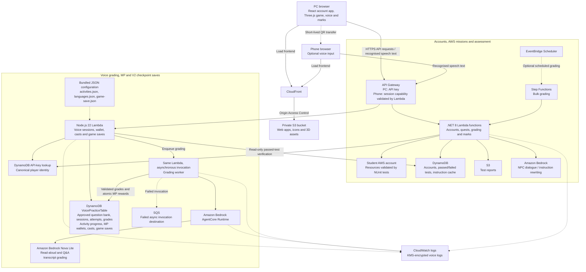

# The Legend of AWS Warrior

The Legend of AWS Warrior is a project assignment with AWS Academy Learner Lab. Students need to play the game to get the instruction generated from AWS Bedrock by talking to the NPC girl and kill the monster to trigger unit test in AWS Lambda. It is an AWS SAM application.

[](https://www.youtube.com/watch?v=xuCo3ZiFt-M)

[](https://www.youtube.com/watch?v=nq4wNlL17Kk)


## Tech Blog
[The Legend of AWS Warrior: A Free Opensource 3D RPG Adventure Game with Generative AI for learning AWS](https://community.aws/content/2ftYEIAT0IlnPwAhvKhlD4PL52h/behind-the-scene-of-the-legend-of-aws-warrior)

## Architecture

The application is deployed with AWS SAM. The current deployment uses the
`CloudProjectMarker` stack in `us-east-1`. Solid arrows below show requests and
data access; dashed arrows show optional paths or supporting configuration.



Browser speech recognition runs on the PC or phone and may use the browser
provider's speech service. The application backend receives text, not audio;
there is no active recording upload or Amazon Transcribe path. The retained
legacy audio bucket is not used by this flow.

AWS assessment marks, voice grades/MP and cosmetic game progress are separate.
Cloud-art casts reserve server MP before their combat effects run locally.
Checkpoint saves use conditional revisions and an
account-scoped local recovery cache; saved mission claims are checked against
passed AWS tests. The marks page loads server results and filters them locally.

Reading configuration covers 302 services and 308 activities. Q&A additionally
supports many database-backed questions per service, available after explicit
batch publication. `question-bank.mjs publish` imports ready questions directly;
`export` downloads the private bank for editing. No draft-review step is required.
The supplied bank contains 12 questions in English, Cantonese and Simplified
Mandarin across six services.
Q&A earns 10/20/30 MP for scores of 60/75/90, once per question, sharing the
existing 100 MP wallet cap. Reading remains at 5/10/15 MP.
Bundled reading configuration changes require deployment; approved question-bank
updates do not. Voice and checkpoint routes share the
optional voice backend. See [backend operations](src/VoicePractice/OPERATIONS.md)
for contracts, persistence and rollout details. The current deployment has no
CloudTrail trail configured for durable audit retention.

## Managing Q&A questions

Q&A is deployed with 12 English/Cantonese/Mandarin questions across S3, EC2, IAM, VPC,
Lambda and DynamoDB. Each service can have many questions. Publish new questions
directly to the database; no draft-review step or application redeployment is
required for existing services and configured languages.

Run from the repository root with authorised AWS operator credentials:

```sh
export AWS_REGION=us-east-1
export VOICE_TABLE="$(aws cloudformation describe-stack-resource \
  --stack-name CloudProjectMarker --logical-resource-id VoicePracticeTable \
  --query 'StackResourceDetail.PhysicalResourceId' --output text --no-cli-pager)"

# Export all questions, or add a service ID (for example s3) after the filename.
node src/VoicePractice/question-bank.mjs export questions-export.json

# Edit the file, then validate and publish only new or changed questions.
node src/VoicePractice/question-bank.mjs validate questions-export.json
node src/VoicePractice/question-bank.mjs publish questions-export.json
```

For **new questions**, use a unique ID, `status:"approved"`, `version:1` and
`expectedRevision:null`. For **existing questions**, keep the exported ID and
`expectedRevision`, increment `version`, and remove unchanged rows from the
publication file. Updating wording or translations does not award MP again.

Each publication supports 1-100 questions in an all-or-nothing transaction.
Exports contain **private answer rubrics**: do not publish them to the website
or commit ad-hoc exports. The export command refuses to overwrite an existing
file. Reopen the game's voice dialog after publication to refresh availability.

See [question-bank operations](src/VoicePractice/OPERATIONS.md#batch-publishing-and-exporting-questions)
for the content fields, service-specific exports, retirement and conflict handling.


## Deploy the updated application.
For the first time, install AWS SAM CLI and the .NET 8 SDK (x86_64 Linux).
The setup script requires `curl`, `unzip`, `tar`, and `sudo` (unless running as root).
It installs a missing .NET 8 SDK under `~/.dotnet` and installs or updates SAM CLI
system-wide. It stops on errors and removes temporary downloads automatically.
```bash
./aws_sam_setup.sh
```

If .NET was installed under `~/.dotnet`, the setup script prints the environment
exports needed for direct `dotnet` commands. Add them to `~/.bashrc` for future
shells. The package update script discovers this local installation automatically.

```bash
sam build && sam deploy --parameter-overrides "SecretHash=bb14ca5898a4e4133bbce2ea2315a1234"
```
SecretHash can be any string of any length. It will be hashed using SHA256 to derive a proper AES-256 encryption key. 


## Cleanup

To delete the sample application that you created, use the AWS CLI. Assuming you used your project name for the stack name, you can run the following:

```bash
sam delete --stack-name CloudProjectMarker
```

## Packages update

Run `./aws_sam_setup.sh` first, or install the
[.NET 8 SDK for Ubuntu](https://learn.microsoft.com/dotnet/core/install/linux-ubuntu)
(not just the runtime) and ensure `dotnet` is on your `PATH`. Then run:

```
./update_packages.sh
```

The script installs or updates `dotnet-outdated-tool` and upgrades packages in both
.NET projects. It stops on the first error; completion is reported only if all
commands succeed.

## Local regression tests

These tests do not call AWS or execute the infrastructure checks in
`src/ProjectTestsLib/`. The backend tests use NUnitLite, like the application.
Run from the repository root with the .NET 8 SDK, Node.js 22.7+ and Python 3:

```bash
dotnet run --project tests/ServerlessAPI.Tests -- --noresult --workers=0
node --test web-game/tests/*.test.mjs
python3 -m unittest discover -s tests -p 'test_*.py'
(cd web-app && CI=true npm test -- --watchAll=false --runInBand)
```

## Resources

See the [AWS SAM developer guide](https://docs.aws.amazon.com/serverless-application-model/latest/developerguide/what-is-sam.html) for an introduction to SAM specification, the SAM CLI, and serverless application concepts.

Next, you can use AWS Serverless Application Repository to deploy ready to use Apps that go beyond hello world samples and learn how authors developed their applications: [AWS Serverless Application Repository main page](https://aws.amazon.com/serverless/serverlessrepo/)

## Full deployment
You can use any string as the hash (any length).
```
./deploy.sh bb14ca5898a4e4133bbce2ea2315a1000
```

## Deploy the WebApps
Update /web-app/src/Constant.js for the Web Endpoint.
Then, run the following command.

```
cd web-app
npm i
npm run build
npm run deploy
```

## Web Game

For a complete player-facing handbook covering controls, combat mechanics, Cloud Art synergies, world regions, and the 16-monster bestiary, see [**`PLAYER_GUIDE.md`**](PLAYER_GUIDE.md) or click the **Combat manual** book icon in the top navigation bar while playing.

Classic remains at `/game.html`; V2 is at `/game-v2.html`.
The Marks page offers both versions. V2 adds a village, market, forest, lake,
bridge, ruins, minimap, quest markers and adjustable graphics quality.
Both versions share the API key and backend marks. V2 stores its active quest
separately in `sessionStorage`, so it does not overwrite Classic's quest.

Serve the game directory locally, then open either entry point:

```
cd web-game
python3 -m http.server
```

Open `http://localhost:8000/game-v2.html` for V2. Use WASD to move and turn,
Shift to run, Space to attack, and E near a guide to get a task. Walk into a
glowing gate to travel automatically; T remains an optional nearby-gate shortcut.
Scroll over the world to zoom the camera; Shift + scroll switches weapons.
You can explore without an API key; set a key to request and grade quests.
Receive new tasks only by pressing E near a character with a golden marker.
Clicking characters or markers does not request tasks, and there is no task-fetch button.
V2 includes synthesized footsteps, distinct sword/axe/punch sounds, dodges,
monster warnings and attacks, spikes, travel gates, chests, healing, impacts,
monster deaths, and task/result sounds. Enemy cues fade with distance and are
rate-limited to avoid overlapping noise. Audio starts after the first key press or click. Mute and
volume controls are in the top navigation; their settings persist in this browser.
The **Voice marks** link opens a separate tab so the current game stays open.
Click the weapon and shield icons to equip items, press `C` / `V` (or `Shift + scroll` over the game) to
cycle weapons and shields, or press keys `1` / `2` / `0` to select Sword / Axe / Unarmed and keys `3`–`7` to toggle the five Cloud Arts.
The equipped icons have an orange border. Hover an icon for its name; the weapon
summary shows damage, attack style and reach. The weapon bar scrolls horizontally
on small screens. Scrolling UI panels or an open dialog does not switch weapons.
You start with a round shield equipped. All 14 melee weapon models and five shield
styles load when selected. Daggers favour speed, hammers favour damage, and
spears and other long weapons have greater reach. Hold R to
stop frontal melee hits and cactus spikes; guarding slows movement and prevents
attacks. Your back remains exposed. Heavy Yeti and Warden blows deal half damage
through a block and break the guard for 1.5 seconds; release R before blocking again.
Pressing R within **0.25 seconds** before a frontal hit triggers a **Timed Perfect Parry**, which negates all damage (even from heavy boss blows) without breaking your guard, reflects ranged spikes back at the attacker for 2x damage, and staggers melee attackers for 2.5 seconds (+25% bonus damage taken).
Blocking lasts only while R is held; it is not a toggle.
Selecting No shield removes protection. Bows are not included; cloud arts provide
ranged and area attacks.
The bottom control bar holds interactive keyboard hints (which can also be clicked directly); the equipment panel only shows
blocking, guard-break and dodge status while active, plus nearby targets and world event alerts.
Sword attacks are fast; the axe hits harder but swings more slowly. Q dodges
backward, or toward a held movement key, with a short invulnerable window and a
cooldown. Dodges respect walls, water and actors. Enemy ground rings warn of
incoming attacks; damage numbers and hit flashes make impacts visible.
Passing a new AWS task repairs one of six village houses. Emerald, gold and
crystal weapon finishes unlock through task victories or optional exploration.
F opens a nearby hidden cache; follow the smuggler's trail west of the forest
watcher, explore the lake shore, or search north of the ruins. The optional
Crystal Warden waits northeast of the ruins and unlocks a crystal finish.
These rewards are cosmetic, never AWS marks; normal monsters remain available
for grading without opening caches or defeating the Warden. Signed-in V2 players
save their safe map checkpoint, equipment, spell selection and cosmetic adventure
progress in DynamoDB. Existing local adventure data is migrated on the first save;
mission claims are checked against the student's actual passed AWS tests.
Exploration cosmetics never grant marks or MP. Reset task marks invalidate saved
mission claims on the next server load; exploration cosmetics remain separate.
Guide characters walk around their home areas, pause when approached or spoken
to, and keep their golden markers and minimap positions as they move.
Defeated monsters return after a short delay at random walkable locations outside
the village and away from players and other actors. The existing monster pool is
reused so encounters continue without growing the population or accumulating bodies.
Three glowing gates at the outer road ends lead to Frostpeak Highlands, Sunspire
Desert, and the nine-room Forgotten Vault. Walk into a gate to enter. Gate travel
arrives at the matching doorway facing into the destination, without immediately
bouncing back. Each map has a return gate; **Return to village** uses the village's
safe spawn and also works after death.
Highlands mix slow, heavy-hitting Yetis with Highland Stags, Bamboo Guardians, Sunspire Wyverns, Whispering Treants, Cyclopes, and Ghosts; the desert adds
stationary Cacti (with aimed, dodgeable spikes) alongside Sunspire Wyverns, Cloud Hornets, Mirrorwater Crabs, Crimson Demons, Green Demons, and Skulls; the vault adds fast, fragile Bats alongside Void Stalkers, Vault Sentinels, Crimson Demons, Ghosts, Skulls, and Green Demons. Across all four maps, 16 animated CC0 Quaternius creature models and 4 distinct NPC Guide character models (`peasant_girl.fbx`, `KnightCharacter.glb`, `castle_guard_01.fbx`, and `RobotExpressive.glb`) bring the regions to life.
Each region also features environmental modifiers (**Highland Tailwind** +12% movement speed in northern Frostpeak Highlands, **Sunspire Oasis** +2 HP/s regeneration in the desert oasis, and **Compute Overclock** +15% melee attack speed in the central Vault chamber) and periodic **AZ Outage Alert** world events (marked on the minimap; defeating 2 monsters near the outage within 45s restores the AZ for +20 HP and a 20s **High Availability Surge** granting +20% speed and attack haste).
New monster models load on the first visit and are cached for later trips.
Each destination has a guide and ordinary monsters that keep the same E-to-task,
kill-to-grade loop. Travel does not change the active task, key, marks, equipment,
or cosmetic progress. Only the current map is built: old terrain, signs and
map-specific GPU resources are disposed, while the shared asset templates and a
fixed character pool are reused. Inactive characters do not update or collide.
The new terrain uses procedural geometry and the existing licensed asset packs.
Shared scenery is cached at startup; map-specific monster models download on the
first visit only. Terrain is built on demand rather than loading every map at once.
Desert pyramids and mountain obstacles are sized to their declared collision
footprints. Player and monster movement checks the whole travelled segment,
not just its destination, so a large movement step cannot skip a thin wall.
Dodge movement also checks intermediate positions.

| Map | Ordinary monsters | Boss |
|---|---:|---|
| Cloudlands Village | 24 | Crystal Warden |
| Frostpeak Highlands | 14 | Frostpeak Titan |
| Sunspire Desert | 14 | Sunspire Overlord |
| Forgotten Vault | 14 | Vault Nightlord |

Ordinary populations are doubled and all four bosses are twice their earlier
visual size. Added spawns avoid walls, scenery, gates and safe camps. Boss HP and
attack values are unchanged; Global Deployment can still defeat a boss in one hit.

### Safe saves and recovery

V2 saves at travel, equipment/spell changes, caches, boss victories and mission
completion, not on each movement/frame. Resume uses the map's safe spawn and fresh
combat state; position, monsters, HP, XP, camera, sound, quality and the active
tab's task instructions are not cloud-saved. MP and voice grades retain their
separate authoritative server records.

The save indicator shows loading, saving, saved, offline retry or conflict.
Pending changes are cached locally under an API-key hash. Retries reuse the same
request ID; account changes ignore old responses. A newer tab/device save is
never silently overwritten: **Load latest save** explicitly discards the local
conflicting draft. Device storage must be available for recovery after closing
the page; without it cloud saving still works, with a warning. A first-time device
needs a successful server load before it can queue offline checkpoint saves.
Unknown future save versions are protected rather than reset. These routes use
the existing optional voice Lambda/table and require its backend deployment.
AWS service plaques mark the six village buildings, and service emblems sit
above travel gates. Small individual AWS service signs are spread throughout
the village, highlands and desert, with a sign in each of the nine vault chambers.
Click a service sign, building plaque or mission badge to read a short service
introduction and open its official AWS page. Gameplay pauses while reading
and resumes when the description is closed. Signs show **New** and **Click to
learn** for new discoveries. Clicking an icon checks server task availability;
**Voice practice** offers reading and approved Q&A where available. Locked task
types are removed from the selector, which is hidden when only one choice remains.
Opening the chooser does not create a session until Start is pressed.
There is no **Mark as read** button. Reading, scrolling and closing a
sign never mark it complete or award MP. Passed voice activities update the local
**Read** indicator, while existing local read history remains preserved.
Only server-graded passing voice activities can award MP.
There are **302 distinct discoveries**:
96 in the village, 76 in the highlands, 62 in the desert, and 68 in the vault.
All are individual signs placed simultaneously across the existing maps,
with no rotating replacements. Each discovery sign has a different offering across all four maps
and turns horizontally toward the camera so its icon and text stay readable;
posts remain upright and building plaques stay attached to their walls.
Building and gate branding can repeat the village services
but shares their Read status. Reading progress remains a local discovery record,
not a source of MP. Existing read/spent badge data is preserved but is not
converted into MP. MP is linked to the student's authenticated account and
comes only from passing graded voice activities; it does not award AWS project
marks, XP or equipment.
The July 2026 official archive contains 305 service-icon entries; duplicated
category entries and Marketplace light/dark artwork share one discovery each.
The collection includes tools, programs, and historical offerings, not just
currently available services. Introductions link to official product pages or
AWS documentation searches; check current availability before using an offering.
Icons load only for the starting map and visited maps, with late downloads
updating individual signs without rebuilding the world.

### Cloud arts and combined attacks

Select one or more cloud arts, then press **X** or the cast button. Selected
buttons show a check mark and service-coloured accent. The summary shows the
selection count, total MP and shared cooldown. There are no selectable power
levels. Ordinary damage scales with current Power; MP costs are fixed.

| Cloud art | AWS theme / colour | MP | Shared cooldown | Effect |
|---|---|---:|---:|---|
| 瞬式・事件雷切 / **Event-Driven λ** | Lambda / orange | 12 | 12s | Forward lightning reaches 120 units and chains to three enemies at 100%, 50%, then 25% damage. |
| 影分身・彈性軍勢 / **Auto Scaling Army** | EC2 Auto Scaling / dark orange | 15 | 20s | Five animated copies of the player advance and strike three times each; walls stop their movement. |
| 領域展開・無量儲存 / **Domain: Infinite Storage** | S3 / green | 20 | 45s | A stationary 16-unit domain deals six damage pulses and a final burst over six seconds, slowing enemies with reduced boss control. |
| 結界術・私有雲界 / **Private Cloud Barrier** | VPC / purple | 15 | 25s | An eight-second, 12-unit ward halves incoming damage while inside and damages/pushes each intruder once. |
| 終式・跨區復甦 / **Cross-Region Recovery** | Recovery concept / teal and gold | 25 | 60s | After a one-second windup, a 12-second anchor catches one hit that would take HP to 25% or below, including a lethal hit, returning the player to a clear anchor location with 35% HP. |

These are fictional AWS-inspired effects, not real AWS service capabilities.
The recovery colour scheme represents a concept rather than one official service.
Attack banners show Chinese and English names with matching service-colour accents.
The book icon in the top navigation opens the **Combat manual** with live weapon,
shield and cloud-art values; the manual pauses gameplay.

Combined casts add the selected MP costs and use the longest selected cooldown.
Pairing specific Cloud Arts in a combined cast triggers **Elemental Synergies**:
- **Cold-Start Surge (`Event-Driven λ` + `Domain: Infinite Storage`)**: Arcs 50% overload lightning and a 1.5s chill to every enemy inside the 16-unit Storage domain.
- **VPC Peered Fleet (`Auto Scaling Army` + `Private Cloud Barrier`)**: Grants peered shadow clones with a wider 5.8-unit strike radius and knockback on every hit.

The server reserves the whole selection in one transaction: insufficient MP means
none of the attacks fire, and retries cannot debit twice. A miss still consumes MP.
Switching selections does not bypass the shared cooldown. Reloading restores the
saved primary art, not the entire multi-selection.

#### 全域部署 / Global Deployment

Select all five arts to turn the existing cast button into **全域部署**; there is
no separate ultimate button. It costs **87 MP** with a **60-second shared cooldown**.
Deselect any art to return to an ordinary combination.

Alongside the five arts, four avatars appear ahead, behind, left and right,
facing outward. Each is six times the player's size and performs three slashes
during its six-second appearance. Three execution waves expand to a **128-unit
radius** over 1.2 seconds each. Their visible radius and hit detection share the
same progression: a monster is defeated when the wave reaches it, not at cast
time. This includes bosses. Buildings and solid walls block these waves; water,
trees and ground clutter do not. An outer ring marks the maximum radius.

The camera automatically pulls back to frame the attack and returns smoothly to
the chosen zoom afterwards; nearby walls may limit that view. Avatars do not
block movement or grant invulnerability. Travel, death and account changes clear
active effects and pending waves.

All kills from a single cast, including its delayed waves, trigger at most
**one AWS mission-grading request**. Later waves do not repeat a completed or
failed check. A new cast or a later ordinary melee kill can retry validation.
Kills, XP, boss cosmetics and respawning still follow their normal paths.

This grading deduplication is per running game instance, not a server-wide
exactly-once guarantee. Other tabs, reloads and retries after a timeout can cause
another grader invocation. Cast debits and checkpoint saves have separate
server-side idempotency rules. The
[AJAX audit and request lifecycle](src/VoicePractice/OPERATIONS.md#browser-ajax-audit-and-request-lifecycle)
lists every V2 request trigger, timeout, retry policy, polling limit and
account-change safeguard, including intentionally repeated availability reads.

#### MP and attack announcements

The MP bar below HP shows the server-backed balance out of **100**; using Global
Deployment at 100 leaves 13 MP. First-pass graded readings earn 5/10/15 MP and Q&A
earns 10/20/30 MP at the corresponding score thresholds. Reading signs, waiting,
kills and missions do not replenish MP. An API key and a working connection are
required for cast reservations. Combat runs locally; the server controls MP
accounting and reservation cooldowns.

Browser text-to-speech announces ordinary combinations' selected attack names
in Cantonese, one after another. The ultimate instead reads **全域部署**, then
**Global Deployment**. A new cast replaces the previous announcement instead of
building a speech queue. Speech follows mute, volume and page-visibility settings.

Use **Voice** to choose an available Cantonese system voice and **Preview** to
hear it; the choice is saved in this browser. A male voice can be selected only
if the device exposes one. The game does not create a male voice or assume a
voice's gender from browser metadata. Voice availability, mixed-language
pronunciation and iOS playback depend on the device/browser; interact with the
page before casting. If speech is unavailable, combat still works.

iOS character shadows and avatars use a CPU-skinning compatibility path, while
other devices use GPU skinning. Effects and attack timing use elapsed time so
low frame rates do not stretch magic durations. Reduced graphics settings limit
visual detail; desktop automation does not replace physical iOS testing.

### Oral service practice (opt-in)

Voice practice defaults to the computer's microphone. If it has no microphone,
choose **Use phone microphone (QR)** to transfer the same activity to a phone.
Transfer disables desktop submission; it does not create another question or
reward. The short-lived QR link grants one phone access; keep it private.
The phone stores its short-lived capability for session recovery, so reloading or
rescanning on the same browser resumes the reading without repeating pairing.
Missing or expired sessions can be recovered without resetting the activity's
reward eligibility.
Both devices require browser speech recognition; the transcript is read-only
and cannot be typed or pasted. On desktop, click Start/Stop to capture speech.
On phone, hold the microphone button and release it to finish, then submit;
keyboard users can hold Space or Enter.
The game sets no speaking-duration timer; browser interruptions are restarted
while held, preserving earlier final words. Repeated empty recognition failures
stop with a retry message. After release, finalization waits for browser final
results, with a five-second recovery guard if the browser omits its end event.
There is no extra consent checkbox or warning banner; the browser's own
microphone permission still applies. There is no recording or Amazon Transcribe fallback.
Unsupported browsers show guidance without consuming the QR; open the link in a
supported browser or ask the teacher for help. Browser recognition may send audio
to the browser provider and is not necessarily on-device. It does not prove speaker identity or prevent
replay/devtools cheating; this is learning practice, not a secure oral exam.

Choose an available reading language before speaking; matching authored text
appears immediately. English (`en-US`), Hong Kong Cantonese (`zh-HK`) and
Mandarin with Simplified Chinese (`zh-CN`) are configured on PC and phone.
An LLM grades recognised passage coverage (70 points) and
content (30), tolerating speech-recognition errors and mixed AWS terminology.
It does not grade pronunciation or assess comprehension. Score 60 passes:
60-74 earns 5 MP, 75-89 earns 10 MP, and 90-100 earns 15 MP, credited up to
the 100 MP capacity. Each versioned activity rewards only its first pass.
Retries, repeated QR sessions and better subsequent scores cannot farm MP.

The configuration contains 308 authored activities covering all 302 discoveries:
one round per service and the existing second round for S3, EC2, IAM, VPC,
Lambda and DynamoDB. Within the selected service, unfinished reading activities
are preferred, starting with the earliest available round. Passing any reading
locks all reading rounds at that service for seven days, across devices and
languages. Q&A questions have independent seven-day locks; other services remain
available. After a lock expires, completed tasks can be retried but cannot earn
their reward again. An unfinished reading round can earn its first reward when
the service unlocks. A first pass consumes its
reward even when the MP bar is full; capped rewards are not held for later.
Existing participation records
remain ungraded and do not receive invented grades or historical MP.

Each student can submit 100 times per UTC day (reset at 08:00 Hong Kong time)
and six times per session. Submission immediately shows saving/grading progress.
Grading runs asynchronously; the active input device checks every four seconds
with a bounded retry count. Desktop checks for phone results remain manual.
Model failures award neither a failing grade nor MP and allow a retry.
Requests time out after twenty seconds with recovery guidance.

All discovery signs offer authored English, Cantonese and Mandarin reading activities;
Q&A is offered where the database has approved questions.
Historical reading records are preserved. Spoken grades and MP are stored
separately from AWS task grades; normal task assignment and kill-to-grade do
not change.

New practices use server-owned translated activity snapshots and versioned
rubrics. AgentCore provides a validated score, breakdown and feedback; backend
code alone decides pass thresholds and MP. DynamoDB transactions protect
grades, once-only rewards and MP deductions. **Voice marks** in game navigation
opens `voice-marks.html` in a separate tab for saved grades, feedback, activity
progress and MP, keeping the current game session open.
Existing sessions retain their saved content/language snapshots. Approved Q&A
questions use their own understanding rubrics without changing the wallet rules.

The marks page separates configured graded activities from the six historical
service-completion records. Grades, feedback, actual MP awarded and Hong Kong
completion times come from the server, not browser reading flags. A saved game
API key is reused on the same origin; a different device can enter its own key
without putting it in the URL. Existing project assessment marks are unchanged.
Service search and All, Attempted, Passed, Needs retry and Not started filters run
against the loaded activities without extra API calls; the shown count is separate
from overall completion. Changing accounts clears the loaded results and filters.

The web app and both game versions use the bundled HKIIT logo for favicon and
home-screen branding, replacing the default React icons.

For contracts, reward atomicity, retry behavior and deployment permissions, see
[`src/VoicePractice/OPERATIONS.md`](src/VoicePractice/OPERATIONS.md).

Voice content is configuration, not JavaScript source:
[`src/VoicePractice/languages.json`](src/VoicePractice/languages.json) defines the
language labels, browser recognition locales and grading feedback languages;
[`src/VoicePractice/activities.json`](src/VoicePractice/activities.json) defines
service labels, stable activity IDs, rounds and translated passages. Add a language
entry and translations for the activities you want to offer; both PC and phone
automatically list only languages with a passage. Different languages share the
same activity's once-only MP reward. Run the backend tests and redeploy the voice
backend after editing these bundled files; configuration edits are not live database
updates and do not require changing frontend code. See the operations guide's
configuration example.

Run the local feature checks from the repository root:

```sh
npm test --prefix src/VoicePractice
npm test --prefix src/VoiceAgent
node --test web-game/tests/*.test.mjs
python3 -m unittest discover -s tests -p test_voice_deployment.py
```

`node web-game/tests/voice-browser-integration.mjs` additionally runs the
served PC/phone flow in Chrome using mocked speech recognition and API
responses. It requires Chrome at `/opt/google/chrome/chrome`; it is not
a physical microphone acceptance test and does not call student AWS accounts.
It also exercises multi-art casting, Global Deployment wave timing, stationary
boss defeats, avatar deformation, voice choice, map populations and gate returns.

`EnableVoicePractice` defaults to `false` in `template.yaml`. The
`AWS::BedrockAgentCore::Runtime` and endpoint are ordinary CloudFormation
resources in the SAM template; CDK is not required. The Node.js code artifact
must be packaged separately. Model access and the target region must support
the configured `VoiceModelId`.

To prepare an additive deployment without rebuilding or changing the deployed
.NET grader:

```sh
python3 admin/deploy_voice_practice.py \
  --stack YOUR_EXISTING_STACK \
  --artifact-bucket YOUR_PRIVATE_SAME_REGION_ARTIFACT_BUCKET \
  --region us-east-1
```

This installs the declared Node dependencies, uploads immutable agent/API
artifacts, validates the combined SAM template, and creates a change set.
It preserves deployed non-voice resources/code and rejects unexpected resource
changes or replacement. Review the printed change set before execution. Use
`--execute` only when provisioning is intended. Keep the existing artifact
bucket private, encrypted and TLS-only. Retained infrastructure includes AgentCore
and a log-encryption KMS key. Graded readings invoke the configured Bedrock model
through AgentCore and incur inference charges, but no Amazon Transcribe charges.
Cap attempts, monitor
spend, and test classroom browsers before rollout.

The retired private audio bucket is kept for safe lifecycle cleanup of previous
recordings after one day (cleanup is not instant). The Lambda no longer has
audio-bucket access or Transcribe permissions, and upload/transcription endpoints
return 404. Do not log transcripts, API keys or pairing tokens;
use scoped IAM roles, encryption and a documented student-data retention policy.
Enable CloudTrail and appropriate S3 data-event/access logging and monitoring
for the deployment; encrypt log destinations and restrict staff access.
The legacy browser-local reading record remains a convenience cache, not
proof of learning. Server grades and MP transactions are authoritative for
rewards, not proof of speaker identity, pronunciation or understanding.

Each expedition has one larger glowing super monster near its farthest enemy
spawn: the **Frostpeak Titan**, **Sunspire Overlord**, or **Vault Nightlord**.
They have more health, stronger attacks, an overhead **SUPER MONSTER** nameplate
with their name and health bar, and longer
attack warnings. Frontal melee hits break shields like the existing heavy
attacks. They respawn normally and do not grant extra MP or marks.
There are no icon-gallery walls,
decorative activation circles or all-services browser. Glowing travel gates
remain functional: walk into a glowing gate to change maps.
Restoring a building lights its plaque's frame. These are
thematic landmarks, not service unlocks or requirements for a particular mission.
The AWS Mission panel shows service badges only when a supported service is
explicitly named in the task name or instructions; unknown tasks remain unlabelled.
Region subtitles and validation messages reinforce the AWS learning objective.
Official AWS architecture icons are stored locally under `web-game/v2/assets/aws/`
with provenance and a separate notice. They are AWS-owned assets, not CC0;
their use does not imply AWS endorsement of this independent educational game.
V2 keeps a compact task tracker on screen. Full task requirements and NPC
conversations open in a large, scrollable reading window and can be reopened
without losing the current task. Instructions open when you accept a task.
Complete those steps in AWS, then defeat a
monster to grade the task. If grading fails, keep the same task, fix your resources,
and defeat another monster to retry. There is no separate grading button.
The game needs a desktop browser with WebGL and import-map support, and internet
access for the pinned Three.js modules. Low quality disables shadows and ground
decoration. V2 uses desktop keyboard/mouse controls, not full touch movement controls.

If WebGL cannot start, V2 retries without antialiasing and with WebGL 1 when
instanced rendering is available, using Low quality for compatibility. It does
not require the high-performance GPU. If all attempts fail, enable graphics
acceleration in your browser settings and restart the browser, close other 3D
tabs, or try another browser with an up-to-date graphics driver. Both Classic
and V2 require working WebGL; reducing graphics quality cannot enable disabled
browser graphics.

V2's code and new assets live under `web-game/v2/`; Classic's entry point and
modules are unchanged. The existing deployment uploads both versions together.
Town models are a curated subset of Kenney's CC0 Fantasy Town Kit 2.0
(26 GLBs and a shared texture, about 526 KiB). Their original license and
provenance are included under `web-game/v2/assets/`. Existing characters,
animations, and Quaternius packs are reused without duplicating their files.

## Reset your marks

On the Marks page, choose **Reset my marks** and confirm. This permanently clears
only the authenticated student's passed marks and failed-test history. It keeps
their API key, saved credentials, linked AWS account, and actual AWS resources.
Other students' records are not changed.

Close game tabs and wait for grading to finish first: an in-progress or scheduled
grader can award marks again afterward. A successful reset clears Classic's saved
quest filter and invalidates V2 quests in other tabs in the same browser.
The Home page's **Reset** button only clears locally saved credentials.

The feature requires deploying the `/resetmarks` POST endpoint from `template.yaml`
as well as the rebuilt frontend; a frontend-only deployment is not sufficient.

## Export Marks
Change table name and region.
```
aws dynamodb scan --table-name CloudProjectMarker-PassedTestTable-XXXXXXX --region us-east-1 \
--select ALL_ATTRIBUTES --page-size 500 --max-items 100000 --output json \
| jq -r '.Items' \
| jq -r 'map({Test: .Test.S, User: .User.S, Marks: .Marks.N, Time: .Time.S}) | (.[0] | keys_unsorted) as $keys | $keys, map([.[ $keys[] ]])[] | @csv' \
> marks.csv
```

## Reference 

https://aws.plainenglish.io/deploy-react-web-app-on-aws-s3-and-cloudfront-using-cloudformation-via-aws-sam-cli-409aa479063d

https://github.com/simondevyoutube/Quick_3D_RPG
