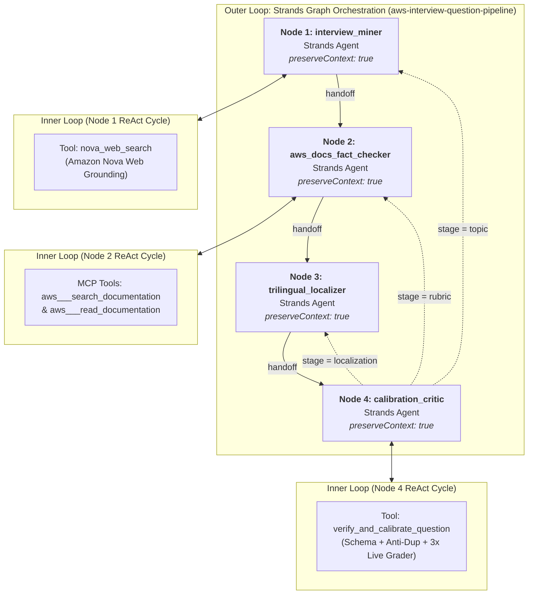

# AWS Strands Multi-Agent Question Generator & Loop Engineering Architecture

> **Implementation Files**
> - Core Strands Graph & Agents: [`src/VoiceAgent/question-generator.mjs`](../src/VoiceAgent/question-generator.mjs)
> - VoicePractice Re-export Wrapper: [`src/VoicePractice/question-generator.mjs`](../src/VoicePractice/question-generator.mjs)
> - CLI & DynamoDB Question Bank Manager: [`src/VoicePractice/question-bank.mjs`](../src/VoicePractice/question-bank.mjs)
> - Live Spoken Answer Grader: [`src/VoiceAgent/agent.mjs`](../src/VoiceAgent/agent.mjs)
> - Unit & Graph Verification Suite: [`src/VoicePractice/tests/question-generator.test.mjs`](../src/VoicePractice/tests/question-generator.test.mjs)

---

## 1. What "Loop Engineering" Actually Means (And What It Does *Not* Mean)

A common misconception is that **Loop Engineering** just means wrapping an LLM API call inside a `for` or `while` retry loop in application code. **That is not Loop Engineering.**

In modern AI systems engineering, **Loop Engineering** is the system-level discipline that sits on top of **Prompt Engineering** and **Context Engineering**:

| Engineering Layer | Core Question | Primary Focus | Analogy |
| :--- | :--- | :--- | :--- |
| **1. Prompt Engineering** | *"What should we say to the model?"* | Crafting instructions, role definitions, and output formatting for a single turn. | Playing a single move in chess. |
| **2. Context Engineering** | *"What does the model need to know and access?"* | Curating the information workspace: system state, prior questions (`avoidQuestions`), MCP tool schemas, and conversation history. | Preparing the board and pieces. |
| **3. Loop Engineering** | *"How does the system autonomously act, verify, self-correct, and terminate?"* | Architecting the closed-loop control system (**Perceive → Reason → Act → Observe → Verify → Self-Correct or Terminate**) with deterministic verifiers, state continuity, and hard resource bounds. | Building the autonomous chess engine. |

### The 5 Pillars of True Loop Engineering
1. **Model-Driven Action & Observation (Not Imperative Scripting)**: Instead of hardcoding when and how to search the web or read documentation, the agent autonomously decides which tools to invoke, inspects the returned observations, and decides whether to call another tool or synthesize its output.
2. **Deterministic Verifiers & Guardrails (Closed-Loop Feedback)**: An agent never grades its own homework by "vibes." Every iteration is checked by deterministic domain verifiers (schema invariants, Jaccard semantic overlap checks, language script hygiene, and live 3-way synthetic student grading).
3. **Structured Error Feedback Into Stateful Memory**: When a verifier rejects an output, the system does not blindly re-run the same prompt from scratch. It preserves the node conversation context (`preserveContext: true`) and feeds the structured critique back into the loop so the agents know *why* the previous candidate failed and *how* to fix it.
4. **Verifiable Goal Termination**: The loop exits as soon as a verifiable goal state (`invocationState.calibratedResult !== null`) is reached—not after a fixed number of turns.
5. **Bounded Governance & Observability**: Hard budget caps across both loop levels (`maxTurnsPerNode = 4` on every inner Strands `Agent` via `BeforeModelCallEvent`, `limits: { turns: 1 }` on the live grader `Agent`, and `maxAttempts = 3` / `maxSteps = 12` on the outer Strands `Graph`) guarantee that no inner tool-calling loop or outer graph feedback cycle can ever run forever, while OpenTelemetry spans and event-stream waterfall traces make every inner tool cycle and outer handoff auditable.

---

## 2. Dual-Level Loop Engineering in AWS Strands (`@strands-agents/sdk`)

Our Question Generator ([`createQuestionGenerator`](../src/VoiceAgent/question-generator.mjs#L394-L909)) implements **two nested levels** of native AWS Strands loops—with zero imperative `for`/`while` retry loops around the graph:



### Level 1: The Inner Loop (Strands `createHarness()` + `GoalLoop` + `ContextOffloader`)
Each node in the pipeline is constructed via [`createHarness`](../src/VoiceAgent/question-generator.mjs#L396-L499) from `@strands-agents/harness` on top of `@strands-agents/sdk` (`harness-sdk`), backed by [`BedrockModel`](../src/VoiceAgent/question-generator.mjs#L408) (`us.amazon.nova-2-lite-v1:0`).
When a node executes, Strands runs its internal **Reason → Tool Use (`tool_use`) → Tool Result → Reason (`end_turn`) → `GoalLoop` Verification (`AfterInvocationEvent`)** loop:
- **Strands Harness (`@strands-agents/harness`)**: Configures each specialist `Agent` with `contextManager: { strategies: ["largeToolOffloading", "overflowProtection"], stash: false }` and locked-down `builtinTools: []`.
- **`ContextOffloader` Plugin (`@strands-agents/sdk/vended-plugins/context-offloader`)**: Attached to every tool-using specialist node (`interview_miner`, `aws_docs_fact_checker`, `calibration_critic`) with `InMemoryStorage` (`maxResultTokens: 2500`, `previewTokens: 1000`) so large AWS documentation reads or web search results never overflow the context window.
- **`GoalLoop` Plugin (`@strands-agents/sdk/vended-plugins/goal`)**: Attached to every specialist node (`<nodeId>:json-goal-loop`, `maxAttempts: Math.min(2, boundedMaxTurns)`) with a deterministic JSON validator ([`parseJsonFromText`](../src/VoiceAgent/question-generator.mjs#L214-L239)). If a node ever outputs malformed non-JSON text on its final turn, `GoalLoop` intercepts `AfterInvocationEvent`, injects structured error feedback via `event.resume`, and self-corrects within the node before handing off to the next graph node.
- In **`interview_miner`**, the model autonomously formulates search queries and calls [`nova_web_search`](../src/VoiceAgent/question-generator.mjs#L348-L377) to inspect real-world interview questions and citations.
- In **`aws_docs_fact_checker`**, the model autonomously queries the live **AWS Knowledge MCP Server** (`https://knowledge-mcp.global.api.aws`) via [`McpClient`](../src/VoiceAgent/question-generator.mjs#L379-L394) (`aws___search_documentation`, `aws___read_documentation`) to verify current AWS behavior.
- In **`calibration_critic`**, the model drafts 3 synthetic student transcripts (`goodEn`, `goodZhHk`, `wrongOutdated`) and calls [`verify_and_calibrate_question`](../src/VoiceAgent/question-generator.mjs#L577-L620). If the failure is only in how the critic phrased a synthetic transcript, the critic can adjust the synthetic transcript and re-call `verify_and_calibrate_question` **within its own inner agent loop** without restarting the entire 4-agent graph!

### Level 2: The Outer Loop (Strands `Graph` Stage-Classified Feedback Cycle)
When the question, rubric, or localization fails verification, the Assurance Plane classifies the defect via [`classifyFailureStage`](../src/VoiceAgent/question-generator.mjs#L291-L307) into one of three fault domains and routes the Strands [`Graph`](../src/VoiceAgent/question-generator.mjs#L761-L828) back to the **exact specialist node** responsible for fixing it:
1. **`failureStage === "localization"` (`calibration_critic ──► trilingual_localizer`)**:
   - Triggered when `zh-CN` contains Cantonese characters, a localized prompt is missing, or `goodZhHk` fails calibration (`< 80%`) while `goodEn` passed.
   - Re-runs **only** `trilingual_localizer` → `calibration_critic` (6 steps total instead of 8), preserving the mined question and AWS documentation verification without re-calling web search or MCP tools.
2. **`failureStage === "rubric"` (`calibration_critic ──► aws_docs_fact_checker`)**:
   - Triggered when concept weights do not sum to `100`, `goodEn` fails calibration (`< 80%`), `wrongOutdated` passes unexpectedly (`>= 60%`), or forbidden voice/pronunciation terms appear.
   - Re-runs `aws_docs_fact_checker` → `trilingual_localizer` → `calibration_critic` (7 steps total), preserving the mined question from `interview_miner`.
3. **`failureStage === "topic"` (`calibration_critic ──► interview_miner`)**:
   - Triggered when [`findDuplicateOrOverlappingQuestion`](../src/VoiceAgent/question-generator.mjs#L241-L280) detects a duplicate ID (`duplicate_id`) or semantic Jaccard overlap (`overlapping_prompt >= 0.55`, `overlapping_concepts >= 0.60`) against `avoidQuestions`.
   - Routes all the way back to `interview_miner` to mine an orthogonal AWS interview scenario.
4. **Targeted Critique Injection & Cleanup**:
   - The failed turn packages `{ previousAttemptCritique, failureStage, targetNode, cycle }` into a native Strands [`TextBlock`](../src/VoiceAgent/question-generator.mjs#L774) and clears it via a `BeforeNodeCallEvent` hook once delivered to the target node so downstream nodes never receive stale critique blocks.
5. **Hard Multi-Layer Maximum Turn Limits (Zero Infinite Loops)**:
   - **Inner Agent Loop Cap (`maxTurnsPerNode = 4`, clamped `1..10`)**: In [`createStrandsNodeAgent`](../src/VoiceAgent/question-generator.mjs#L381-L407), each specialist Strands `Agent` registers `BeforeInvocationEvent` and `BeforeModelCallEvent` hooks that count model turns within a node execution and throw `Agent "<id>" exceeded maximum inner loop turns (<boundedMaxTurns>)` if a tool-calling loop ever exceeds the turn budget.
   - **Live Spoken Answer Grader Cap (`limits: { turns: 1 }`)**: In [`src/VoiceAgent/agent.mjs`](../src/VoiceAgent/agent.mjs#L131), `strandsAgent.invoke` passes `{ limits: { turns: 1 } }` so the live rubric grader never loops.
   - **Outer Graph Loop Cap (`maxAttempts = 3` clamped `1..10`, `maxSteps = 12` clamped `4..40`)**: Conditional back-edges only fire while `attempt < boundedMaxAttempts`, and Strands `Graph` enforces `maxSteps: boundedMaxSteps` and `maxConcurrency: 1`.

---

## 3. Specialist Agent Breakdown

### Node 1: `interview_miner` (`InterviewQuestionMinerAgent`)
- **Source**: [`src/VoiceAgent/question-generator.mjs#L562-L585`](../src/VoiceAgent/question-generator.mjs#L562-L585)
- **Tools**: [`nova_web_search`](../src/VoiceAgent/question-generator.mjs#L317-L345) (Amazon Bedrock `ConverseCommand` with `systemTool: { name: "nova_grounding" }`)
- **Responsibility**:
  - Searches the live web for frequently asked cloud engineering interview questions for the target AWS service (`s3`, `iam`, `ec2`, `vpc`, etc.).
  - Inspects `avoidQuestions` (summaries of all existing questions for the same service) and `previousAttemptCritique` (if looping back from `calibration_critic`) to pick an orthogonal architectural scenario and feature.
  - Flags any community claims suspected of being outdated (`suspectedOutdatedClaims`).

### Node 2: `aws_docs_fact_checker` (`AwsDocsFactCheckerAgent`)
- **Source**: [`src/VoiceAgent/question-generator.mjs#L587-L619`](../src/VoiceAgent/question-generator.mjs#L587-L619)
- **Tools**: Live **AWS Knowledge MCP** tools ([`loadAwsKnowledgeMcpTools`](../src/VoiceAgent/question-generator.mjs#L348-L363): `aws___search_documentation`, `aws___read_documentation`)
- **Responsibility**:
  - Audits both the mined question premise and community answer against official AWS documentation.
  - Rewrites outdated premises (e.g., S3 eventual consistency myths, default encryption misconceptions) into accurate questions and stores the outdated belief in `misconceptions[]`.
  - Designs 2–3 atomic grading `concepts[]` whose integer weights sum strictly to `100`.

### Node 3: `trilingual_localizer` (`TrilingualLocalizationAgent`)
- **Source**: [`src/VoiceAgent/question-generator.mjs#L621-L657`](../src/VoiceAgent/question-generator.mjs#L621-L657)
- **Tools**: Pure transformation node (no external tools)
- **Responsibility**:
  - Produces natural spoken interview prompts across all three supported game locales:
    - `en-US`: Conversational English scenario prompt.
    - `zh-HK`: Authentic spoken Hong Kong Cantonese (e.g., 你嘅, 點解, 點樣, 入面, 邊啲) with natural English AWS term code-switching (`Amazon S3`, `IAM role`, `Security Group`).
    - `zh-CN`: Natural Simplified Chinese Mandarin, strictly free of Cantonese-specific characters (`/[嘅喺唔畀佢哋乜啲揀嚟]/u`).

### Node 4: `calibration_critic` (`CalibrationCriticAgent`)
- **Source**: [`src/VoiceAgent/question-generator.mjs#L659-L683`](../src/VoiceAgent/question-generator.mjs#L659-L683)
- **Tools**: [`verify_and_calibrate_question`](../src/VoiceAgent/question-generator.mjs#L519-L559)
- **Responsibility**:
  - Generates three realistic spoken student transcripts:
    1. `goodEn`: Spoken English answer covering all rubric concepts.
    2. `goodZhHk`: Spoken Hong Kong Cantonese + English code-switched answer covering all rubric concepts.
    3. `wrongOutdated`: Plausible spoken answer stating `misconceptions[0]` and missing required concepts.
  - Calls `verify_and_calibrate_question`, which runs [`verifyAndCalibrate`](../src/VoiceAgent/question-generator.mjs#L415-L517).

---

## 4. Deterministic Verifiers & Anti-Duplication Guardrails

Inside [`verifyAndCalibrate`](../src/VoiceAgent/question-generator.mjs#L415-L517), every candidate question must pass **five deterministic gates** before `invocationState.calibratedResult` is set:

1. **Schema & Weight Invariants (`validateQuestion`)**:
   - Enforces non-empty trilingual prompts (`en-US`, `zh-HK`, `zh-CN`), 2–3 atomic concepts with integer weights summing to `100`, non-empty `misconceptions`, `acceptableAnswers`, and `referenceAnswer`.
2. **Multi-Slot Semantic Anti-Duplication ([`findDuplicateOrOverlappingQuestion`](../src/VoiceAgent/question-generator.mjs#L241-L280))**:
   - Rejects exact ID collisions (`duplicate_id`), normalized title collisions (`duplicate_title`), and normalized prompt collisions (`duplicate_prompt`).
   - Computes stopword-filtered **Jaccard token similarity** against every existing question for that service:
     - Rejects `overlapping_prompt` when prompt/title token similarity `>= 0.55`.
     - Rejects `overlapping_concepts` when grading rubric concept similarity `>= 0.60`.
3. **Language Script Hygiene**:
   - Rejects `zh-CN` prompts containing Cantonese-only characters (`/[嘅喺唔畀佢哋乜啲揀嚟]/u`).
4. **Content-Only Grading Guardrail**:
   - Scans every text field against `forbiddenVoiceClaim` to ensure rubrics never mention pronunciation, accent, or voice quality.
5. **3-Way Live Grader Calibration**:
   - Runs the real production grader ([`createGraderAgent`](../src/VoiceAgent/agent.mjs)) and [`gradeAnswer`](../src/VoicePractice/questions.mjs) in parallel across all 3 synthetic transcripts:
     - `goodEn` **must pass with score `>= 80%`**.
     - `goodZhHk` **must pass with score `>= 80%`**.
     - `wrongOutdated` **must fail with score `< 60%`**.

---

## 5. Native Graph Visualization & Runtime Trace Observability

Strands provides two complementary observability layers wired into [`src/VoiceAgent/question-generator.mjs`](../src/VoiceAgent/question-generator.mjs#L7-L195) and [`src/VoicePractice/question-bank.mjs`](../src/VoicePractice/question-bank.mjs#L98-L155):

1. **Live `graph.stream()` Event Collector + HTML Waterfall Report**:
   - Captures `beforeNodeCallEvent`, `nodeStreamUpdateEvent` (`beforeToolCallEvent`, `afterToolCallEvent`, `agentResultEvent`), `nodeResultEvent`, and `multiAgentHandoffEvent`.
   - [`extractGraphTopology`](../src/VoiceAgent/question-generator.mjs#L20-L81) inspects `graph.nodes` and `graph.edges` to generate a Mermaid diagram annotated with visit counts, execution latency, tools invoked, and conditional loop-back counts.
   - [`renderStrandsTraceReportHtml`](../src/VoiceAgent/question-generator.mjs#L91-L195) renders a self-contained dark-mode HTML dashboard with the Mermaid topology, edge handoff badges, per-step token usage, timeline waterfall bars, and inner agent cycle breakdowns.
2. **Native OpenTelemetry (`@strands-agents/sdk/telemetry`)**:
   - [`enableStrandsTelemetry`](../src/VoiceAgent/question-generator.mjs#L7-L18) initializes `setupTracer` and `setupMeter` to emit standard GenAI OpenTelemetry spans (`gen_ai.agent.invoked`, `gen_ai.tool.invoked`) to any OTLP collector (Jaeger, AWS X-Ray, Langfuse, Phoenix) or console.

### CLI Usage Examples

```bash
# Generate 2 distinct questions for S3 and export an interactive HTML trace report + JSON trace
node src/VoicePractice/question-bank.mjs generate \
  --service=s3 \
  --count=2 \
  --dry-run \
  --trace-html=/tmp/strands-s3-trace.html \
  --trace-json=/tmp/strands-s3-trace.json

# Enable live console event streaming + OpenTelemetry exporter
node src/VoicePractice/question-bank.mjs generate \
  --service=s3 \
  --count=1 \
  --dry-run \
  --trace-console \
  --otel
```
