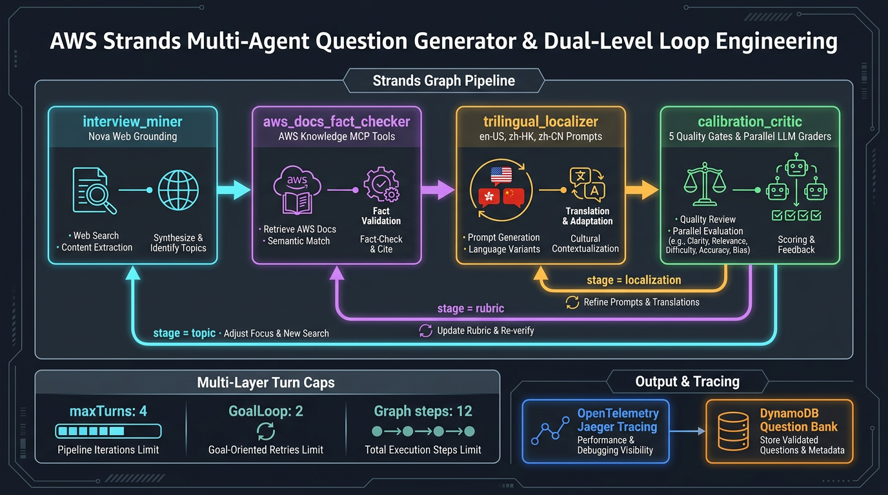
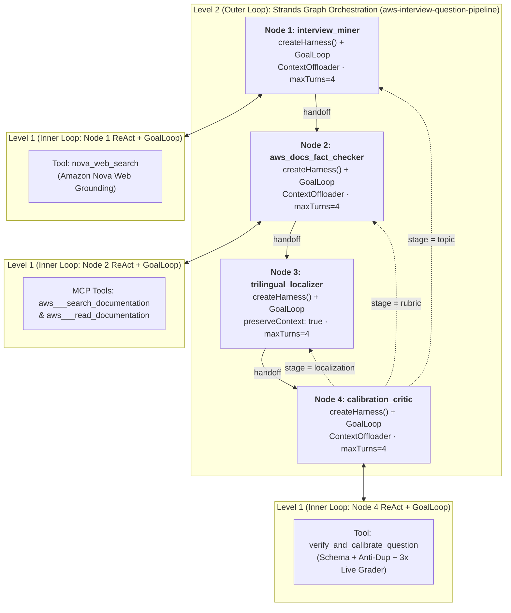
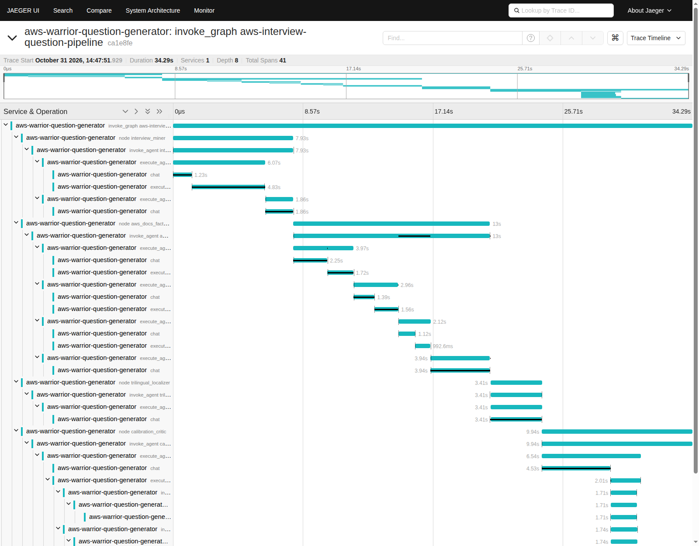
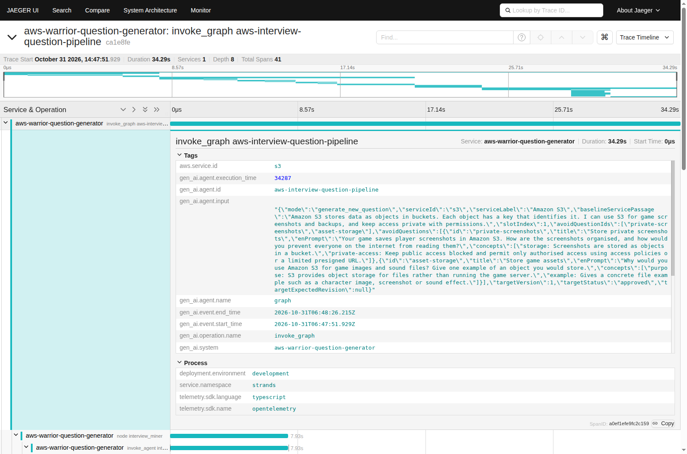

# AWS Strands Multi-Agent Question Generator & Loop Engineering Architecture

> **Implementation Files**
> - Core Strands Graph, Harness & Specialist Agents: [`src/VoiceAgent/question-generator.mjs`](../src/VoiceAgent/question-generator.mjs)
> - VoicePractice Batch Job & Checkpoint Runner: [`src/VoicePractice/question-generator.mjs`](../src/VoicePractice/question-generator.mjs)
> - CLI & DynamoDB Question Bank Manager: [`src/VoicePractice/question-bank.mjs`](../src/VoicePractice/question-bank.mjs)
> - Live Spoken Answer Grader (`createHarness` + `BedrockModel`): [`src/VoiceAgent/agent.mjs`](../src/VoiceAgent/agent.mjs)
> - Unit & Graph Verification Suite: [`tests/voice-practice/question-generator.test.mjs`](../tests/voice-practice/question-generator.test.mjs)

---

## 1. What "Loop Engineering" Actually Means (And What It Does *Not* Mean)

A common misconception is that **Loop Engineering** just means wrapping an LLM API call inside an imperative `for` or `while` retry loop in application code. **That is not Loop Engineering.**

In modern AI systems engineering, **Loop Engineering** is the system-level discipline that sits on top of **Prompt Engineering** and **Context Engineering**:

| Engineering Layer | Core Question | Primary Focus | Analogy |
| :--- | :--- | :--- | :--- |
| **1. Prompt Engineering** | *"What should we say to the model?"* | Crafting instructions, role definitions, and output formatting for a single turn. | Playing a single move in chess. |
| **2. Context Engineering** | *"What does the model need to know and access?"* | Curating the information workspace: system state, prior questions (`avoidQuestions`), MCP tool schemas, context offloading, and conversation history. | Preparing the board and pieces. |
| **3. Loop Engineering** | *"How does the system autonomously act, verify, self-correct, and terminate?"* | Architecting the closed-loop control system (**Perceive → Reason → Act → Observe → Verify → Self-Correct or Terminate**) with deterministic verifiers, stateful memory continuity, and hard multi-layer resource bounds. | Building the autonomous chess engine. |

### The 5 Pillars of True Loop Engineering
1. **Model-Driven Action & Observation (Not Imperative Scripting)**: Instead of hardcoding when and how to search the web or read documentation, each specialist agent autonomously decides which tools to invoke, inspects the returned observations, and decides whether to call another tool or synthesize its output.
2. **Deterministic Verifiers & Guardrails (Closed-Loop Feedback)**: An agent never grades its own homework by "vibes." Every iteration is checked by deterministic verifiers: JSON schema validation (`GoalLoop`), rubric weight invariants (`validateQuestion`), stopword-filtered Jaccard semantic overlap checks (`findDuplicateOrOverlappingQuestion`), Cantonese/Mandarin script hygiene, and live 3-way synthetic student grading (`verifyAndCalibrate`).
3. **Structured Error Feedback Into Stateful Memory**: When a verifier rejects an output, the system does not blindly re-run the same prompt from scratch. It preserves the node conversation context (`preserveContext: true`) and feeds the structured critique back into the exact responsible node so the agent knows *why* the previous candidate failed and *how* to fix it.
4. **Verifiable Goal Termination**: Both the inner `GoalLoop` and the outer `Graph` exit as soon as a verifiable goal state (`passed: true` / `invocationState.calibratedResult !== null`) is satisfied—not after a fixed number of turns.
5. **Bounded Multi-Layer Governance & Native Observability**: Hard budget caps across every loop level (`maxTurnsPerNode = 4` on every inner specialist agent via `BeforeModelCallEvent`, `maxAttempts = 2` on each node's `GoalLoop`, `limits: { turns: 1 }` on the live spoken answer grader, and `maxAttempts = 3` / `maxSteps = 12` on the outer Strands `Graph`) guarantee that no inner tool-calling loop or outer graph feedback cycle can ever run forever, while native Strands OpenTelemetry (`@strands-agents/sdk/telemetry`) emits full GenAI trace hierarchies to OTLP collectors like Jaeger.

---

## 2. Dual-Level Loop Engineering with `@strands-agents/harness` and `@strands-agents/sdk`

Our Question Generator ([`createQuestionGenerator`](../src/VoiceAgent/question-generator.mjs#L398-L996)) implements **two nested levels** of native AWS Strands loops—with zero imperative `for`/`while` retry loops around the graph:





### Level 1: The Inner Loop (`createHarness()` + `GoalLoop` + `ContextOffloader`)
Each specialist node in the pipeline is constructed via [`createStrandsNodeAgent`](../src/VoiceAgent/question-generator.mjs#L284-L396) using `createHarness()` from `@strands-agents/harness` (`^0.3.3`) and `@strands-agents/sdk` (`^1.23.0`), backed by [`BedrockModel`](../src/VoiceAgent/question-generator.mjs#L296-L302) (`us.amazon.nova-2-lite-v1:0`, `temperature: 0`, `stream: false`).

When a node executes, Strands runs its internal **Reason → Tool Use (`tool_use`) → Tool Result (`ContextOffloader`) → Reason (`end_turn`) → `GoalLoop` Verification (`AfterInvocationEvent`)** cycle:

1. **Strands Harness (`@strands-agents/harness` `createHarness`)**:
   - Configures each specialist agent with `contextManager: { strategies: ["largeToolOffloading", "overflowProtection"], stash: false }`, `effort: "auto"`, `caching: false`, and locked-down `builtinTools: []`, `builtinPlugins: []`, `session: false`, `memory: false`, `skills: false`, `backgroundTasks: false`.
2. **`ContextOffloader` Plugin (`@strands-agents/sdk/vended-plugins/context-offloader`)**:
   - Attached to every tool-using specialist node (`interview_miner`, `aws_docs_fact_checker`, `calibration_critic`) with `InMemoryStorage` (`maxResultTokens: 2500`, `previewTokens: 1000`, `includeRetrievalTool: false`).
   - Automatically truncates and offloads oversized AWS documentation reads or web grounding payloads so they never overflow the model's context window across multi-turn tool calls.
3. **`GoalLoop` Plugin (`@strands-agents/sdk/vended-plugins/goal`)**:
   - Attached to every specialist node (`<id>:json-goal-loop`, `maxAttempts: Math.min(2, boundedMaxTurns)`, `preserveContext: true`) with a deterministic JSON goal evaluator ([`parseJsonFromText`](../src/VoiceAgent/question-generator.mjs#L201-L212)).
   - If a specialist node ever outputs prose or malformed JSON on its final turn, `GoalLoop` intercepts `AfterInvocationEvent`, injects structured error feedback (`"Output from <id> was not valid JSON... Return ONLY valid JSON matching your node schema"`), and resumes the agent within the same node before handing off to the next graph node.
4. **Hard Inner Turn Budget (`maxTurnsPerNode = 4`, clamped `1..10`)**:
   - Each node registers `BeforeInvocationEvent` (resetting the turn counter only when `!event?.resumed` so `GoalLoop` resumes share the same bounded turn budget) and `BeforeModelCallEvent` hooks that throw `Agent "<id>" exceeded maximum inner loop turns (<boundedMaxTurns>)` if a runaway tool loop ever exceeds the turn cap.

### Level 2: The Outer Loop (Strands `Graph` Stage-Classified Feedback Cycle)
When the candidate question, rubric, or localization fails verification in `calibration_critic`, the Assurance Plane classifies the defect via [`classifyFailureStage`](../src/VoiceAgent/question-generator.mjs#L183-L199) into one of three fault domains and routes the Strands [`Graph`](../src/VoiceAgent/question-generator.mjs#L748-L816) back to the **exact specialist node** responsible for fixing it:

| Failure Stage | Conditional Back-Edge | Trigger Conditions | Nodes Re-Executed |
| :--- | :--- | :--- | :--- |
| **`"localization"`** | `calibration_critic ──► trilingual_localizer` | • `zh-CN` contains Cantonese-only characters (`/[嘅喺唔畀佢哋乜啲揀嚟]/u`)<br/>• Missing `zh-HK` or `zh-CN` prompt<br/>• `goodZhHk` fails calibration (`score < 80`) while `goodEn` passed | `trilingual_localizer` → `calibration_critic` *(2 nodes; skips web search & MCP docs)* |
| **`"rubric"`** | `calibration_critic ──► aws_docs_fact_checker` | • Concept weights do not sum to `100`<br/>• `goodEn` fails calibration (`score < 80`)<br/>• `wrongOutdated` passes unexpectedly (`score >= 60`)<br/>• Forbidden voice/pronunciation terms detected | `aws_docs_fact_checker` → `trilingual_localizer` → `calibration_critic` *(3 nodes; preserves mined topic)* |
| **`"topic"`** | `calibration_critic ──► interview_miner` | • Duplicate `question.id` (`duplicate_id`)<br/>• Duplicate title/prompt (`duplicate_title`, `duplicate_prompt`)<br/>• Semantic Jaccard overlap (`overlapping_prompt >= 0.55` or `overlapping_concepts >= 0.60`) | Full 4-node cycle starting at `interview_miner` to mine an orthogonal AWS topic |

#### How Cyclic Graph Execution Works in `@strands-agents/sdk`
- **Cyclic Dependency Initialization (`BeforeMultiAgentInvocationEvent`)**: Because `trilingual_localizer`, `aws_docs_fact_checker`, and `interview_miner` have incoming conditional back-edges from `calibration_critic`, a `BeforeMultiAgentInvocationEvent` hook ([`question-generator.mjs#L799-L804`](../src/VoiceAgent/question-generator.mjs#L799-L804)) marks `calibration_critic` as `Status.COMPLETED` when `results.length === 0` so forward edges fire normally on cycle 1 while conditional back-edges only fire after `calibration_critic` is the most recently completed node (`state.results.at(-1)?.nodeId === "calibration_critic"`).
- **Targeted Critique Injection & Cleanup (`BeforeNodeCallEvent`)**: When a cycle fails, `evaluateCriticOutcome` appends a `TextBlock` containing `{ previousAttemptCritique, failureStage, targetNode, cycle }` to `calibration_critic`'s result content so Strands passes it directly into the target node's input, and a `BeforeNodeCallEvent` hook ([`question-generator.mjs#L806-L814`](../src/VoiceAgent/question-generator.mjs#L806-L814)) clears that temporary `TextBlock` once delivered so downstream nodes never receive stale critique blocks.

---

## 3. Specialist Agent Breakdown

### Node 1: `interview_miner` (`InterviewQuestionMinerAgent`)
- **Source**: [`src/VoiceAgent/question-generator.mjs#L572-L596`](../src/VoiceAgent/question-generator.mjs#L572-L596)
- **Tools**: [`nova_web_search`](../src/VoiceAgent/question-generator.mjs#L236-L265) (Amazon Bedrock `ConverseCommand` with `systemTool: { name: "nova_grounding" }`)
- **Plugins**: `ContextOffloader` + `interview_miner:json-goal-loop`
- **Responsibility**:
  - Searches the live web via Amazon Nova Web Grounding for the most frequently asked cloud engineering interview questions for the target AWS service (`s3`, `iam`, `ec2`, `vpc`, `rds`, `cloudfront`, `ecs`, etc.).
  - Inspects `avoidQuestions` (summaries of all existing questions for the same service) and `previousAttemptCritique` (if looping back on `failureStage === "topic"`) to pick an orthogonal architectural scenario and AWS capability.
  - Flags any community claims suspected of being outdated (`suspectedOutdatedClaims`).

### Node 2: `aws_docs_fact_checker` (`AwsDocsFactCheckerAgent`)
- **Source**: [`src/VoiceAgent/question-generator.mjs#L598-L632`](../src/VoiceAgent/question-generator.mjs#L598-L632)
- **Tools**: Live **AWS Knowledge MCP** tools ([`loadAwsKnowledgeMcpTools`](../src/VoiceAgent/question-generator.mjs#L267-L282) connected to `https://knowledge-mcp.global.api.aws`: `aws___search_documentation`, `aws___read_documentation`)
- **Plugins**: `ContextOffloader` + `aws_docs_fact_checker:json-goal-loop`
- **Responsibility**:
  - Audits both the mined question premise and community answer against official AWS documentation.
  - Rewrites outdated premises (e.g., S3 eventual consistency myths, default encryption misconceptions) into accurate questions and stores the outdated belief in `misconceptions[]`.
  - Designs 2–3 atomic grading `concepts[]` whose integer weights sum strictly to `100`.

### Node 3: `trilingual_localizer` (`TrilingualLocalizationAgent`)
- **Source**: [`src/VoiceAgent/question-generator.mjs#L634-L672`](../src/VoiceAgent/question-generator.mjs#L634-L672)
- **Tools**: Pure transformation node (no external tools)
- **Plugins**: `trilingual_localizer:json-goal-loop`
- **Responsibility**:
  - Produces natural spoken interview prompts across all three supported game locales:
    - `en-US`: Conversational English scenario prompt.
    - `zh-HK`: Authentic spoken Hong Kong Cantonese (e.g., 你嘅, 點解, 點樣, 入面, 邊啲) with natural English AWS term code-switching (`Amazon S3`, `IAM role`, `Security Group`).
    - `zh-CN`: Natural Simplified Chinese Mandarin, strictly free of Cantonese-specific characters (`/[嘅喺唔畀佢哋乜啲揀嚟]/u`).

### Node 4: `calibration_critic` (`CalibrationCriticAgent`)
- **Source**: [`src/VoiceAgent/question-generator.mjs#L674-L699`](../src/VoiceAgent/question-generator.mjs#L674-L699)
- **Tools**: [`verify_and_calibrate_question`](../src/VoiceAgent/question-generator.mjs#L526-L569)
- **Plugins**: `ContextOffloader` + `calibration_critic:json-goal-loop`
- **Responsibility**:
  - Generates three realistic spoken student transcripts:
    1. `goodEn`: Spoken English answer covering all rubric concepts.
    2. `goodZhHk`: Spoken Hong Kong Cantonese + English code-switched answer covering all rubric concepts.
    3. `wrongOutdated`: Plausible spoken answer stating `misconceptions[0]` and missing required concepts.
  - Calls `verify_and_calibrate_question`, which runs [`verifyAndCalibrate`](../src/VoiceAgent/question-generator.mjs#L422-L524). If a transcript phrasing issue caused calibration to fail, `calibration_critic` can refine the synthetic transcript and re-call `verify_and_calibrate_question` within its own inner turn budget before finishing.

---

## 4. Deterministic Verifiers & Anti-Duplication Guardrails

Inside [`verifyAndCalibrate`](../src/VoiceAgent/question-generator.mjs#L422-L524), every candidate question must pass **five deterministic gates** before `invocationState.calibratedResult` is set:

1. **Schema & Weight Invariants (`validateQuestion`)**:
   - Enforces non-empty trilingual prompts (`en-US`, `zh-HK`, `zh-CN`), 2–3 atomic concepts with integer weights summing strictly to `100`, non-empty `misconceptions`, `acceptableAnswers`, and `referenceAnswer`.
2. **Multi-Slot Semantic Anti-Duplication ([`findDuplicateOrOverlappingQuestion`](../src/VoiceAgent/question-generator.mjs#L142-L181))**:
   - Rejects exact ID collisions (`duplicate_id`), normalized title collisions (`duplicate_title`), and normalized prompt collisions (`duplicate_prompt`).
   - Computes stopword-filtered **Jaccard token similarity** ([`tokenizeTopicText`](../src/VoiceAgent/question-generator.mjs#L123-L131)) against every existing question for that service (including bundled baseline questions in [`src/VoicePractice/questions.json`](../src/VoicePractice/questions.json), exported DynamoDB questions, and earlier slots in the same batch):
     - Rejects `overlapping_prompt` when prompt/title token similarity `>= 0.55`.
     - Rejects `overlapping_concepts` when grading rubric concept similarity `>= 0.60`.
3. **Language Script Hygiene**:
   - Rejects `zh-CN` prompts containing Cantonese-only characters (`/[嘅喺唔畀佢哋乜啲揀嚟]/u`).
4. **Content-Only Grading Guardrail**:
   - Scans every text field against `forbiddenVoiceClaim` to ensure rubrics never mention pronunciation, accent, or voice quality.
5. **3-Way Live Grader Calibration**:
   - Runs the real production grader ([`createGraderAgent`](../src/VoiceAgent/agent.mjs), which itself runs on `@strands-agents/harness` `createHarness` with `limits: { turns: 1 }`) and [`gradeAnswer`](../src/VoicePractice/questions.mjs) in parallel across all 3 synthetic transcripts:
     - `goodEn` **must pass with score `>= 80%`**.
     - `goodZhHk` **must pass with score `>= 80%`**.
     - `wrongOutdated` **must fail with score `< 60%`**.

---

## 5. Native Strands Observability & Live OTLP Tracing (Jaeger UI)

Strands provides two complementary native observability layers wired into [`src/VoiceAgent/question-generator.mjs`](../src/VoiceAgent/question-generator.mjs#L11-L96) and [`src/VoicePractice/question-bank.mjs`](../src/VoicePractice/question-bank.mjs#L100-L150):

1. **Native OpenTelemetry (`@strands-agents/sdk/telemetry` + `@strands-agents/harness`)**:
   - [`enableStrandsTelemetry`](../src/VoiceAgent/question-generator.mjs#L11-L20) and `@strands-agents/harness` (`OTEL_TRACES_EXPORTER=otlp` / `console`) initialize `setupTracer` to emit standard GenAI OpenTelemetry spans (`invoke_graph`, `node <id>`, `invoke_agent <id>`, `execute_agent_loop_cycle`, `chat`, `execute_tool <name>`) with custom attributes (`aws.service.id`, `strands.pipeline.mode`, `strands.slot.index`) and token usage (`gen_ai.usage.input_tokens`, `gen_ai.usage.output_tokens`, `gen_ai.usage.total_tokens`).
   - At the end of each graph run, `generateOrRefreshQuestion` calls `await tracerProvider.forceFlush()` so all batched OTLP spans are guaranteed to flush immediately to your OTLP collector (Jaeger, Langfuse, or Arize Phoenix) before the CLI exits.
2. **Live `graph.stream()` Event Collector & Topology Extractor**:
   - Captures `beforeNodeCallEvent`, `nodeStreamUpdateEvent` (`beforeToolCallEvent`, `afterToolCallEvent`, `agentResultEvent`), `nodeResultEvent`, and `multiAgentHandoffEvent`.
   - [`extractGraphTopology`](../src/VoiceAgent/question-generator.mjs#L22-L96) inspects `graph.nodes` and `graph.edges` (normalizing `AgentNode` edge references to string node IDs) to record node visit counts, execution latency, tools invoked, `GoalLoop` verification status (`goalLoopResult`), and conditional loop-back counts, plus a Mermaid flowchart string.

### CLI Usage & Live Jaeger UI Walkthrough

```bash
# 1. Start the official Jaeger all-in-one OTLP collector & Web UI (http://localhost:16686)
docker run -d --rm --name strands-jaeger \
  -e COLLECTOR_OTLP_ENABLED=true \
  -p 16686:16686 \
  -p 4317:4317 \
  -p 4318:4318 \
  jaegertracing/all-in-one:latest

# 2. Generate 1 calibrated S3 question with live Strands OpenTelemetry streaming to Jaeger UI
OTEL_TRACES_EXPORTER=otlp \
OTEL_EXPORTER_OTLP_ENDPOINT=http://localhost:4318 \
OTEL_SERVICE_NAME=aws-warrior-question-generator \
node src/VoicePractice/question-bank.mjs generate \
  /tmp/s3-single-question.json s3 \
  --count=1 \
  --no-publish \
  --force \
  --otel \
  --trace-console \
  --trace-json=/tmp/s3-single-trace.json

# 3. Generate & publish 2 approved questions per service to DynamoDB
AWS_REGION=us-east-1 VOICE_TABLE=CloudProjectMarker-VoicePracticeTable-xxxx \
node src/VoicePractice/question-bank.mjs generate \
  generated-questions.json rds,cloudfront,ecs \
  --count=2 \
  --publish \
  --otel

# 4. Refresh & re-verify existing DynamoDB questions against current AWS documentation
AWS_REGION=us-east-1 VOICE_TABLE=CloudProjectMarker-VoicePracticeTable-xxxx \
node src/VoicePractice/question-bank.mjs refresh \
  refreshed-questions.json s3,ec2,iam,vpc,lambda,dynamodb \
  --publish \
  --otel
```

### Example Live Trace Hierarchy in Jaeger (`http://localhost:16686`)
When running the single-service `s3` generation above, Jaeger captures **41 hierarchical OpenTelemetry spans** under a single root trace (`invoke_graph aws-interview-question-pipeline`, `34.29s`, `35,711` total tokens):



Expanding any span in the Jaeger UI reveals the full GenAI OpenTelemetry attributes (`gen_ai.operation.name`, `gen_ai.agent.id`, `gen_ai.agent.input`, `gen_ai.usage.*`, `service.namespace: strands`):



- `invoke_graph aws-interview-question-pipeline` (`34,286.7ms`)
  - `node interview_miner` (`7,934.9ms`) → `invoke_agent interview_miner`
    - `execute_agent_loop_cycle` (`6,065.8ms`) → `chat` (`1,227.4ms`) + `execute_tool nova_web_search` (`4,833.2ms`)
    - `execute_agent_loop_cycle` (`1,864.2ms`) → `chat` (`1,863.2ms`)
  - `node aws_docs_fact_checker` (`12,997.6ms`) → `invoke_agent aws_docs_fact_checker`
    - `execute_agent_loop_cycle` (`3,971.5ms`) → `chat` (`2,250.8ms`) + `execute_tool aws___search_documentation` (`1,718.1ms`)
    - `execute_agent_loop_cycle` (`6,543.3ms`) → `chat` (`3,940.2ms`) + `2x execute_tool aws___read_documentation` (`1,561.0ms`, `992.6ms`)
    - `execute_agent_loop_cycle` (`2,115.1ms`) → `chat` (`1,117.2ms`)
  - `node trilingual_localizer` (`3,414.3ms`) → `invoke_agent trilingual_localizer`
    - `execute_agent_loop_cycle` (`3,412.4ms`) → `chat` (`3,410.7ms`)
  - `node calibration_critic` (`9,937.3ms`) → `invoke_agent calibration_critic`
    - `execute_agent_loop_cycle` (`6,544.2ms`) → `chat` (`4,533.0ms`) + `execute_tool verify_and_calibrate_question` (`2,007.5ms`)
      - `3x invoke_agent Strands Agent` (parallel live grading of `goodEn=100`, `goodZhHk=100`, `wrongOutdated=50`)
    - `execute_agent_loop_cycle` (`3,392.1ms`) → `chat` (`3,388.7ms`)
