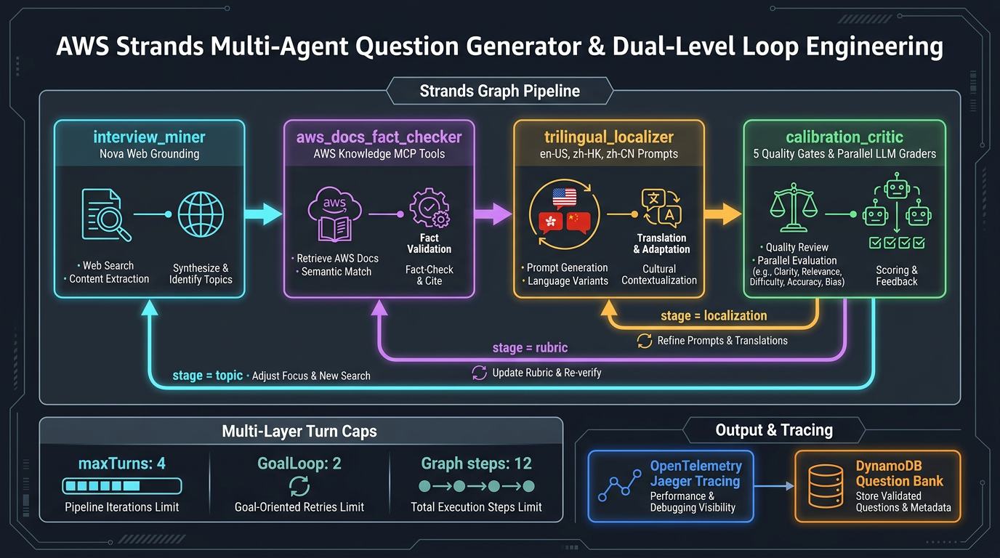
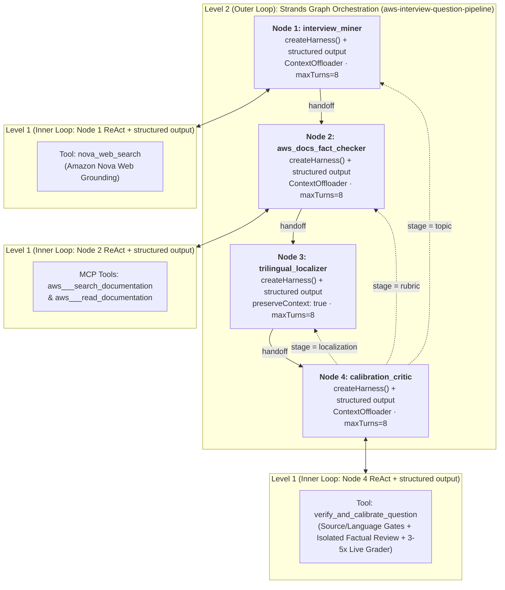
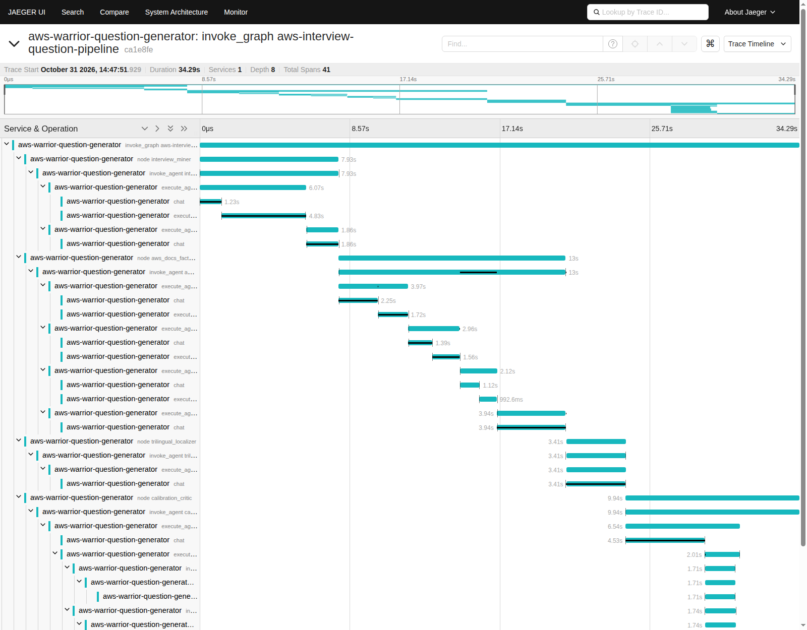
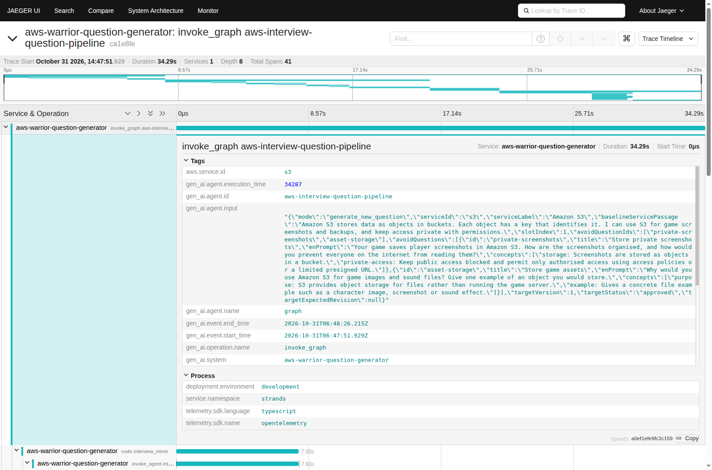

# AWS Strands Multi-Agent Question Generator & Loop Engineering Architecture

> **Implementation Files**
> - Core Strands Graph, Harness & Specialist Agents: [`src/VoiceAgent/question-generator.mjs`](../src/VoiceAgent/question-generator.mjs)
> - VoicePractice Batch Job & Checkpoint Runner: [`src/VoicePractice/question-generator.mjs`](../src/VoicePractice/question-generator.mjs)
> - CLI & DynamoDB Question Bank Manager: [`src/VoicePractice/question-bank.mjs`](../src/VoicePractice/question-bank.mjs)
> - Live Spoken Answer Grader (`createHarness` + `BedrockModel`): [`src/VoiceAgent/agent.mjs`](../src/VoiceAgent/agent.mjs)
> - Unit & Graph Verification Suite: [`tests/voice-practice/question-generator.test.mjs`](../tests/voice-practice/question-generator.test.mjs)

---

## Configurable models and Web Answer

Generation and refresh now produce **drafts** by default. The CLI never writes generated
questions to DynamoDB, even when `VOICE_TABLE` is set; it may still read existing questions
for refresh and duplicate detection. `--publish` is rejected during generation. Review
the saved private file, import it with `question-bank.mjs import FILE`, then explicitly
approve each question with its current revision. Refresh keeps the ID, increases the
version and requires reapproval. Existing student scores, rewards and Nova grading are
unchanged.

The default Chinese profile (`--model-profile=chinese`) selects:

| Role | Bedrock model |
| --- | --- |
| Interview miner | `us.amazon.nova-2-lite-v1:0` |
| Fact-checker / rubric writer | `zai.glm-5` |
| Localizer | `qwen.qwen3-next-80b-a3b` |
| Independent critic | `deepseek.v3.2` |
| Calibration grader | `us.amazon.nova-2-lite-v1:0` |
| Nova web grounding | `us.amazon.nova-2-lite-v1:0` |

Use `--model-profile=nova` for Nova-only generation; this profile uses the existing
`modelId` / `QUESTION_MODEL_ID` / `VOICE_MODEL_ID` fallback. An explicit shared
`modelId` / `--model` / `QUESTION_MODEL_ID` overrides the default when no profile is
specified. `VOICE_MODEL_ID` alone does not replace the default Chinese generator
profile or change live grading. Grounding always has its own Nova configuration.
Override roles with `--miner-model`,
`--fact-checker-model`, `--localizer-model`, `--critic-model`, `--grader-model`,
and `--grounding-model` (all use `=MODEL_ID`). Corresponding environment variables
are `QUESTION_MINER_MODEL_ID`, `QUESTION_FACT_CHECKER_MODEL_ID`,
`QUESTION_LOCALIZER_MODEL_ID`, `QUESTION_CRITIC_MODEL_ID`, `QUESTION_GRADER_MODEL_ID`,
and `QUESTION_GROUNDING_MODEL_ID`. Kimi K2.5 can replace a writer or critic for comparisons;
it is not an additional stage. Catalog availability does not establish invocation access
or provider compatibility with forced structured output.

Each research node gets at most two tool calls per visit, enforced in Strands
middleware rather than by its prompt or retained message history. Subsequent calls are
forced to `strands_structured_output`; turns are reserved for schema correction.
Research errors count against the limit. Existing node-turn and graph-cycle limits
still apply. These are execution bounds, **not a dollar spending cap**.

The optional `--evidence-source=web-answer` / `QUESTION_EVIDENCE_SOURCE` setting selects
the IAM-signed Gateway adapter instead of public AWS Knowledge MCP. Set
`--web-answer-url=HTTPS_GATEWAY_MCP_URL` / `QUESTION_WEB_ANSWER_URL`; a configured URL
selects Web Answer unless the evidence source is explicitly overridden. It is available
in `us-east-1` only. The adapter discovers `___WebAnswer` by name, processes every answer
block, rejects errors or missing/non-AWS citations, limits request duration, and disconnects
on success and failure. It never silently falls back to another evidence provider.
Web Answer is only available to the fact-checker; live student grading never browses.

The fact-checker uses one successful evidence search followed by `read_aws_sources` for
up to three official AWS pages. Canonical documentation URLs may be read even when
discovery returned localized blogs; guessed URLs never qualify unless the actual page
is successfully fetched and its quotations verified. Each page read has a 15-second timeout, a one-megabyte
download cap and a 16,000-character source-text cap. At most three redirects may be
followed, validating each destination against the same official AWS HTTPS allowlist
and retaining the original/canonical URL association. Credentials, query parameters
and non-AWS origins are rejected. These bounded source reads are additional
HTTP requests, not additional Web Answer calls.

The writer must supply private `sourceClaims` covering the English prompt, every
concept, misconception and acceptable answer, and the reference answer. Each claim
contains `field`, `claim` and `sourceUrl`. The server, not the writer, binds a short
verbatim `quote` selected from the matching source page actually read during the current
visit. Model-written quotations are not trusted evidence. Field coverage and source-page
provenance are checked; a Web Answer summary or citation URL alone is insufficient.
The selected excerpt is context for the reviewer, **not a claim of semantic entailment**;
the reviewer must inspect the full field and full supplied source passage.
Invalid citations or unread source references are returned directly to the writer as Strands
structured-output validation feedback, allowing correction with the pages already read
instead of sending an ungrounded rubric onward or repeating research unnecessarily.

Inside the calibration verifier, an isolated `FactualReviewAgent` uses the configured
critic model to inspect the proposed question, claims and source passages **before any
grading call**. It receives no synthetic scores or writer/calibrator approval. Every
field requires a supported verdict; contradictory, insufficient or omitted claim
verdicts reject even a top-level `passed=true`. Reviews are cached per question and
evidence snapshot, including rejections, so unchanged candidates cannot be repeatedly
reviewed until one happens to pass. Private traces retain these checks in
`qualityReviews`; model usage includes the `factualReviewer` calls.
An approval must have an empty `issues` list. Inconsistent approval notes are returned
as structured-output validation feedback for correction within the reviewer's turn limit.

For open architectural questions, the reviewer must provide up to two source-backed,
genuinely different valid alternative answers and their source URLs. The server binds
their actual source excerpts too. These are calibrated alongside the good
English, good Cantonese and outdated answers. A valid alternative scoring below 80
rejects the rubric and routes it back to the writer. Fixed feature-comparison questions
may have no alternatives, with an explicit reason.

Localization uses a technical glossary and deterministic PITR checks: point-in-time
recovery must not become point-to-point recovery. The Cantonese prompt must contain
spoken Cantonese phrasing; this presence check does not guarantee natural fluency.
The independent review also checks translation fidelity, conditional defaults, timeline
arithmetic, storage-duration versus billing restrictions, and optional-service grading.

The calibration critic receives the proposed English rubric and latest research results.
A rejected review overrides successful synthetic calibration and routes feedback to the
responsible node. Missing evidence and changes to the English prompt/rubric fail validation.
Source URLs are retained on the question and displayed as safe links on desktop/phone;
private rubrics and research answers are not returned to students. Source links alone
do not establish factual correctness. The reviewer can also falsely reject a valid
draft, especially when interpreting conditional transition rules. These checks still use a fallible model; human
factual and Cantonese review remains required. Explicitly injected `docTools: []` is a
test seam without source fetching, not a grounded production configuration.

### Isolated research infrastructure

`cdk/research-app.ts` synthesizes **only** `CloudProjectMarkerResearch`; the existing
Warrior application entry point and SAM template are unchanged. It adds an IAM Gateway,
official AWS domain restrictions, and an unattached scoped generator caller policy.
The Web Answer target uses a CDK SDK custom resource because CloudFormation's
`ConnectorSource` does not expose version pinning; the control API requests `1.1.0`.
The Gateway service role has Web Answer permissions, not model invocation permissions.

```bash
npm --prefix cdk run check
npm --prefix cdk test
npm --prefix cdk run synth:research
```

Deployment, IAM policy attachment and paid trials require separate review. Before a live
trial, verify the Gateway and target are `READY`, explicitly attach
`GeneratorCallerPolicyArn` to the intended generator identity, and set `WebAnswerUrl`
as `QUESTION_WEB_ANSWER_URL`. Custom model overrides require corresponding IAM scopes;
the supplied policy covers the profile above and Kimi K2.5. The custom-resource Lambda
is deployment-only, not a generator runtime or provisioned model endpoint.

After deployment approval, an **unpublished paid** local trial can be run with:

```bash
AWS_REGION=us-east-1 env -u VOICE_TABLE \
node src/VoicePractice/question-bank.mjs generate \
  /tmp/rds-draft.json rds --count=1 --no-publish \
  --model-profile=chinese --evidence-source=web-answer \
  --web-answer-url="$QUESTION_WEB_ANSWER_URL" \
  --trace-json=/tmp/rds-draft-trace.json
```

Keep traces private. They include research results, per-model invocation records
(including grounding, graders and failures), SDK attempt counts when available, and
the critic review. Batch traces retain failed attempts. Usage covers only responses
that report tokens; errors and SDK retries can leave unreported usage, and injected
graders are marked incomplete. The CLI no longer reports a misleading Nova-only USD
estimate. Reconcile provider token usage and Web Answer/Gateway charges with AWS billing.
No live provider/Gateway trial is performed by unit tests or CDK synthesis.

Respect Web Answer's acceptable-use terms: retain/display citations, do not bulk
reproduce results or use them to build a competing index/database. Keep trials bounded.

## Costing from traces, not token limits

All figures below are **USD**, using public Standard pricing checked on **8 November
2026** for `us-east-1` and the Nova US inference profile. These are trace-based
estimates, not an AWS invoice or a maximum-token calculation.

### Pricing assumptions

| Model | Input USD per million tokens | Output USD per million tokens |
| --- | ---: | ---: |
| Nova 2 Lite, US profile | $0.33 | $2.75 |
| GLM 5 | $1.00 | $3.20 |
| Qwen3 Next 80B A3B | $0.15 | $1.20 |
| DeepSeek v3.2 | $0.62 | $1.85 |

Nova web grounding adds **$0.03 per request**. AgentCore Web Answer adds
**$10 per 1,000 tool calls**; Gateway API invocations such as ListTools, InvokeTool
and Ping add **$0.005 per 1,000 invocations**. These are separate from model tokens.
Qwen input uses the higher published website rate of $0.15 per million rather
than the Price List API's $0.14 rate.

Sources: [Amazon Bedrock pricing](https://aws.amazon.com/bedrock/pricing/),
[AgentCore pricing](https://aws.amazon.com/bedrock/agentcore/pricing/), and the
[AWS Price List API](https://docs.aws.amazon.com/awsaccountbilling/latest/aboutv2/price-changes.html)
(`AmazonBedrock`, filtered by model, region and Standard input/output dimensions).
Exclude batch, custom-model and global-profile rates when pricing this US-profile run.
Recheck prices and the configured profile before another paid batch.

### Accounting method and tracing limits

Sum each model's **reported** input and output tokens at its own rates, then add
grounding, Web Answer and Gateway charges:

```text
model_USD = sum((input_tokens * input_USD_per_million
                + output_tokens * output_USD_per_million) / 1_000_000)
estimated_USD = model_USD + grounding_requests * 0.03
                + web_answer_calls * 10 / 1_000
                + gateway_invocations * 0.005 / 1_000
```

For current traces, include all `modelInvocations`: miner, grounding, writer,
localizer, critic, isolated factual reviewer and grader, including retained failed
attempts and fresh retries. Deduplicate copied invocation records using their full
record identity and occurrence number within each trace. Do not deduplicate only
by role, model and start time: parallel graders can start in the same millisecond.
Do not add parent graph usage to child model usage or equate an OpenTelemetry span
count with a billable model-call count.

`maxTokens`, node-turn limits and graph-attempt limits are execution bounds, not
actual token consumption or a monetary cap. Structured output is not a separate
priced service in this estimate, although schema corrections can cause extra calls.
Errors without usage and SDK-internal retries can still leave incomplete billing
data. Use AWS billing to reconcile the final charges.

### Historical Nova-only trial versus the current Chinese-profile trial

Both trials ended with five questions for S3, IAM, EC2, RDS and CloudFront, but they
used different workflows and **different accounting scopes**.

| Measurement | Earlier Nova-only trial | Current Chinese-profile trial |
| --- | ---: | ---: |
| Reported input tokens | 182,418 | 1,598,041 |
| Reported output tokens | 21,602 | 128,238 |
| Reported total tokens | 204,020 | 1,726,279 |
| Recorded model calls | 48 main-agent calls only | 221 across all recorded roles and retained retries |
| Calls per completed question | 9.6 main-agent calls only | 44.2 across all recorded roles and retained retries |
| Known Nova grounding requests | 8 | 17 |
| Known Web Answer calls | Not used | 18 |

The earlier successful traces show 8-12 main-agent calls per question. They exclude
failed attempts and may omit nested grounding/grader token usage. The current
221-call total includes those recorded roles and retries; **44.2 is already the
per-question average, not the total for five questions**. It is not a measured
no-retry baseline. Tool-result continuations and multiple grading tests require
additional calls even when a candidate succeeds.

| Priced component | Earlier Nova-only recorded portion | Current Chinese-profile estimate |
| --- | ---: | ---: |
| Reported model tokens | $0.1196 | $1.4231 |
| Known Nova grounding requests | $0.2400 | $0.5100 |
| Known Web Answer calls | Not used | $0.1800 |
| Gateway planning allowance | Not used | $0.0009 |
| **Estimated subtotal for five completed questions** | **$0.3596** | **$2.1140** |
| **Subtotal per completed question** | **$0.0719** | **$0.4228** |

The Gateway allowance assumes ten operations per Web Answer call; Gateway operations
were not directly traced. The current sample excludes the two separate S3/CloudFront
fairness probes. The older subtotal is only the priced successful recorded portion,
**not the full cost of the Nova trial**. This is not an apples-to-apples model-cost
or quality benchmark, and switching today's pipeline to Nova does not recreate the
older workflow or establish the same cost.

With default model settings, adding `--model-profile=nova` selects Nova for every
generator role, including the isolated factual reviewer through the critic setting.
To explicitly pin the shared fallback, use
`--model-profile=nova --model=us.amazon.nova-2-lite-v1:0`. Per-role flags and
`QUESTION_*_MODEL_ID` overrides still take precedence. Changing the model profile
does not disable Web Answer or quality checks, or change the student grader.

Private measurement inputs were `nova-structured-trial-5-traces.json` and its
`nova-structured-trial-5-run.json` accounting note, plus the latest
`quality-five-traces.json` and IAM/RDS retry traces. Keep these files private;
the aggregate figures above do not require publishing questions, rubrics or research.

### All-service planning, not an executed replacement

Extrapolating the current trial's unrounded average of **$0.422797462 per completed
question**, including its retained retries, gives:

| Questions per service | New questions across 302 services | Baseline estimate | Illustrative budget reserve |
| --- | ---: | ---: | ---: |
| 1 | 302 | $127.68 | $200-$300 |
| 2 | 604 | $255.37 | $400-$600 |

The reserves apply 1.5-2 times the baseline, rounded up to $100 increments. They are
planning allowances, **not guaranteed AWS billing caps**, maximum-token costs or
implemented spending controls. Five services are not representative of the entire
catalog; difficult services, extra retries and second-question diversity can increase
costs, while fewer retries can reduce them. Full service coverage is not guaranteed.
Taxes, discounts, unmeasured database/storage/log charges and unrelated student-runtime
costs are excluded. This estimate did not start an all-service generation or database
replacement.

---

## 1. What "Loop Engineering" Actually Means (And What It Does *Not* Mean)

A common misconception is that **Loop Engineering** just means wrapping an LLM API call inside an imperative `for` or `while` retry loop in application code. **That is not Loop Engineering.**

In modern AI systems engineering, **Loop Engineering** is the system-level discipline that sits on top of **Prompt Engineering** and **Context Engineering**:

| Engineering Layer | Core Question | Primary Focus | Analogy |
| :--- | :--- | :--- | :--- |
| **1. Prompt Engineering** | *"What should we say to the model?"* | Crafting instructions, role definitions, and output formatting for a single turn. | Playing a single move in chess. |
| **2. Context Engineering** | *"What does the model need to know and access?"* | Curating the information workspace: system state, prior questions (`avoidQuestions`), MCP tool schemas, context offloading, and conversation history. | Preparing the board and pieces. |
| **3. Loop Engineering** | *"How does the system autonomously act, verify, self-correct, and terminate?"* | Architecting the closed-loop control system (**Perceive → Reason → Act → Observe → Verify → Self-Correct or Terminate**) with deterministic verifiers, stateful memory continuity, and hard multi-layer resource bounds. | Building the autonomous chess engine. |

### The 5 Pillars of True Loop Engineering
1. **Model-Driven Action & Observation (Not Imperative Scripting)**: Instead of hardcoding when and how to search the web or read documentation, each specialist agent autonomously decides which tools to invoke, inspects the returned observations, and decides whether to call another tool or synthesize its output.
2. **Deterministic Verifiers & Guardrails (Closed-Loop Feedback)**: An agent never grades its own homework by "vibes." Every iteration is checked by deterministic verifiers: Strands structured-output schema validation (Zod), rubric weight invariants (`validateQuestion`), stopword-filtered Jaccard semantic overlap checks (`findDuplicateOrOverlappingQuestion`), Cantonese/Mandarin script hygiene, and live 3-way synthetic student grading (`verifyAndCalibrate`).
3. **Structured Error Feedback Into Stateful Memory**: When a verifier rejects an output, the system does not blindly re-run the same prompt from scratch. It preserves the node conversation context (`preserveContext: true`) and feeds the structured critique back into the exact responsible node so the agent knows *why* the previous candidate failed and *how* to fix it.
4. **Verifiable Goal Termination**: Both the inner structured-output loop and the outer `Graph` exit as soon as a verifiable goal state (validated structured output / `invocationState.calibratedResult !== null`) is satisfied—not after a fixed number of turns.
5. **Bounded Multi-Layer Governance & Native Observability**: Hard execution caps across every loop level (`maxTurnsPerNode = 8` on every inner specialist agent via `BeforeModelCallEvent`, including structured-output retries, `limits: { turns: 1 }` on the live spoken answer grader, and `maxAttempts = 3` / `maxSteps = 12` on the outer Strands `Graph`) prevent unbounded inner tool-calling loops and outer graph feedback cycles. These are not dollar spending caps. Native Strands OpenTelemetry (`@strands-agents/sdk/telemetry`) emits GenAI trace hierarchies to OTLP collectors like Jaeger; [cost accounting](#costing-from-traces-not-token-limits) also requires per-model usage and separately priced tools.

---

## 2. Dual-Level Loop Engineering with `@strands-agents/harness` and `@strands-agents/sdk`

Our Question Generator ([`createQuestionGenerator`](../src/VoiceAgent/question-generator.mjs#L398-L996)) implements **two nested levels** of native AWS Strands loops—with zero imperative `for`/`while` retry loops around the graph:





### Level 1: The Inner Loop (`createHarness()` + Structured Output + `ContextOffloader`)
Each specialist node in the pipeline is constructed via [`createStrandsNodeAgent`](../src/VoiceAgent/question-generator.mjs#L284-L396) using `createHarness()` from `@strands-agents/harness` (`^0.3.3`) and `@strands-agents/sdk` (`^1.23.0`), backed by [`BedrockModel`](../src/VoiceAgent/question-generator.mjs#L296-L302) (`us.amazon.nova-2-lite-v1:0`, `temperature: 0`, `stream: false`).

When a node executes, Strands runs its internal **Reason → Tool Use (`tool_use`) → Tool Result (`ContextOffloader`) → Structured Output Tool → Zod Validation** cycle:

1. **Strands Harness (`@strands-agents/harness` `createHarness`)**:
   - Configures each specialist agent with `contextManager: { strategies: ["largeToolOffloading", "overflowProtection"], stash: false }`, `effort: "auto"`, `caching: false`, and locked-down `builtinTools: []`, `builtinPlugins: []`, `session: false`, `memory: false`, `skills: false`, `backgroundTasks: false`.
2. **`ContextOffloader` Plugin (`@strands-agents/sdk/vended-plugins/context-offloader`)**:
   - Attached to every tool-using specialist node (`interview_miner`, `aws_docs_fact_checker`, `calibration_critic`) with `InMemoryStorage` (`maxResultTokens: 2500`, or `30000` for the fact-checker's bounded source pages; `previewTokens: 1000`, `includeRetrievalTool: false`).
   - Automatically truncates and offloads oversized AWS documentation reads or web grounding payloads so they never overflow the model's context window across multi-turn tool calls.
3. **Strands Structured Output (`structuredOutputSchema`)**:
   - Each specialist has a separate Zod schema for its mined topic, verified rubric, localized question, or final calibration candidate. Strands exposes the schema as `strands_structured_output`, which the agent calls last after its research or calibration tools.
   - Invalid tool arguments produce validation feedback for correction within the same node. A plain-text reply triggers Strands' forced structured-output retry. The generator no longer extracts JSON from model text.
   - A `NodeResultEvent` hook serializes the validated `structuredOutput` into a `TextBlock` for graph handoffs, because the graph forwards node content rather than the structured-output property. The critic verifier consumes the typed result directly.
4. **Hard Inner Turn Budget (`maxTurnsPerNode = 8`, clamped `1..12`)**:
   - Each node registers `BeforeInvocationEvent` and `BeforeModelCallEvent` hooks that throw `Agent "<id>" exceeded maximum inner loop turns (<boundedMaxTurns>)` if a tool loop or structured-output retry exceeds the turn cap.

### Level 2: The Outer Loop (Strands `Graph` Stage-Classified Feedback Cycle)
When the candidate question, rubric, or localization fails verification in `calibration_critic`, the Assurance Plane classifies the defect via [`classifyFailureStage`](../src/VoiceAgent/question-generator.mjs#L183-L199) into one of three fault domains and routes the Strands [`Graph`](../src/VoiceAgent/question-generator.mjs#L748-L816) back to the **exact specialist node** responsible for fixing it:

| Failure Stage | Conditional Back-Edge | Trigger Conditions | Nodes Re-Executed |
| :--- | :--- | :--- | :--- |
| **`"localization"`** | `calibration_critic ──► trilingual_localizer` | • `zh-CN` contains Cantonese-only characters (`/[嘅喺唔畀佢哋乜啲揀嚟]/u`)<br/>• Missing `zh-HK` or `zh-CN` prompt<br/>• `goodZhHk` fails calibration (`score < 80`) while `goodEn` passed | `trilingual_localizer` → `calibration_critic` *(2 nodes; skips web search & MCP docs)* |
| **`"rubric"`** | `calibration_critic ──► aws_docs_fact_checker` | • Concept weights do not sum to `100`<br/>• `goodEn` fails calibration (`score < 80`)<br/>• `wrongOutdated` passes unexpectedly (`score >= 60`)<br/>• Forbidden voice/pronunciation terms detected | `aws_docs_fact_checker` → `trilingual_localizer` → `calibration_critic` *(3 nodes; preserves mined topic)* |
| **`"topic"`** | `calibration_critic ──► interview_miner` | • Duplicate `question.id` (`duplicate_id`)<br/>• Duplicate title/prompt (`duplicate_title`, `duplicate_prompt`)<br/>• Semantic Jaccard overlap (`overlapping_prompt >= 0.55` or `overlapping_concepts >= 0.60`) | Full 4-node cycle starting at `interview_miner` to mine an orthogonal AWS topic |

#### How Cyclic Graph Execution Works in `@strands-agents/sdk`
- **Cyclic Dependency Initialization (`BeforeMultiAgentInvocationEvent`)**: Because `trilingual_localizer`, `aws_docs_fact_checker`, and `interview_miner` have incoming conditional back-edges from `calibration_critic`, a `BeforeMultiAgentInvocationEvent` hook ([`question-generator.mjs#L799-L804`](../src/VoiceAgent/question-generator.mjs#L799-L804)) marks `calibration_critic` as `Status.COMPLETED` when `results.length === 0` so forward edges fire normally on cycle 1 while conditional back-edges only fire after `calibration_critic` is the most recently completed node (`state.results.at(-1)?.nodeId === "calibration_critic"`).
- **Targeted Critique Injection & Cleanup (`BeforeNodeCallEvent`)**: When a cycle fails, `evaluateCriticOutcome` appends a `TextBlock` containing `{ previousAttemptCritique, failureStage, targetNode, cycle }` to `calibration_critic`'s result content so Strands passes it directly into the target node's input, and a `BeforeNodeCallEvent` hook ([`question-generator.mjs#L806-L814`](../src/VoiceAgent/question-generator.mjs#L806-L814)) clears that temporary `TextBlock` once delivered so downstream nodes never receive stale critique blocks.

---

## 3. Specialist Agent Breakdown

### Node 1: `interview_miner` (`InterviewQuestionMinerAgent`)
- **Source**: [`src/VoiceAgent/question-generator.mjs#L572-L596`](../src/VoiceAgent/question-generator.mjs#L572-L596)
- **Tools**: [`nova_web_search`](../src/VoiceAgent/question-generator.mjs#L236-L265) (Amazon Bedrock `ConverseCommand` with `systemTool: { name: "nova_grounding" }`)
- **Output**: Zod-validated mined topic, answer, suspected outdated claims, and web citations
- **Plugins**: `ContextOffloader`
- **Responsibility**:
  - Searches the live web via Amazon Nova Web Grounding for the most frequently asked cloud engineering interview questions for the target AWS service (`s3`, `iam`, `ec2`, `vpc`, `rds`, `cloudfront`, `ecs`, etc.).
  - Inspects `avoidQuestions` (summaries of all existing questions for the same service) and `previousAttemptCritique` (if looping back on `failureStage === "topic"`) to pick an orthogonal architectural scenario and AWS capability.
  - Flags any community claims suspected of being outdated (`suspectedOutdatedClaims`).

### Node 2: `aws_docs_fact_checker` (`AwsDocsFactCheckerAgent`)
- **Source**: [`src/VoiceAgent/question-generator.mjs#L598-L632`](../src/VoiceAgent/question-generator.mjs#L598-L632)
- **Tools**: Live **AWS Knowledge MCP** tools ([`loadAwsKnowledgeMcpTools`](../src/VoiceAgent/question-generator.mjs#L267-L282) connected to `https://knowledge-mcp.global.api.aws`: `aws___search_documentation`, `aws___read_documentation`)
- **Output**: Zod-validated English question, rubric, and AWS documentation citations
- **Plugins**: `ContextOffloader`
- **Responsibility**:
  - Audits both the mined question premise and community answer against official AWS documentation.
  - Rewrites outdated premises (e.g., S3 eventual consistency myths, default encryption misconceptions) into accurate questions and stores the outdated belief in `misconceptions[]`.
  - Designs 2–3 atomic grading `concepts[]` whose integer weights sum strictly to `100`.

### Node 3: `trilingual_localizer` (`TrilingualLocalizationAgent`)
- **Source**: [`src/VoiceAgent/question-generator.mjs#L634-L672`](../src/VoiceAgent/question-generator.mjs#L634-L672)
- **Tools**: `strands_structured_output` only (no external tools)
- **Output**: Zod-validated question requiring all three locale prompts
- **Responsibility**:
  - Produces natural spoken interview prompts across all three supported game locales:
    - `en-US`: Conversational English scenario prompt.
    - `zh-HK`: Authentic spoken Hong Kong Cantonese (e.g., 你嘅, 點解, 點樣, 入面, 邊啲) with natural English AWS term code-switching (`Amazon S3`, `IAM role`, `Security Group`).
    - `zh-CN`: Natural Simplified Chinese Mandarin, strictly free of Cantonese-specific characters (`/[嘅喺唔畀佢哋乜啲揀嚟]/u`).

### Node 4: `calibration_critic` (`CalibrationCriticAgent`)
- **Source**: [`src/VoiceAgent/question-generator.mjs#L674-L699`](../src/VoiceAgent/question-generator.mjs#L674-L699)
- **Tools**: [`verify_and_calibrate_question`](../src/VoiceAgent/question-generator.mjs#L526-L569)
- **Output**: Zod-validated question and all three synthetic transcripts
- **Plugins**: `ContextOffloader`
- **Responsibility**:
  - Generates three realistic spoken student transcripts:
    1. `goodEn`: Spoken English answer covering all rubric concepts.
    2. `goodZhHk`: Spoken Hong Kong Cantonese + English code-switched answer covering all rubric concepts.
    3. `wrongOutdated`: Plausible spoken answer stating `misconceptions[0]` and missing required concepts.
  - Calls `verify_and_calibrate_question`, which runs [`verifyAndCalibrate`](../src/VoiceAgent/question-generator.mjs#L422-L524). If a transcript phrasing issue caused calibration to fail, `calibration_critic` can refine the synthetic transcript and re-call `verify_and_calibrate_question` within its own inner turn budget before finishing.

---

## 4. Deterministic Verifiers & Anti-Duplication Guardrails

Inside [`verifyAndCalibrate`](../src/VoiceAgent/question-generator.mjs#L422-L524), every candidate question must pass **five deterministic gates** before `invocationState.calibratedResult` is set:

1. **Schema & Weight Invariants (`validateQuestion`)**:
   - Enforces non-empty trilingual prompts (`en-US`, `zh-HK`, `zh-CN`), 2–3 atomic concepts with integer weights summing strictly to `100`, non-empty `misconceptions`, `acceptableAnswers`, and `referenceAnswer`.
2. **Multi-Slot Semantic Anti-Duplication ([`findDuplicateOrOverlappingQuestion`](../src/VoiceAgent/question-generator.mjs#L142-L181))**:
   - Rejects exact ID collisions (`duplicate_id`), normalized title collisions (`duplicate_title`), and normalized prompt collisions (`duplicate_prompt`).
   - Computes stopword-filtered **Jaccard token similarity** ([`tokenizeTopicText`](../src/VoiceAgent/question-generator.mjs#L123-L131)) against every existing question for that service (including bundled baseline questions in [`src/VoicePractice/questions.json`](../src/VoicePractice/questions.json), exported DynamoDB questions, and earlier slots in the same batch):
     - Rejects `overlapping_prompt` when prompt/title token similarity `>= 0.55`.
     - Rejects `overlapping_concepts` when grading rubric concept similarity `>= 0.60`.
3. **Language Script Hygiene**:
   - Rejects `zh-CN` prompts containing Cantonese-only characters (`/[嘅喺唔畀佢哋乜啲揀嚟]/u`).
4. **Content-Only Grading Guardrail**:
   - Scans every text field against `forbiddenVoiceClaim` to ensure rubrics never mention pronunciation, accent, or voice quality.
5. **3-Way Live Grader Calibration**:
   - Runs the real production grader ([`createGraderAgent`](../src/VoiceAgent/agent.mjs), which itself runs on `@strands-agents/harness` `createHarness` with `limits: { turns: 1 }`) and [`gradeAnswer`](../src/VoicePractice/questions.mjs) in parallel across all 3 synthetic transcripts:
     - `goodEn` **must pass with score `>= 80%`**.
     - `goodZhHk` **must pass with score `>= 80%`**.
     - `wrongOutdated` **must fail with score `< 60%`**.

---

## 5. Native Strands Observability & Live OTLP Tracing (Jaeger UI)

Strands provides two complementary native observability layers wired into [`src/VoiceAgent/question-generator.mjs`](../src/VoiceAgent/question-generator.mjs#L11-L96) and [`src/VoicePractice/question-bank.mjs`](../src/VoicePractice/question-bank.mjs#L100-L150):

1. **Native OpenTelemetry (`@strands-agents/sdk/telemetry` + `@strands-agents/harness`)**:
   - [`enableStrandsTelemetry`](../src/VoiceAgent/question-generator.mjs#L11-L20) and `@strands-agents/harness` (`OTEL_TRACES_EXPORTER=otlp` / `console`) initialize `setupTracer` to emit standard GenAI OpenTelemetry spans (`invoke_graph`, `node <id>`, `invoke_agent <id>`, `execute_agent_loop_cycle`, `chat`, `execute_tool <name>`) with custom attributes (`aws.service.id`, `strands.pipeline.mode`, `strands.slot.index`) and token usage (`gen_ai.usage.input_tokens`, `gen_ai.usage.output_tokens`, `gen_ai.usage.total_tokens`).
   - At the end of each graph run, `generateOrRefreshQuestion` calls `await tracerProvider.forceFlush()` so all batched OTLP spans are guaranteed to flush immediately to your OTLP collector (Jaeger, Langfuse, or Arize Phoenix) before the CLI exits.
2. **Live `graph.stream()` Event Collector & Topology Extractor**:
   - Captures `beforeNodeCallEvent`, `nodeStreamUpdateEvent` (`beforeToolCallEvent`, `afterToolCallEvent`, `agentResultEvent`), `nodeResultEvent`, and `multiAgentHandoffEvent`.
   - [`extractGraphTopology`](../src/VoiceAgent/question-generator.mjs#L22-L96) inspects `graph.nodes` and `graph.edges` (normalizing `AgentNode` edge references to string node IDs) to record node visit counts, execution latency, tools invoked, structured-output enablement (`structuredOutput`), and conditional loop-back counts, plus a Mermaid flowchart string.

### CLI Usage & Live Jaeger UI Walkthrough

```bash
# 1. Start the official Jaeger all-in-one OTLP collector & Web UI (http://localhost:16686)
docker run -d --rm --name strands-jaeger \
  -e COLLECTOR_OTLP_ENABLED=true \
  -p 16686:16686 \
  -p 4317:4317 \
  -p 4318:4318 \
  jaegertracing/all-in-one:latest

# 2. Generate 1 calibrated S3 question with live Strands OpenTelemetry streaming to Jaeger UI
OTEL_TRACES_EXPORTER=otlp \
OTEL_EXPORTER_OTLP_ENDPOINT=http://localhost:4318 \
OTEL_SERVICE_NAME=aws-warrior-question-generator \
node src/VoicePractice/question-bank.mjs generate \
  /tmp/s3-single-question.json s3 \
  --count=1 \
  --no-publish \
  --force \
  --otel \
  --trace-console \
  --trace-json=/tmp/s3-single-trace.json

# 3. Generate 2 unpublished drafts per service, reading existing questions for deduplication
AWS_REGION=us-east-1 VOICE_TABLE=CloudProjectMarker-VoicePracticeTable-xxxx \
node src/VoicePractice/question-bank.mjs generate \
  generated-questions.json rds,cloudfront,ecs \
  --count=2 \
  --no-publish \
  --otel

# 4. Refresh existing DynamoDB questions into an unpublished draft file for review
AWS_REGION=us-east-1 VOICE_TABLE=CloudProjectMarker-VoicePracticeTable-xxxx \
node src/VoicePractice/question-bank.mjs refresh \
  refreshed-questions.json s3,ec2,iam,vpc,lambda,dynamodb \
  --no-publish \
  --otel
```

### Example Live Trace Hierarchy in Jaeger (`http://localhost:16686`)
When running the single-service `s3` generation above, Jaeger captures **41 hierarchical OpenTelemetry spans** under a single root trace (`invoke_graph aws-interview-question-pipeline`, `34.29s`, `35,711` total tokens):

This is a historical trace example, not a current-run forecast or complete billing
record. Forty-one spans do not mean forty-one model calls, and root/child token
totals must not be added together. See [trace-based costing](#costing-from-traces-not-token-limits)
for the later trials and their accounting limits.



Expanding any span in the Jaeger UI reveals the full GenAI OpenTelemetry attributes (`gen_ai.operation.name`, `gen_ai.agent.id`, `gen_ai.agent.input`, `gen_ai.usage.*`, `service.namespace: strands`):



- `invoke_graph aws-interview-question-pipeline` (`34,286.7ms`)
  - `node interview_miner` (`7,934.9ms`) → `invoke_agent interview_miner`
    - `execute_agent_loop_cycle` (`6,065.8ms`) → `chat` (`1,227.4ms`) + `execute_tool nova_web_search` (`4,833.2ms`)
    - `execute_agent_loop_cycle` (`1,864.2ms`) → `chat` (`1,863.2ms`)
  - `node aws_docs_fact_checker` (`12,997.6ms`) → `invoke_agent aws_docs_fact_checker`
    - `execute_agent_loop_cycle` (`3,971.5ms`) → `chat` (`2,250.8ms`) + `execute_tool aws___search_documentation` (`1,718.1ms`)
    - `execute_agent_loop_cycle` (`6,543.3ms`) → `chat` (`3,940.2ms`) + `2x execute_tool aws___read_documentation` (`1,561.0ms`, `992.6ms`)
    - `execute_agent_loop_cycle` (`2,115.1ms`) → `chat` (`1,117.2ms`)
  - `node trilingual_localizer` (`3,414.3ms`) → `invoke_agent trilingual_localizer`
    - `execute_agent_loop_cycle` (`3,412.4ms`) → `chat` (`3,410.7ms`)
  - `node calibration_critic` (`9,937.3ms`) → `invoke_agent calibration_critic`
    - `execute_agent_loop_cycle` (`6,544.2ms`) → `chat` (`4,533.0ms`) + `execute_tool verify_and_calibrate_question` (`2,007.5ms`)
      - `3x invoke_agent Strands Agent` (parallel live grading of `goodEn=100`, `goodZhHk=100`, `wrongOutdated=50`)
    - `execute_agent_loop_cycle` (`3,392.1ms`) → `chat` (`3,388.7ms`)
