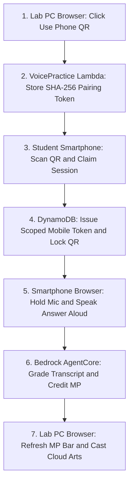

## The Legend of AWS Warrior V2 (Part 1 - The Game): Gamifying Cloud Architecture, Oral Interview Prep and 19 Anime x AWS Cloud Arts in a 3D Action RPG

**By Cyrus Wong**
*AWS AI Hero | AWS AI User Group Hong Kong Leader | Programme Leader of Higher Diploma in Cloud and Data Centre Administration (IT114115), Hong Kong Institute of Information Technology (HKIIT)*

> 3-Part Technical Blog Series: Part 1 covers the Game and Pedagogy, [Part 2 covers the AWS Serverless and AgentCore Design](https://github.com/wongcyrus/The-Legend-of-AWS-Warrior/blob/main/docs/blog/PART2_AWS_DESIGN.md), and [Part 3 covers Autonomous Question Generation with Strands Multi-Agent Graphs](https://github.com/wongcyrus/The-Legend-of-AWS-Warrior/blob/main/docs/blog/PART3_GEN_QUESTION.md).

---

## 1. Introduction: From Automated Lab Grader to Generative AI Oral Training World

When we first launched **The Legend of AWS Warrior (V1)** (featured on the [AWS Public Sector Blog](https://aws.amazon.com/blogs/publicsector/gamifying-lab-tutorials-automated-marking-system-the-legend-of-aws-warrior/)), our mission at the Hong Kong Institute of Information Technology (HKIIT) was to solve a fundamental bottleneck in cloud education: **manual lab grading does not scale.**

By coupling a browser-based RPG with a serverless .NET automatic grading backend powered by **NUnitLite**, students in our **Higher Diploma in Cloud and Data Centre Administration (IT114115)** programme could provision real infrastructure in their own AWS Learner Lab accounts—configuring IAM roles, VPCs, S3 buckets, and EC2 instances—and receive instant, deterministic verification inside a game.

<Youtube id="60bc3f0d_74" />

> **[INSERT IMAGE: docs/images/v2_screen_1_title.png — The Legend of AWS Warrior V2 Title Screen]**

### The Pedagogical Gap: Why We Replaced Text Boxes with Spoken Answers

After running V1 across hundreds of students in the Generative AI era, we observed five critical real-world challenges in classroom assignments and mock technical interviews:

1. **Defeating the "Copy-to-AI, Paste-Back" Reflex**: With traditional text-based online quizzes or written Q&A forms, students routinely copy the question, paste it into an AI chatbot, copy the generated answer, and paste it back into the submission box—all in under five seconds **without ever reading the question or reading the answer.** By requiring a **spoken voice answer** (and making the browser speech-recognition transcript strictly **read-only with typing and pasting disabled**), we break the copy-paste shortcut. Even if a student consults AI or study notes first, **they must read and speak the answer aloud at least once**—forcing the architectural concepts through their eyes, voice, and working memory.
2. **Bridging the Oral Interview Gap**: A student might score 100% on a hands-on S3 lab task, yet freeze during a Cloud Engineer job interview when asked: *"Can you explain why you chose S3 Standard-IA and Glacier over S3 Standard, and how you scope lifecycle rules safely?"*
3. **Trilingual Technical Articulation (`en-US`, `zh-HK`, `zh-CN`)**: In Hong Kong and across Asia, cloud engineers often reason in Cantonese or Mandarin while naturally code-switching with English AWS service terminology. Students needed a low-stress, repeatable environment to practice speaking cloud architectures aloud in **English (`en-US`)**, **Hong Kong Cantonese (`zh-HK`)**, and **Simplified Chinese Mandarin (`zh-CN`)**.
4. **Why Build a 3D Action RPG? Because Fun is the Key to Learning**: Asking a student to repeat an oral architecture explanation into a standard web form feels like a chore. Asking them to speak an Amazon S3 or VPC architecture explanation so they can charge up **Magic Power (MP)** to unleash an anime-inspired **Aurora Excalibur** or **Hyperscale Rumbling** ultimate against a dungeon boss turns oral practice into an engaging gameplay loop.
5. **Solving the Classroom Hardware Bottleneck (Lab PCs Have No Microphones)**: In university computer laboratories, students sit at institutional desktop PCs that **do not have built-in microphones**, and institutions cannot practically manage shared headsets for hundreds of students every day. We needed a frictionless way for a student playing the 3D RPG on a mic-less lab PC to use their own **smartphone as an instant wireless voice controller**—without logging in or typing long URLs.

Enter **The Legend of AWS Warrior V2**—a complete generational leap into a **four-region 3D open-world Action RPG** built in Three.js (`r118`), featuring **302 discoverable AWS service landmarks**, **trilingual oral practice**, **ephemeral Mobile QR-Code Handoff**, **responsive melee and timed shield parry combat**, and **19 Anime x AWS Cloud Arts**.

---

## 2. 302 Discoverable AWS Service Landmarks and Dual Oral Practice Modes

### 2.1 Exploring 302 Official AWS Service Plaques Across Four Realms

Across the four open-world realms (`96` in Cloudlands Village, `76` in Frostpeak Highlands, `62` in Sunspire Desert, and `68` across the nine chambers of the Forgotten Vault), every one of the **302 official AWS services** features an interactive 3D service plaque with official AWS architecture icons and live task-availability indicators.

> **[INSERT IMAGE: docs/images/v2_screen_2_gameplay.png — Cloudlands Village 3D Gameplay and AWS ServicePlaques]**

Clicking any service plaque within `24 units` opens the **AWS Service Discovery Dialog**:

> **[INSERT IMAGE: docs/images/v2_screen_3_dialog.png — AWS Service Discovery Dialog and Voice Practice]**

### 2.2 Dual Voice Practice Modes: Graded Read-Aloud vs. Architectural Q&A

To scaffold student confidence from basic AWS terminology familiarity to open-ended interview answers, V2 provides two distinct voice assessment modes:

| Dimension | Mode 1: Graded Read-Aloud (`graded_read_aloud`) | Mode 2: Architectural Q&A (`graded_question_answer`) |
| - | - | - |
| **Pedagogical Goal** | Build confidence speaking AWS service terminology and core definitions aloud. | Train interview-style architectural explanation in the student's own spoken words. |
| **Service Coverage** | **All 302 AWS Services out of the box** (308 trilingual passages in [activities.json](https://github.com/wongcyrus/The-Legend-of-AWS-Warrior/blob/main/src/VoicePractice/activities.json)). | **Predefined, calibrated questions** published to DynamoDB `VoicePracticeTable` (`PK = QUESTION_BANK`). |
| **Student Prompt** | Authored passage displayed on screen in English, Cantonese, or Mandarin. | Open-ended scenario interview question without showing the reference answer. |
| **AI Grading Rubric** | **Transcript Coverage** (`0-70` pts) + **Content Fidelity** (`0-30` pts) = `0-100` score (judging text meaning only, never pronunciation). | Predefined weighted multi-concept rubric (`concepts[]` summing to `100` pts) + mandatory verbatim transcript evidence. |
| **MP Reward and Cooldown** | **`+5 / +10 / +15 MP`** (`60-74` / `75-89` / `90-100`) on first pass; **7-day service cooldown**. | **`+10 / +20 / +30 MP`** (`60-74` / `75-89` / `90-100`) on first pass per unique question; **7-day per-question cooldown** with sticky shuffle and LRU rotation. |

### 2.3 Read-Only Speech-to-Text (No Copy-Paste Allowed) and Zero Pronunciation Bias

Three deliberate design choices make voice practice both **copy-paste proof** and **privacy-first**:

- **Read-Only Speech Capture (Defeating AI Copy-Paste)**: On both PC and smartphone, the transcript field is **strictly read-only and cannot be typed or pasted into**—only the browser's live `SpeechRecognition` stream can populate it. Students cannot copy a question to an AI chatbot and paste the answer back without reading it; to submit an answer, they **must speak it aloud**, guaranteeing that they read and vocalize the AWS architecture explanation at least once.
- **100% Client-Side Audio Privacy**: Raw audio waveforms **never** leave the student's browser or smartphone. The browser converts speech into a UTF-8 transcript locally, eliminating S3 audio bucket storage and Amazon Transcribe costs.
- **Zero Pronunciation Bias**: Because our AI grader only receives the text transcript, it evaluates **architectural meaning and concept coverage**, tolerating natural Hong Kong Cantonese + English code-switching (`S3 bucket`, `IAM role`, `Multi-AZ`) and speech-recognition homophones (`S three` / `S3`), and is strictly blocked from commenting on voice quality, accent, or pronunciation.

---

## 3. Solving the "Lab PC Has No Mic" Bottleneck: Ephemeral Mobile QR-Code Handoff

In a physical computer lab, 40 students sit side-by-side at institutional desktop PCs with no microphones. Asking students to log into their academic credentials on a mobile browser just to answer a 30-second voice prompt would break gameplay flow.

We solved this with an **Ephemeral Capability-Token QR Handoff** ([src/VoicePractice/domain.mjs](https://github.com/wongcyrus/The-Legend-of-AWS-Warrior/blob/main/src/VoicePractice/domain.mjs)):

> **[INSERT IMAGE: docs/images/aws_warrior_v2_qr_handoff_diagram.png — Seamless Cross-Device Mobile QR Handoff Diagram]**



### Key UX and Security Highlights

- **Zero Mobile Login and Zero API-Key Exposure**: The QR code carries a short-lived, single-use `pairingToken`—never the student's `x-api-key`.
- **Single-Claim Lock**: As soon as the student's phone claims the session (`POST /voice/mobile/claim`), a conditional DynamoDB write atomically consumes the `pairingToken` hash and issues a session-scoped `mobileToken`, preventing any second device from claiming the QR code.
- **Hold-to-Speak Mobile Ergonomics**: On the phone, students hold the microphone button to speak and release to finalize, with automatic browser-interruption stitch recovery so pauses mid-sentence never erase earlier spoken words.

---

## 4. The 4-Region 3D Open World, Dynamic AZ Outages and Tactical Melee Combat

### 4.1 Four Playable Realms, Environmental Buffs and Dynamic AZ Outage Alerts

AWS Warrior V2 expands from the single dungeon room of V1 into a four-region open world rendered in Three.js (`r118`), populated by **16 animated CC0 Quaternius monster species**, **4 distinct NPC Guide models**, and **4 double-scale regional bosses**:

| Region | Ordinary Monsters | Regional Boss | Environmental Buff |
| - | - | - | - |
| **1. Cloudlands Village** (Primary Hub) | `24` | **Crystal Warden** | Safe central village hub with 6 repairable buildings and 3 hidden caches (`F`) |
| **2. Frostpeak Highlands** (Snow Biome) | `14` | **Frostpeak Titan** (Glacial Shockwave) | **Highland Tailwind**: `+12%` movement speed in the northern highlands |
| **3. Sunspire Desert** (Dune Biome) | `14` | **Sunspire Overlord** (3-Way Fan Spikes) | **Sunspire Oasis**: `+2 HP/s` regeneration near the central oasis |
| **4. The Forgotten Vault** (9-Room Dungeon) | `14` | **Vault Nightlord** (Shadow Step Ambush) | **Compute Overclock**: `+15%` melee attack speed in the central chamber |

Every `75 seconds`, a dynamic **AZ Outage Alert** highlights a degraded perimeter on the minimap with a **45-second countdown**. Racing to the outage zone and defeating **2 monsters** within 45 seconds restores the Availability Zone, healing **`+20 HP`** and granting a **High Availability Surge** (`+20%` movement speed and `+20%` attack haste for `20 seconds`).

### 4.2 Responsive Melee Combat, Timed Perfect Parry and Close-Range Hit Guarantee

Players can switch seamlessly across **15 melee weapon styles** (`C` or `Shift + Scroll`) and **5 shield styles** (`V`):

> **[INSERT IMAGE: docs/images/v2_screen_4_equipment.png — Equipment Panel with 15 Weapons and 5 Shields]**

- **Timed Perfect Parry (Press `R` within 0.25s of impact)**: Holding `R` raises your shield to block frontal melee hits and cactus spikes within 60 degrees. Pressing `R` within **0.25 seconds** before impact executes a **Timed Perfect Parry**: negating **100% of damage** (even from heavy boss strikes) without guard break, reflecting ranged spikes back at the attacker for **2x damage**, and staggering melee attackers for `2.5s` (`+25%` bonus counterattack damage).
- **Close-Range 360-Degree and Standoff Melee Target Acquisition ([web-game/v2/main.js](https://github.com/wongcyrus/The-Legend-of-AWS-Warrior/blob/main/web-game/v2/main.js))**: In 3D action RPGs, two frustrating edge cases can happen if melee hit detection uses a naive fixed-length forward cone: (1) a fast enemy steps inside your character collision radius where the angle dot product drops below the cone threshold, or (2) a large boss/monster has an `attackRange` (`4.8-5.8` units) longer than a short weapon's reach (`3.7-4.6` units), allowing the monster to hit you while your swings miss. Our `findAttackTarget()` resolver eliminates both blind spots:

```javascript
// web-game/v2/main.js
findAttackTarget() {
  const weapon = this.currentWeapon();
  let best = null;
  let bestDist = Infinity;
  const forward = new THREE.Vector3(0, 0, 1).applyQuaternion(this.player.group.quaternion);
  for (const m of this.monsters) {
    if (m.dead || m.map !== this.currentMap) continue;
    const delta = m.group.position.clone().sub(this.player.group.position);
    delta.y = 0;
    const dist = delta.length();
    const closeRangeLeeway = 2.6 + (m.hitRadius ?? 0);
    const effectiveReach = Math.max(weapon.reach, (m.attackRange ?? 0) + 1.0) + (m.hitRadius ?? 0);
    if (dist > effectiveReach) continue;
    const dot = dist < 0.001 ? 1 : forward.dot(delta.normalize());
    const minDot = dist <= closeRangeLeeway ? -1.0 : dist < 2.2 ? -0.35 : 0.15;
    if (dot >= minDot && dist < bestDist) {
      best = m;
      bestDist = dist;
    }
  }
  return best;
}
```

Any monster close enough to melee-strike the Warrior can **always** be struck back, and point-blank overlapping enemies are hit across a full 360 degrees (`minDot = -1.0`).

---

## 5. The 19 Anime x AWS Cloud Arts and Cataclysmic 5-Art Ultimates

Passing graded voice practice activities charges the server-backed **MP Wallet** (up to `100 MP`). Players toggle Cloud Arts using keys **`3`-`7`** and press **`X`** to cast. Every cast is authorized atomically by the server (`POST /voice/casts`) before local 3D effects and Cantonese battle cries fire, and all monster kills from a single cast (including multi-wave ultimates) share **one grading batch** so multi-kill waves never spam duplicate AWS mission-grading calls.

---

### 5.1 The 5 Base Cloud Arts (1 Art Selected)

#### 1. 瞬式・事件雷切 (Event-Driven λ)

- **Key / Cost / Cooldown**: Key `3` | `12 MP` | `12s` cooldown
- **AWS Service Theme**: AWS Lambda
- **Combat Mechanics**: Fires a forward lightning bolt reaching `120 units` and chaining across up to 3 targets (`100%`, `50%`, and `25%` damage).

> **[UPLOAD YOUTUBE VIDEO: docs/videos/THE LEGEND OF AWS Warrior - 瞬式・事件雷切 (Event-Driven λ).mp4 — Replace with Youtube embed]**

#### 2. 影分身・彈性軍勢 (Auto Scaling Army)

- **Key / Cost / Cooldown**: Key `4` | `15 MP` | `20s` cooldown
- **AWS Service Theme**: Amazon EC2 Auto Scaling
- **Combat Mechanics**: Summons 5 animated shadow copies of the Warrior that advance forward up to `28 units` and strike enemies 3 times each.

> **[UPLOAD YOUTUBE VIDEO: docs/videos/THE LEGEND OF AWS Warrior - 影分身・彈性軍勢 (Auto Scaling Army).mp4 — Replace with Youtube embed]**

#### 3. 領域展開・無量儲存 (Domain: Infinite Storage)

- **Key / Cost / Cooldown**: Key `5` | `20 MP` | `45s` cooldown
- **AWS Service Theme**: Amazon S3
- **Combat Mechanics**: Expands a stationary `16-unit` storage domain for `6 seconds`, dealing 6 damage pulses plus a final burst while slowing enemies inside.

> **[UPLOAD YOUTUBE VIDEO: docs/videos/THE LEGEND OF AWS Warrior - 領域展開・無量儲存 (Domain - Infinite Storage).mp4 — Replace with Youtube embed]**

#### 4. 結界術・私有雲界 (Private Cloud Barrier)

- **Key / Cost / Cooldown**: Key `6` | `15 MP` | `25s` cooldown
- **AWS Service Theme**: Amazon VPC
- **Combat Mechanics**: Deploys a `12-unit` protective subnet ward for `8 seconds` that halves incoming damage and repels approaching enemies.

> **[UPLOAD YOUTUBE VIDEO: docs/videos/THE LEGEND OF AWS Warrior - 結界術・私有雲界 (Private Cloud Barrier).mp4 — Replace with Youtube embed]**

#### 5. 終式・跨區復甦 (Cross-Region Recovery)

- **Key / Cost / Cooldown**: Key `7` | `25 MP` | `60s` cooldown
- **AWS Service Theme**: AWS Cross-Region Disaster Recovery
- **Combat Mechanics**: Restores `35% HP` immediately on cast and places a `12-second` recovery anchor that intercepts a lethal or low-HP hit (`25% HP` or below), teleporting the Warrior back and restoring `35% HP`.

> **[UPLOAD YOUTUBE VIDEO: docs/videos/THE LEGEND OF AWS Warrior - 終式・跨區復甦 (Cross-Region Recovery).mp4 — Replace with Youtube embed]**

---

### 5.2 Tier 1 Awakening Combo Arts (2 Cloud Arts Combined)

#### 6. 千刃・容器萬解 (Fargate Blade Barrage)

- **Keys / Cost / Cooldown**: Keys `3+4` or `4+5` | `27-35 MP` | `20-45s` cooldown
- **AWS Service Theme**: AWS Fargate and Amazon ECS
- **Anime Inspiration and 3D Combat Effect**: *Bleach (Senbonzakura) / Fate (Gate of Babylon)* — Opens 5 golden container portals behind the Warrior firing 18 glowing blades up to `75 units` in 3 volleys (`2.2x` Power per volley).

> **[UPLOAD YOUTUBE VIDEO: docs/videos/THE LEGEND OF AWS Warrior - 千刃・容器萬解 (Fargate Blade Barrage).mp4 — Replace with Youtube embed]**

#### 7. 赫式・毫秒爆裂 (Dynamo Singularity)

- **Keys / Cost / Cooldown**: Keys `3+5` | `32 MP` | `45s` cooldown
- **AWS Service Theme**: Amazon DynamoDB
- **Anime Inspiration and 3D Combat Effect**: *Jujutsu Kaisen (Hollow Purple)* — Fuses Blue and Red orbs into an `18-unit` Hollow Purple singularity sphere shooting `115 units` forward (`3.4x` Power across 4 waves).

> **[UPLOAD YOUTUBE VIDEO: docs/videos/THE LEGEND OF AWS Warrior - 赫式・毫秒爆裂 (Dynamo Singularity).mp4 — Replace with Youtube embed]**

#### 8. 神羅・負載天征 (ALB Almighty Push)

- **Keys / Cost / Cooldown**: Keys `4+6` or `3+6` | `27-30 MP` | `25s` cooldown
- **AWS Service Theme**: Elastic Load Balancing (ALB)
- **Anime Inspiration and 3D Combat Effect**: *Naruto (Shinra Tensei)* — The Warrior rises into the sky releasing a 360-degree gravity repulsion sphere and 16 radial spikes across `32 units` (`3.0x` Power + knockback).

> **[UPLOAD YOUTUBE VIDEO: docs/videos/THE LEGEND OF AWS Warrior - 神羅・負載天征 (ALB Almighty Push).mp4 — Replace with Youtube embed]**

#### 9. 天照・全知之眼 (CloudWatch Omniscience)

- **Keys / Cost / Cooldown**: Keys `5+6` or `6+7` | `35-40 MP` | `45-60s` cooldown
- **AWS Service Theme**: Amazon CloudWatch and AWS X-Ray
- **Anime Inspiration and 3D Combat Effect**: *Naruto (Amaterasu)* — Erupts 24 pitch-black flame pillars and a floating Mangekyo eye with a sweeping X-Ray laser pulsing 6 times over `7 seconds` (`1.8x` Power + slow).

> **[UPLOAD YOUTUBE VIDEO: docs/videos/THE LEGEND OF AWS Warrior - 天照・全知之眼 (CloudWatch Omniscience).mp4 — Replace with Youtube embed]**

#### 10. 炎呼吸・邊緣瞬閃 (CloudFront Edge Flash)

- **Keys / Cost / Cooldown**: Keys `3+7` or `4+7` | `37-40 MP` | `60s` cooldown
- **AWS Service Theme**: Amazon CloudFront
- **Anime Inspiration and 3D Combat Effect**: *Demon Slayer (Thunderclap and Flash x Rengoku)* — Unleashes twin spiraling flame-and-thunder dragon helices and 8 Edge-PoP fire pillars along a `65-unit` corridor (`3.2x` Power across 3 slashes).

> **[UPLOAD YOUTUBE VIDEO: docs/videos/THE LEGEND OF AWS Warrior - 炎呼吸・邊緣瞬閃 (CloudFront Edge Flash).mp4 — Replace with Youtube embed]**

#### 11. 天礙震星・基岩星隕 (Bedrock Titan Meteor)

- **Keys / Cost / Cooldown**: Keys `5+7` | `45 MP` | `60s` cooldown
- **AWS Service Theme**: Amazon Bedrock
- **Anime Inspiration and 3D Combat Effect**: *Naruto (Tengai Shinsei)* — Summons a sky portal dropping twin colossal craggy meteors `22 units` ahead, dealing `9.0x` Power AoE damage across a `26-unit` radius.

> **[UPLOAD YOUTUBE VIDEO: docs/videos/THE LEGEND OF AWS Warrior - 天礙震星・基岩星隕 (Bedrock Titan Meteor).mp4 — Replace with Youtube embed]**

---

### 5.3 Tier 2 Grand Awakening Combo Arts (3 Cloud Arts Combined)

#### 12. 須佐能乎・容器魔神 (EKS Susanoo Mecha)

- **Keys / Cost / Cooldown**: Keys `3+4+[5/6/7]` | `42-52 MP` | `25-60s` cooldown
- **AWS Service Theme**: Amazon EKS
- **Anime Inspiration and 3D Combat Effect**: *Naruto (Complete Body Susanoo)* — Manifests a `24-unit` cyan Susanoo colossus around the Warrior that cleaves 4 times with twin energy katanas across `42 units` (`4.2x` Power per cleave).

> **[UPLOAD YOUTUBE VIDEO: docs/videos/THE LEGEND OF AWS Warrior - 須佐能乎・容器魔神 (EKS Susanoo Mecha).mp4 — Replace with Youtube embed]**

#### 13. 伏魔御廚子・無伺服器斬界 (Step Functions Malevolent Shrine)

- **Keys / Cost / Cooldown**: Keys `[3/4]+5+6` | `47-50 MP` | `45s` cooldown
- **AWS Service Theme**: AWS Step Functions
- **Anime Inspiration and 3D Combat Effect**: *Jujutsu Kaisen (Malevolent Shrine)* — Summons a dark-crimson Torii shrine unleashing 8 omnidirectional slash waves across `38 units` over `4.5 seconds` (`2.8x` Power + slow).

> **[UPLOAD YOUTUBE VIDEO: docs/videos/THE LEGEND OF AWS Warrior - 伏魔御廚子・無伺服器斬界 (Step Functions Malevolent Shrine).mp4 — Replace with Youtube embed]**

#### 14. 地爆天星・資料湖封印 (Lake Formation Planetary Devastation)

- **Keys / Cost / Cooldown**: Keys `[3/4]+5+7` or `3+6+7` | `52-60 MP` | `60s` cooldown
- **AWS Service Theme**: AWS Lake Formation
- **Anime Inspiration and 3D Combat Effect**: *Naruto (Chibaku Tensei)* — Launches a black gravity core into the sky, ripping 18 earthen boulders upward into a floating planetoid that crushes enemies below (`8.5x` Power AoE).

> **[UPLOAD YOUTUBE VIDEO: docs/videos/THE LEGEND OF AWS Warrior - 地爆天星・資料湖封印 (Lake Formation Planetary Devastation).mp4 — Replace with Youtube embed]**

#### 15. 時空回溯・快照結界 (EBS Snapshot Time Rewind)

- **Keys / Cost / Cooldown**: Keys `[4/5]+6+7` | `55-60 MP` | `60s` cooldown
- **AWS Service Theme**: Amazon EBS Snapshots
- **Anime Inspiration and 3D Combat Effect**: *JoJo (The World) / Bleach* — Projects a `34-unit` golden clockwork astrolabe with 12 Roman-numeral pillars and counter-rotating clock hands pulsing 4 time-shockwaves (`3.4x` Power each).

> **[UPLOAD YOUTUBE VIDEO: docs/videos/THE LEGEND OF AWS Warrior - 時空回溯・快照結界 (EBS Snapshot Time Rewind).mp4 — Replace with Youtube embed]**

---

### 5.4 Tier 3 Mythic Awakening Combo Arts (4 Cloud Arts Combined)

#### 16. 誓約勝利・極光聖劍 (Aurora Excalibur)

- **Keys / Cost / Cooldown**: Keys `3+4+5+[6/7]` or `3+4+6+7` | `62-72 MP` | `45-60s` cooldown
- **AWS Service Theme**: Amazon Aurora Global Database
- **Anime Inspiration and 3D Combat Effect**: *Fate/Stay Night (Excalibur)* — Points a `92-unit` golden light pillar into the sky, then cleaves downward into a `110-unit` golden-cyan Excalibur beam (`4.8x` Power across 4 ticks).

> **[UPLOAD YOUTUBE VIDEO: docs/videos/THE LEGEND OF AWS Warrior - 誓約勝利・極光聖劍 (Aurora Excalibur).mp4 — Replace with Youtube embed]**

#### 17. 無量空處・全知星圖 (SageMaker Infinite Void)

- **Keys / Cost / Cooldown**: Keys `[3/4]+5+6+7` | `72-75 MP` | `60s` cooldown
- **AWS Service Theme**: Amazon SageMaker
- **Anime Inspiration and 3D Combat Effect**: *Jujutsu Kaisen (Unlimited Void)* — Encloses a `44-unit` radius inside a cosmic black dome with 24 orbiting stars and an event-horizon ring (`3.2x` Power across 6 bursts + `6.0x` singularity finale).

> **[UPLOAD YOUTUBE VIDEO: docs/videos/THE LEGEND OF AWS Warrior - 無量空處・全知星圖 (SageMaker Infinite Void).mp4 — Replace with Youtube embed]**

---

### 5.5 Cataclysmic 5-Art Super Attacks (All 5 Cloud Arts Combined: `87 MP`, 50% / 50% Chance)

Selecting all 5 Cloud Arts (`3`-`7`) transforms the cast button into **全域部署 (`87 MP`, `60s` cooldown)**, triggering a **50% / 50% randomized cataclysmic formation** across a **`128-unit` radius** with three expanding execution shockwaves that defeat ordinary monsters and bosses on wave contact:

#### 18. 全域部署 (Global Deployment — 50% Chance)

- **Keys / Cost / Cooldown**: Keys `3+4+5+6+7` | `87 MP` | `60s` cooldown
- **AWS Service Theme**: AWS Global Multi-Region Infrastructure
- **3D Combat Effect**: Summons **four 6x Cloud Avatars** facing North, South, East, and West with 24 sky-to-ground judgement pillars, tectonic fissures, and three `128-unit` execution shockwaves.

> **[UPLOAD YOUTUBE VIDEO: docs/videos/THE LEGEND OF AWS Warrior - 全域部署 (Global Deployment).mp4 — Replace with Youtube embed]**

#### 19. 地鳴・超大規模踏境 (Hyperscale Rumbling — 50% Chance)

- **Keys / Cost / Cooldown**: Keys `3+4+5+6+7` | `87 MP` | `60s` cooldown
- **AWS Service Theme**: AWS Hyperscale Compute Fleet
- **Anime Inspiration and 3D Combat Effect**: *Attack on Titan (The Rumbling)* — Erects the **Founding Titan's colossal skeletal spine and ribcage** at the origin and marches an expanding wall of **7.5x crimson Colossal Titans** outward in scalding steam across `128 units`.

> **[UPLOAD YOUTUBE VIDEO: docs/videos/THE LEGEND OF AWS Warrior - 地鳴・超大規模踏境 (Hyperscale Rumbling).mp4 — Replace with Youtube embed]**

---

## 6. Continue to Part 2: Under the Hood of the AWS Serverless and AgentCore Design

Now that you have seen how speaking AWS architecture into a smartphone fuels high-tier anime super attacks on a lab PC, how do we prevent students from jailbreaking the AI grader, fabricating quotes, or stealing Magic Power (MP)?

Continue to **[Part 2 - The AWS Design: Zero-Trust Serverless Referee, Amazon Bedrock AgentCore Runtime and Single-Table DynamoDB Architecture](https://github.com/wongcyrus/The-Legend-of-AWS-Warrior/blob/main/docs/blog/PART2_AWS_DESIGN.md)**.
