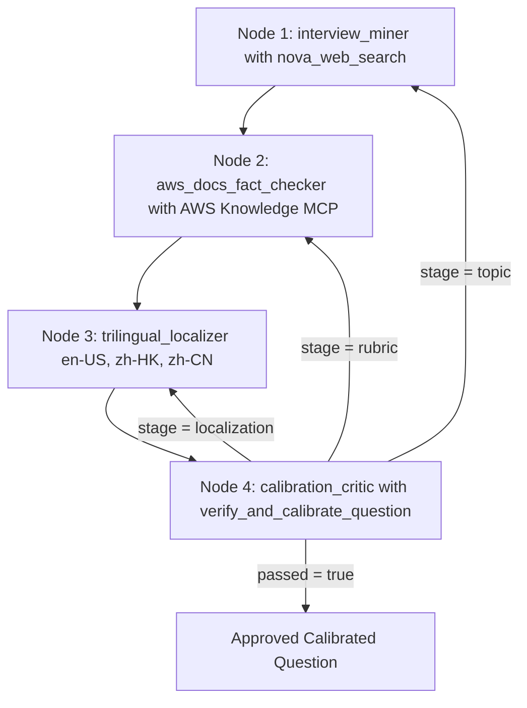

## The Legend of AWS Warrior V2 (Part 3 - Gen Question): Autonomous AWS Question Bank Generation with Loop Engineering, Strands Multi-Agent Graphs, Harness Plugins and Live OpenTelemetry Tracing

> **[INSERT COVER IMAGE: docs/images/aws_warrior_v2_blog_part3_cover.png — Blog Part 3 Cover Banner]**

**By Cyrus Wong**
*AWS AI Hero | AWS AI User Group Hong Kong Leader | Programme Leader of Higher Diploma in Cloud and Data Centre Administration (IT114115), Hong Kong Institute of Information Technology (HKIIT)*

> 3-Part Technical Blog Series: [Part 1 covers the Game and Pedagogy](https://github.com/wongcyrus/The-Legend-of-AWS-Warrior/blob/main/docs/blog/PART1_THE_GAME.md), [Part 2 covers the AWS Serverless and AgentCore Design](https://github.com/wongcyrus/The-Legend-of-AWS-Warrior/blob/main/docs/blog/PART2_AWS_DESIGN.md), and Part 3 covers Autonomous Question Generation with Loop Engineering and Strands Multi-Agent Graphs.

---

## 1. Introduction: Why Single-Pass Prompting Fails for Production Question Banks

In **[Part 1 - The Game](https://github.com/wongcyrus/The-Legend-of-AWS-Warrior/blob/main/docs/blog/PART1_THE_GAME.md)** and **[Part 2 - The AWS Design](https://github.com/wongcyrus/The-Legend-of-AWS-Warrior/blob/main/docs/blog/PART2_AWS_DESIGN.md)**, we established why **Architectural Q&A** in **The Legend of AWS Warrior V2** never improvises questions at runtime:

- Every Q&A session is backed by an approved question in DynamoDB (`PK = QUESTION_BANK`) containing trilingual prompts (`en-US`, `zh-HK`, `zh-CN`), 2-3 atomic concepts whose integer weights sum to `100`, known misconceptions, acceptable answers, and a reference answer.
- However, scaling and refreshing questions across **302 AWS service landmarks** faces three major hurdles:
  1. **Community Interview Questions Go Stale**: Popular online AWS interview questions often repeat outdated claims (such as claiming S3 is eventually consistent for new objects or unencrypted by default, when AWS enabled strong read-after-write consistency and default SSE-S3 / Block Public Access years ago).
  2. **Ungrounded Rubrics Fail Live Student Grading**: A rubric that looks reasonable on paper might be phrased too narrowly for our Two-Phase `NFKC` substring verifier (`gradeAnswer`), causing a genuinely good spoken English or Hong Kong Cantonese code-switched student answer to score below `80%`, or allowing a misconception answer to pass (`>= 60%`).
  3. **Multi-Slot Topic Duplication**: Asking an LLM to generate multiple questions for Amazon S3 or RDS naturally gravitates toward the exact same headline topic unless a deterministic semantic deduplicator forces it onto an orthogonal architectural scenario.

To solve all three autonomously, we built a self-calibrating **4-Agent Question Generator and Refresher** ([src/VoiceAgent/question-generator.mjs](https://github.com/wongcyrus/The-Legend-of-AWS-Warrior/blob/main/src/VoiceAgent/question-generator.mjs) and [src/VoicePractice/question-generator.mjs](https://github.com/wongcyrus/The-Legend-of-AWS-Warrior/blob/main/src/VoicePractice/question-generator.mjs)) powered by **Loop Engineering**, **`@strands-agents/harness` (`^0.3.3`)**, **`@strands-agents/sdk` (`^1.23.0`)**, **Amazon Nova Web Grounding (`nova_grounding`)**, the live **AWS Knowledge MCP Server (`https://knowledge-mcp.global.api.aws`)**, and **Native Strands OpenTelemetry (`@strands-agents/sdk/telemetry`)**.

---

## 2. The Loop Engineering Idea: Moving Beyond Imperative Retry Loops

A common misconception is that **Loop Engineering** simply means wrapping an LLM call inside an imperative `for` or `while` retry loop:

```javascript
// ANTI-PATTERN: Blind imperative retry loop (NOT Loop Engineering)
for (let attempt = 0; attempt < 3; attempt++) {
  const raw = await callModel(giantMonolithicPrompt);
  if (isValid(raw)) return raw; // Wipes memory on failure; re-runs Web Search & MCP from scratch!
}
```

Why does this anti-pattern fail in production?
1. **Stateless Amnesia**: When an attempt fails on localization or rubric weights, a blind `for` loop discards the entire conversation state and forces the model to re-run expensive web searches and AWS documentation reads from scratch.
2. **No Fault Isolation**: A single monolithic prompt cannot cleanly separate live web discovery, official documentation fact-checking, trilingual localization, and adversarial rubric calibration.
3. **Self-Grading by "Vibes"**: Asking the same LLM that wrote a question *"Is your question good?"* produces rubber-stamp approvals rather than deterministic verification against the actual production grading engine.

### The Three Layers of Modern AI Systems Engineering

In modern AI systems engineering, **Loop Engineering** sits above **Prompt Engineering** and **Context Engineering**:

| Engineering Layer | Core Question | Primary Focus | Strands Implementation in Our Pipeline |
| - | - | - | - |
| **1. Prompt Engineering** | *"What should we say to the model?"* | Role definitions, rules, and JSON output schemas for a single turn. | Specialist `systemPrompt` per node (`interview_miner`, `aws_docs_fact_checker`, `trilingual_localizer`, `calibration_critic`). |
| **2. Context Engineering** | *"What does the model need to know and access?"* | Curating workspace state, tools, prior questions, and context window limits. | `invocationState` (`targetMeta`, `avoidQuestions`), `McpClient`, `ContextOffloader` (`maxResultTokens: 2500`), and `preserveContext: true`. |
| **3. Loop Engineering** | *"How does the system autonomously perceive, act, verify, route feedback, and terminate?"* | Designing the closed-loop control system (**Perceive -> Reason -> Act -> Observe -> Verify -> Targeted Self-Correction or Terminate**) with deterministic verifiers and multi-layer turn bounds. | Inner agent ReAct + `GoalLoop` (`@strands-agents/sdk/vended-plugins/goal`) nested inside an outer cyclic Strands `Graph` with stage-classified conditional back-edges. |

### How Loop Engineering Maps to `@strands-agents/harness` and `@strands-agents/sdk`

Our implementation realizes **five core Loop Engineering principles** using native Strands primitives:

1. **Autonomous Tool-Calling Loops (`tool()` + `McpClient`)**: Specialist agents autonomously decide what to query via `nova_web_search` and `aws___search_documentation` / `aws___read_documentation`, inspect live citations, and perform multi-turn research before emitting a candidate.
2. **Intra-Node Self-Correction (`GoalLoop` + `ContextOffloader`)**: Every specialist agent runs inside a Strands Harness (`createHarness`) with a vended `GoalLoop` plugin that intercepts `AfterInvocationEvent`. If an agent outputs invalid JSON, `GoalLoop` feeds the parse error back into the agent's preserved conversation context and resumes the node immediately—without triggering an outer graph cycle.
3. **Deterministic Closed-Loop Verifiers (`verifyAndCalibrate`)**: Candidate questions must pass 5 deterministic code verifiers, including stopword-filtered Jaccard semantic anti-duplication (`findDuplicateOrOverlappingQuestion`) and 3x parallel live grading (`Promise.all` over `goodEn`, `goodZhHk`, and `wrongOutdated`) using our real production Strands grader (`createGraderAgent` + `gradeAnswer`).
4. **Fault-Isolated Graph Routing (`Graph` Conditional Back-Edges + `preserveContext: true`)**: When verification fails, `classifyFailureStage` classifies the defect as `"localization"`, `"rubric"`, or `"topic"`. The Strands `Graph` routes a structured `TextBlock` critique back to the **exact responsible node** (`trilingual_localizer`, `aws_docs_fact_checker`, or `interview_miner`), which repairs its output in-place using its preserved conversation history (`preserveContext: true`).
5. **Defense-in-Depth Turn Governance**: Hard turn caps at four independent layers (`limits: { turns: 1 }` on the grader, `maxAttempts: 2` on `GoalLoop`, `maxTurnsPerNode = 4` via `BeforeModelCallEvent`, and `maxAttempts = 3` / `maxSteps = 12` on `Graph`) guarantee termination.

---

## 3. Dual-Level Loop Architecture and Complete Strands Implementation

Our question generator ([src/VoiceAgent/question-generator.mjs](https://github.com/wongcyrus/The-Legend-of-AWS-Warrior/blob/main/src/VoiceAgent/question-generator.mjs)) implements **two nested levels** of native Strands loops:

> **[INSERT IMAGE: docs/images/aws_warrior_v2_strands_question_generator_diagram.png — AWS Strands Multi-Agent Question Generator and Dual-Level Loop Engineering]**



### 3.1 Grounding Tools: Amazon Nova Web Grounding (`tool()`) and AWS Knowledge MCP (`McpClient`)

We wire two live grounding mechanisms into Strands:
1. **`createNovaWebSearchTool`**: Wraps Amazon Bedrock's `ConverseCommand` with `systemTool: { name: "nova_grounding" }` inside a Strands `tool()`, extracting search queries and web citations from `citationsContent`.
2. **`loadAwsKnowledgeMcpTools`**: Uses Strands' native `McpClient.loadServers()` to connect to the live **AWS Knowledge MCP Server** (`https://knowledge-mcp.global.api.aws`) and filter for `aws___search_documentation` and `aws___read_documentation`.

```javascript
// src/VoiceAgent/question-generator.mjs
import { BedrockRuntimeClient, ConverseCommand } from "@aws-sdk/client-bedrock-runtime";
import { McpClient, tool } from "@strands-agents/sdk";

const defaultClient = new BedrockRuntimeClient({ maxAttempts: 3, retryMode: "adaptive" });

export function extractNovaGroundingResult(response) {
  const blocks = response?.output?.message?.content ?? [];
  const textParts = [], queries = [], citations = [];
  for (const block of blocks) {
    if (typeof block?.text === "string") textParts.push(block.text);
    if (block?.toolUse?.name === "nova_grounding" && block.toolUse.input?.query) {
      queries.push(String(block.toolUse.input.query));
    }
    for (const citation of block?.citationsContent?.citations ?? []) {
      const url = citation?.location?.web?.url;
      if (url) citations.push({ title: citation?.title ?? url, url });
    }
  }
  return { answer: textParts.join("").trim(), queries, citations };
}

export function createNovaWebSearchTool({
  send = command => defaultClient.send(command),
  modelId = process.env.VOICE_MODEL_ID ?? "us.amazon.nova-2-lite-v1:0",
} = {}) {
  return tool({
    name: "nova_web_search",
    description: "Search the live web using Amazon Nova Web Grounding (nova_grounding) for common AWS interview questions, community answers, and recent AWS service changes.",
    inputSchema: {
      type: "object",
      properties: { query: { type: "string", description: "Search query for AWS interview questions." } },
      required: ["query"],
    },
    callback: async input => {
      const query = String(input?.query ?? "").trim();
      if (!query) throw new Error("Search query is required");
      const response = await send(new ConverseCommand({
        modelId,
        messages: [{ role: "user", content: [{ text: query }] }],
        toolConfig: { tools: [{ systemTool: { name: "nova_grounding" } }] },
        inferenceConfig: { maxTokens: 1000, temperature: 0 },
      }));
      return extractNovaGroundingResult(response);
    },
  });
}

export async function loadAwsKnowledgeMcpTools({
  url = "https://knowledge-mcp.global.api.aws",
  allowed = ["aws___search_documentation", "aws___read_documentation"],
} = {}) {
  const [mcpClient] = await McpClient.loadServers({
    awsKnowledge: { url, toolFilters: { allowed } },
  });
  const tools = await mcpClient.listTools();
  return { tools, disconnect: () => mcpClient.disconnect() };
}
```

### 3.2 Level 1 (Inner Loop): Building Each Specialist Node with `createHarness`, `GoalLoop`, and `ContextOffloader`

Every specialist node is constructed by `createStrandsNodeAgent()`. Three Loop Engineering mechanisms work together inside each node:

1. **Intra-Node `GoalLoop` (`@strands-agents/sdk/vended-plugins/goal`)**: Evaluates `parseJsonFromText(text)` on the node's final response. If a model outputs malformed JSON, `GoalLoop` returns `{ passed: false, feedback: ... }` and resumes the agent in-place (`preserveContext: true`) up to `maxAttempts: 2`.
2. **`ContextOffloader` (`@strands-agents/sdk/vended-plugins/context-offloader`)**: Offloads MCP documentation reads larger than `2500` tokens into `InMemoryStorage` while keeping a `1000`-token preview in active context, preventing context overflow across multi-turn tool calls.
3. **Resumption-Aware Turn Cap (`BeforeInvocationEvent` + `BeforeModelCallEvent`)**: When `GoalLoop` resumes an agent after a JSON failure, `event.resumed` is `true`, so `turnsInCurrentInvocation` is **not** reset—ensuring tool calls and `GoalLoop` retries share a single hard ceiling (`boundedMaxTurns = 4`).

```javascript
// src/VoiceAgent/question-generator.mjs
import { createHarness } from "@strands-agents/harness";
import { BedrockModel, BeforeInvocationEvent, BeforeModelCallEvent } from "@strands-agents/sdk";
import { ContextOffloader, InMemoryStorage } from "@strands-agents/sdk/vended-plugins/context-offloader";
import { GoalLoop } from "@strands-agents/sdk/vended-plugins/goal";

async function createStrandsNodeAgent({
  id, description, systemPrompt, tools = [], send, modelId, maxTokens = 2200, maxTurns = 4, traceAttributes,
}) {
  const boundedMaxTurns = Math.min(10, Math.max(1, Math.trunc(Number(maxTurns) || 4)));
  const model = new BedrockModel({
    modelId, maxTokens, temperature: 0, stream: false,
    clientConfig: { maxAttempts: 3, retryMode: "adaptive" },
  });

  // 1. Intra-Node GoalLoop Plugin: Self-corrects malformed non-JSON output before graph handoff
  const jsonGoalLoop = new GoalLoop({
    name: `${id}:json-goal-loop`,
    maxAttempts: Math.min(2, boundedMaxTurns),
    preserveContext: true,
    goal: response => {
      const text = (response?.content ?? [])
        .map(block => (typeof block?.text === "string" ? block.text : ""))
        .join("\n").trim();
      try {
        parseJsonFromText(text);
        return { passed: true };
      } catch (error) {
        return {
          passed: false,
          feedback: `Output from ${id} was not valid JSON (${error.message}). Return ONLY valid JSON matching your node schema.`,
        };
      }
    },
  });

  // 2. ContextOffloader Plugin: Offloads large MCP documentation reads (>2500 tokens) to InMemoryStorage
  const plugins = [jsonGoalLoop];
  if (tools.length > 0) {
    plugins.unshift(new ContextOffloader({
      storage: new InMemoryStorage(),
      maxResultTokens: 2500,
      previewTokens: 1000,
      includeRetrievalTool: false,
    }));
  }

  // 3. Strands Harness with Large-Tool Offloading and Overflow Protection
  const agent = await createHarness({
    id, name: id, description, model, effort: "auto", caching: false,
    systemPrompt, tools, plugins, builtinTools: [], builtinPlugins: [],
    contextManager: { strategies: ["largeToolOffloading", "overflowProtection"], stash: false },
    session: false, memory: false, skills: false, backgroundTasks: false, printer: false, retryStrategy: null,
    ...(traceAttributes ? { traceAttributes } : {}),
  });

  // 4. Hard Inner Turn Cap (Default 4 turns, shared across tool calls and GoalLoop resumes)
  let turnsInCurrentInvocation = 0;
  agent.addHook(BeforeInvocationEvent, event => {
    if (!event?.resumed) turnsInCurrentInvocation = 0;
  });
  agent.addHook(BeforeModelCallEvent, () => {
    turnsInCurrentInvocation += 1;
    if (turnsInCurrentInvocation > boundedMaxTurns) {
      throw new Error(`Agent "${id}" exceeded maximum inner loop turns (${boundedMaxTurns})`);
    }
  });
  return agent;
}
```

### 3.3 The 4 Specialist Agents and Their Prompt Contracts

Each node in the Strands `Graph` has a single responsibility and strict JSON output schema:

<SimpleTabs>

<SimpleTab name="1. interview_miner">

```javascript
const interviewMiner = await createStrandsNodeAgent({
  id: "interview_miner",
  description: "Mines common real-world AWS interview questions using Amazon Nova web grounding.",
  modelId, send, tools: webSearchTool ? [webSearchTool] : [], maxTurns: boundedMaxTurnsPerNode, traceAttributes,
  systemPrompt: `You are Agent 1 (InterviewQuestionMinerAgent) in a Strands Multi-Agent AWS Question Bank pipeline.
1. Always call nova_web_search first to search for frequently asked interview questions for the target AWS service.
2. If avoidQuestions or previousAttemptCritique is present, pick a COMPLETELY DIFFERENT architectural scenario and unique candidateId.
3. Focus on practical scenario questions answerable orally in 20-45 seconds and flag suspectedOutdatedClaims.
4. Return ONLY valid JSON: { serviceId, candidateId, interviewTopic, commonQuestion, typicalCommunityAnswer, suspectedOutdatedClaims, webCitations }`,
});
```

</SimpleTab>

<SimpleTab name="2. aws_docs_fact_checker">

```javascript
const awsDocsFactChecker = await createStrandsNodeAgent({
  id: "aws_docs_fact_checker",
  description: "Audits interview questions and answers against official AWS documentation via AWS Knowledge MCP.",
  modelId, send, tools: activeDocTools, maxTurns: boundedMaxTurnsPerNode, traceAttributes,
  systemPrompt: `You are Agent 2 (AwsDocsFactCheckerAgent) in a Strands Multi-Agent AWS Question Bank pipeline.
1. Call aws___search_documentation (and aws___read_documentation) to verify current AWS behavior and security defaults.
2. If [node: calibration_critic] reported a rubric critique, fix concepts[], weights, misconceptions[], or prompt clarity.
3. Rewrite outdated premises to match official AWS docs and move outdated community myths into misconceptions[].
4. Design 2-3 atomic concepts[] whose integer weights sum strictly to 100. Never mention voice or pronunciation.
5. Return ONLY valid JSON: { id, serviceId, title, enPrompt, concepts: [{ id, description, weight }], misconceptions, acceptableAnswers, referenceAnswer, awsDocCitations }`,
});
```

</SimpleTab>

<SimpleTab name="3. trilingual_localizer">

```javascript
const trilingualLocalizer = await createStrandsNodeAgent({
  id: "trilingual_localizer",
  description: "Localizes AWS-verified questions into en-US, Hong Kong Cantonese (zh-HK), and Mandarin (zh-CN).",
  modelId, send, tools: [], maxTurns: boundedMaxTurnsPerNode, traceAttributes,
  systemPrompt: `You are Agent 3 (TrilingualLocalizationAgent) in a Strands Multi-Agent AWS Question Bank pipeline.
1. Resolve any localization critique from [node: calibration_critic] while keeping the verified rubric intact.
2. "en-US": Conversational English scenario prompt.
3. "zh-HK": Authentic spoken Hong Kong Cantonese (你嘅、點解、點樣、入面) with natural English AWS term code-switching.
4. "zh-CN": Natural Simplified Chinese Mandarin; NEVER use Cantonese characters (嘅, 喺, 唔, 畀, 佢, 哋, 乜, 啲, 揀, 嚟).
5. Return ONLY valid JSON matching the full question schema with prompts: { "en-US", "zh-HK", "zh-CN" }.`,
});
```

</SimpleTab>

<SimpleTab name="4. calibration_critic">

```javascript
const calibrationCritic = await createStrandsNodeAgent({
  id: "calibration_critic",
  description: "Generates 3 synthetic student transcripts and invokes verify_and_calibrate_question.",
  modelId, send, tools: [calibrationTool], maxTurns: boundedMaxTurnsPerNode, traceAttributes,
  systemPrompt: `You are Agent 4 (CalibrationCriticAgent) in a Strands Multi-Agent AWS Question Bank pipeline.
1. Construct three realistic 1-2 sentence spoken student transcripts:
   - "goodEn": Spoken English answer covering every concept in question.concepts[].
   - "goodZhHk": Spoken HK Cantonese + English code-switched answer covering every concept in question.concepts[].
   - "wrongOutdated": Plausible spoken answer stating question.misconceptions[0] and missing required concepts.
2. Call verify_and_calibrate_question with { question, syntheticTranscripts }. Refine transcripts if needed, or output the JSON so the Strands Graph routes rubric/topic/localization critiques back to the responsible node.`,
});
```

</SimpleTab>

</SimpleTabs>

### 3.4 Deterministic Verifiers, Semantic Deduplication, and `toolContext.invocationState`

The heart of **Loop Engineering** is replacing subjective LLM self-review with deterministic verification. When `calibration_critic` calls `verify_and_calibrate_question`, Strands passes `toolContext.invocationState` into the tool callback, running **five deterministic gates** in `verifyAndCalibrate()`:

1. **Gate 1 (`validateQuestion`)**: Enforces trilingual prompts, 2-3 concepts whose integer weights sum strictly to `100`, non-empty `misconceptions`, `acceptableAnswers`, and `referenceAnswer`.
2. **Gate 2 (`findDuplicateOrOverlappingQuestion`)**: Normalizes tokens via `NFKC`, strips stopwords and the service name, and computes **Jaccard token similarity** against `avoidQuestions`. Rejects `overlapping_prompt` (`>= 0.55`) and `overlapping_concepts` (`>= 0.60`).
3. **Gate 3 (`cantoneseOnlyChars`)**: Rejects `zh-CN` prompts containing Cantonese-only characters (`/[嘅喺唔畀佢哋乜啲揀嚟]/u`).
4. **Gate 4 (`forbiddenVoiceClaim`)**: Ensures no field mentions pronunciation, voice tone, or accent.
5. **Gate 5 (3x Parallel Live Grader Calibration)**: Invokes the production Strands grader (`grader` from `src/VoiceAgent/agent.mjs`, running with `limits: { turns: 1 }`) and our Two-Phase `NFKC` substring verifier (`gradeAnswer`) in parallel via `Promise.all`:
   - `goodEn` must pass with `score >= 80`.
   - `goodZhHk` (Cantonese + English code-switched) must pass with `score >= 80`.
   - `wrongOutdated` (stating `misconceptions[0]`) must fail with `score < 60`.

```javascript
// src/VoiceAgent/question-generator.mjs
export function findDuplicateOrOverlappingQuestion(question, avoidQuestions = [], avoidIds = []) {
  const blockedIds = new Set(avoidIds.map(id => String(id).trim()).filter(Boolean));
  if (blockedIds.has(question.id)) return { reason: "duplicate_id", matchId: question.id };
  const candidatePromptTokens = tokenizeTopicText(`${question.title ?? ""} ${question.prompts?.["en-US"] ?? ""}`, question.serviceId);
  const candidateConceptTokens = tokenizeTopicText((question.concepts ?? []).map(c => `${c.id} ${c.description}`).join(" "), question.serviceId);

  for (const rawExisting of avoidQuestions) {
    const existing = summarizeExistingQuestion(rawExisting);
    if (!existing) continue;
    if (existing.id === question.id) return { reason: "duplicate_id", matchId: existing.id, matchTitle: existing.title };
    const promptSim = jaccardSimilarity(candidatePromptTokens, tokenizeTopicText(`${existing.title} ${existing.enPrompt}`, question.serviceId));
    if (promptSim >= 0.55) return { reason: "overlapping_prompt", similarity: promptSim, matchId: existing.id, matchTitle: existing.title };
    const conceptSim = jaccardSimilarity(candidateConceptTokens, tokenizeTopicText(existing.concepts.join(" "), question.serviceId));
    if (conceptSim >= 0.6) return { reason: "overlapping_concepts", similarity: conceptSim, matchId: existing.id, matchTitle: existing.title };
  }
  return null;
}

export function classifyFailureStage(errorOrMessage) {
  const msg = String(errorOrMessage?.message ?? errorOrMessage ?? "");
  if (/already used|overlaps too closely|duplicate_|overlapping_|Question id is required/i.test(msg)) return "topic";
  if (/Mandarin prompt \(zh-CN\) contains Cantonese-only characters|Synthetic goodZhHk failed/i.test(msg)) return "localization";
  return "rubric";
}

// Inside verifyAndCalibrate(candidate, targetMeta): 3x Parallel Live Grader Calibration
const [enRaw, hkRaw, wrongRaw] = await Promise.all([
  grader({ operation: "grade_answer", language: "en-US", feedbackLanguage: "English", question: rubricFor("en-US"), transcript: transcripts.goodEn }),
  grader({ operation: "grade_answer", language: "zh-HK", feedbackLanguage: "Traditional Chinese (Cantonese)", question: rubricFor("zh-HK"), transcript: transcripts.goodZhHk }),
  grader({ operation: "grade_answer", language: "en-US", feedbackLanguage: "English", question: rubricFor("en-US"), transcript: transcripts.wrongOutdated }),
]);
const enGrade = gradeAnswer(enRaw, question, transcripts.goodEn);
if (!enGrade.passed || enGrade.score < 80) throw new Error(`Synthetic goodEn failed calibration (score=${enGrade.score}, expected >=80)`);
const hkGrade = gradeAnswer(hkRaw, question, transcripts.goodZhHk);
if (!hkGrade.passed || hkGrade.score < 80) throw new Error(`Synthetic goodZhHk failed calibration (score=${hkGrade.score}, expected >=80)`);
const wrongGrade = gradeAnswer(wrongRaw, question, transcripts.wrongOutdated);
if (wrongGrade.passed || wrongGrade.score >= 60) throw new Error(`Synthetic wrongOutdated passed unexpectedly (score=${wrongGrade.score}, expected <60)`);

// Strands Tool bridging inner agent execution with outer Graph invocationState
const calibrationTool = tool({
  name: "verify_and_calibrate_question",
  description: "Run schema validation, semantic duplicate detection, and 3-way live student grading.",
  inputSchema: {
    type: "object",
    properties: {
      question: { type: "object" },
      syntheticTranscripts: {
        type: "object",
        properties: { goodEn: { type: "string" }, goodZhHk: { type: "string" }, wrongOutdated: { type: "string" } },
        required: ["goodEn", "goodZhHk", "wrongOutdated"],
      },
    },
    required: ["question", "syntheticTranscripts"],
  },
  callback: async (input, toolContext) => {
    const state = toolContext?.invocationState ?? {};
    try {
      const verified = await verifyAndCalibrate(input, state.targetMeta);
      state.calibratedResult = verified;
      state.lastCritique = null;
      state.lastFailureStage = null;
      return { passed: true, questionId: verified.question.id, calibration: verified.calibration };
    } catch (error) {
      state.calibratedResult = null;
      state.lastCritique = error.message;
      state.lastFailureStage = classifyFailureStage(error);
      return { passed: false, failureStage: state.lastFailureStage, critique: error.message };
    }
  },
});
```

### 3.5 Level 2 (Outer Loop): Cyclic Strands `Graph` Engineering and Targeted Feedback Routing

Building a **cyclic multi-agent graph** in `@strands-agents/sdk` where `calibration_critic` conditionally routes execution back to `trilingual_localizer`, `aws_docs_fact_checker`, or `interview_miner` uses three key techniques in `buildGraph()`:

1. **Enabling Forward Progress in a Cyclic Graph (`BeforeMultiAgentInvocationEvent`)**: Because upstream nodes have incoming conditional back-edges from `calibration_critic`, a `BeforeMultiAgentInvocationEvent` hook marks `calibration_critic.status = Status.COMPLETED` when `results.length === 0` so forward edges fire on Cycle 1, while conditional back-edges check `lastNodeId === "calibration_critic"` and `invocationState.lastFailureStage`.
2. **Injecting Structured Critique into Stateful Node Memory (`evaluateCriticOutcome` + `TextBlock`)**: When verification fails, `evaluateCriticOutcome()` increments `invocationState.cycleCount` and appends a `new TextBlock(critiqueMessage)` (`{ previousAttemptCritique, failureStage, targetNode, cycle }`) to `lastCriticResult.content`. Because every node sets `preserveContext: true`, the target node receives this critique on top of its prior conversation history.
3. **Ephemeral Critique Cleanup (`BeforeNodeCallEvent`)**: Once the critique `TextBlock` is delivered to the target node, `BeforeNodeCallEvent` clears `lastCriticResult.content = []` so downstream nodes never receive stale critiques.

```javascript
// src/VoiceAgent/question-generator.mjs
const evaluateCriticOutcome = async state => {
  const criticResults = state.node("calibration_critic")?.results ?? [];
  const turnNumber = criticResults.length;
  if (invocationState.evaluatedCriticTurn === turnNumber) return;
  invocationState.evaluatedCriticTurn = turnNumber;

  if (!invocationState.calibratedResult) {
    const finalText = (state.node("calibration_critic")?.content ?? [])
      .map(block => (typeof block?.text === "string" ? block.text : "")).join("\n").trim();
    try {
      invocationState.calibratedResult = await verifyAndCalibrate(parseJsonFromText(finalText), invocationState.targetMeta);
      invocationState.lastCritique = null;
      invocationState.lastFailureStage = null;
    } catch (error) {
      invocationState.lastCritique = error.message;
      invocationState.lastFailureStage = classifyFailureStage(error);
    }
  }
  if (invocationState.calibratedResult) {
    invocationState.shouldRetry = false;
    return;
  }
  invocationState.cycleCount = (invocationState.cycleCount ?? 0) + 1;
  invocationState.lastFailureStage = invocationState.lastFailureStage ?? classifyFailureStage(invocationState.lastCritique);
  invocationState.shouldRetry = invocationState.cycleCount < boundedMaxAttempts;

  const targetByStage = { localization: "trilingual_localizer", rubric: "aws_docs_fact_checker", topic: "interview_miner" };
  const critiqueMessage = JSON.stringify({
    previousAttemptCritique: invocationState.lastCritique,
    failureStage: invocationState.lastFailureStage,
    targetNode: targetByStage[invocationState.lastFailureStage] ?? "interview_miner",
    cycle: invocationState.cycleCount,
  });
  const lastCriticResult = criticResults[criticResults.length - 1];
  if (lastCriticResult && Array.isArray(lastCriticResult.content)) {
    lastCriticResult.content.push(new TextBlock(critiqueMessage));
  }
};

const graph = new Graph({
  id: "aws-interview-question-pipeline",
  sources: ["interview_miner"],
  ...(traceAttributes ? { traceAttributes } : {}),
  nodes: [
    { agent: interviewMiner, preserveContext: true },
    { agent: awsDocsFactChecker, preserveContext: true },
    { agent: trilingualLocalizer, preserveContext: true },
    { agent: calibrationCritic, preserveContext: true },
  ],
  edges: [
    ["interview_miner", "aws_docs_fact_checker"],
    ["aws_docs_fact_checker", "trilingual_localizer"],
    ["trilingual_localizer", "calibration_critic"],
    {
      source: "calibration_critic",
      target: "trilingual_localizer",
      handler: async state => {
        const lastNodeId = state.results.at(-1)?.nodeId;
        if (lastNodeId === "aws_docs_fact_checker") return true;
        if (lastNodeId !== "calibration_critic") return false;
        await evaluateCriticOutcome(state);
        return Boolean(invocationState.shouldRetry && invocationState.lastFailureStage === "localization");
      },
    },
    {
      source: "calibration_critic",
      target: "aws_docs_fact_checker",
      handler: async state => {
        const lastNodeId = state.results.at(-1)?.nodeId;
        if (lastNodeId === "interview_miner") return true;
        if (lastNodeId !== "calibration_critic") return false;
        await evaluateCriticOutcome(state);
        return Boolean(invocationState.shouldRetry && invocationState.lastFailureStage === "rubric");
      },
    },
    {
      source: "calibration_critic",
      target: "interview_miner",
      handler: async state => {
        const lastNodeId = state.results.at(-1)?.nodeId;
        if (lastNodeId !== "calibration_critic") return false;
        await evaluateCriticOutcome(state);
        return Boolean(invocationState.shouldRetry && invocationState.lastFailureStage === "topic");
      },
    },
  ],
  maxConcurrency: 1,
  maxSteps: boundedMaxSteps,
});

graph.addHook(BeforeMultiAgentInvocationEvent, event => {
  const criticNodeState = event.state.node("calibration_critic");
  if (criticNodeState && criticNodeState.results.length === 0) {
    criticNodeState.status = Status.COMPLETED;
  }
});

graph.addHook(BeforeNodeCallEvent, event => {
  if (event.nodeId !== "calibration_critic") {
    const criticResults = event.state.node("calibration_critic")?.results ?? [];
    const lastCriticResult = criticResults[criticResults.length - 1];
    if (lastCriticResult?.content?.length > 0) lastCriticResult.content = [];
  }
});
```

### 3.6 Streaming Graph Execution (`graph.stream`) and Multi-Slot Batch Accumulation

To execute the pipeline and capture live telemetry, `generateOrRefreshQuestion()` consumes `graph.stream(taskPrompt, { invocationState })`, while `runQuestionBatchJob` ([src/VoicePractice/question-generator.mjs](https://github.com/wongcyrus/The-Legend-of-AWS-Warrior/blob/main/src/VoicePractice/question-generator.mjs)) feeds each newly approved question into `avoidQuestions` before starting the next slot:

```javascript
// 1. Streaming live Strands Graph events (src/VoiceAgent/question-generator.mjs)
const streamGen = graph.stream(taskPrompt, { invocationState });
for (let next = await streamGen.next(); !next.done; next = await streamGen.next()) {
  const event = next.value;
  if (event.type === "beforeNodeCallEvent") {
    inFlightByNode.set(event.nodeId, { stepIndex: ++stepCounter, nodeId: event.nodeId, toolCalls: [] });
  } else if (event.type === "multiAgentHandoffEvent") {
    const isLoopBack = event.source === "calibration_critic" && (event.targets ?? []).length > 0;
    handoffs.push({ source: event.source, targets: event.targets, isLoopBack, failureStage: isLoopBack ? invocationState.lastFailureStage : null });
  }
}

// 2. Accumulating avoidQuestions across multi-slot generation (src/VoicePractice/question-generator.mjs)
for (let i = 0; i < countPerService; i++) {
  const { question, trace } = await generator.generateOrRefreshQuestion({
    serviceId, label: meta.label, passage: meta.passage,
    avoidIds: [...existingIds],
    avoidQuestions: [...existingQuestionsById.values()],
    slotIndex: i + 1, status,
  });
  existingIds.add(question.id);
  existingQuestionsById.set(question.id, question);
  generatedForService.push(question);
}
```

### 3.7 Multi-Layer Maximum Turn Limits (Preventing Infinite Loops)

To guarantee that no agent or graph can ever enter an infinite loop, turn caps are enforced at **four independent layers**:

| Layer | Component | Bound | Enforcement Mechanism |
| - | - | - | - |
| **Layer 1** | Live Spoken Answer Grader (`src/VoiceAgent/agent.mjs`) | `limits: { turns: 1 }` | Passed directly to `strandsAgent.invoke(..., { limits: { turns: 1 } })` |
| **Layer 2** | Intra-Node JSON `GoalLoop` (`@strands-agents/sdk/vended-plugins/goal`) | `maxAttempts: 2` | Bounded `AfterInvocationEvent` JSON self-correction per node |
| **Layer 3** | Inner Specialist Agent ReAct Loop (`createStrandsNodeAgent`) | `maxTurnsPerNode = 4` (clamped `1..10`) | `BeforeInvocationEvent` + `BeforeModelCallEvent` hook throws if model calls exceed `boundedMaxTurns` |
| **Layer 4** | Outer Multi-Agent `Graph` (`aws-interview-question-pipeline`) | `maxAttempts = 3` / `maxSteps = 12` (clamped `4..40`) | Conditional back-edges require `cycleCount < boundedMaxAttempts` and `Graph` enforces `maxSteps` |

---

## 4. Native Strands Observability and Live UI Tracing in Jaeger

Instead of writing custom trace wrappers, we rely on **Strands' native OpenTelemetry instrumentation** (`@strands-agents/sdk/telemetry` `setupTracer` + `@strands-agents/harness` `OTEL_TRACES_EXPORTER=otlp`), flushing all spans via `await tracerProvider.forceFlush()` when `generateOrRefreshQuestion` completes:

```javascript
let tracerProvider = null;

export async function enableStrandsTelemetry({
  otlp = Boolean(process.env.OTEL_EXPORTER_OTLP_ENDPOINT || process.env.OTEL_EXPORTER_OTLP_TRACES_ENDPOINT || process.env.LANGFUSE_BASE_URL),
  console: consoleExporter = process.env.STRANDS_TRACE_CONSOLE === "1",
} = {}) {
  if (tracerProvider) return true;
  if (!otlp && !consoleExporter) return false;
  const telemetry = await import("@strands-agents/sdk/telemetry");
  tracerProvider = telemetry.setupTracer({ exporters: { otlp, console: consoleExporter } });
  return true;
}
```

### 4.1 Running a Live Single-Service (`s3`) Generation with Jaeger UI Tracing

```bash
# 1. Start the Official Jaeger All-in-One OTLP Collector and Web UI
docker run -d --rm --name strands-jaeger \
  -e COLLECTOR_OTLP_ENABLED=true \
  -p 16686:16686 -p 4317:4317 -p 4318:4318 \
  jaegertracing/all-in-one:latest

# 2. Run Single-Service s3 Generation with Strands OTLP Export
OTEL_TRACES_EXPORTER=otlp \
OTEL_EXPORTER_OTLP_ENDPOINT=http://localhost:4318 \
OTEL_SERVICE_NAME=aws-warrior-question-generator \
node src/VoicePractice/question-bank.mjs generate \
  /tmp/s3-single-question.json s3 \
  --count=1 --no-publish --force --otel --trace-console \
  --trace-json=/tmp/s3-single-trace.json
```

### 4.2 Inspecting the 41 Live OpenTelemetry Spans in Jaeger (`http://localhost:16686`)

Opening `http://localhost:16686` reveals the complete **41-span trace hierarchy** (`traceId: ca1e8feaead2c97eb97c5f3380747da7`, duration `34.29s`, `35,711` total tokens across `us.amazon.nova-2-lite-v1:0`):

> **[INSERT IMAGE: docs/images/strands_otel_jaeger_trace_s3.png — Live Strands OpenTelemetry 41-Span Trace Waterfall in Jaeger UI]**

Clicking into the root `invoke_graph aws-interview-question-pipeline` span displays Strands' native GenAI OpenTelemetry tags (`aws.service.id: s3`, `gen_ai.agent.execution_time: 34287`, `gen_ai.agent.input` with `avoidQuestions`, `service.namespace: strands`, and token usage):

> **[INSERT IMAGE: docs/images/strands_otel_jaeger_spans_detail_s3.png — Expanded Strands GenAI Span Attributes in Jaeger UI]**

```
invoke_graph aws-interview-question-pipeline (34,286.7ms | 35,711 tokens)
├── node interview_miner (7,934.9ms)
│   └── invoke_agent interview_miner (7,931.2ms)
│       ├── execute_agent_loop_cycle cycle-1 (6,065.8ms)
│       │   ├── chat us.amazon.nova-2-lite-v1:0 (1,227.4ms)
│       │   └── execute_tool nova_web_search (4,833.2ms)
│       └── execute_agent_loop_cycle cycle-2 (1,864.2ms)
├── node aws_docs_fact_checker (12,997.6ms)
│   └── invoke_agent aws_docs_fact_checker (12,996.5ms)
│       ├── execute_agent_loop_cycle cycle-1 -> aws___search_documentation (1,718.1ms)
│       ├── execute_agent_loop_cycle cycle-2 -> 2x aws___read_documentation (2,553.6ms)
│       └── execute_agent_loop_cycle cycle-3 (2,115.1ms)
├── node trilingual_localizer (3,414.3ms)
│   └── invoke_agent trilingual_localizer (3,412.8ms)
└── node calibration_critic (9,937.3ms)
    └── invoke_agent calibration_critic (9,936.3ms)
        ├── execute_agent_loop_cycle cycle-1 (6,544.2ms)
        │   └── execute_tool verify_and_calibrate_question (2,007.5ms)
        │       ├── invoke_agent Strands Agent [goodEn -> 100/100] (2,001.8ms)
        │       ├── invoke_agent Strands Agent [goodZhHk -> 100/100] (1,706.8ms)
        │       └── invoke_agent Strands Agent [wrongOutdated -> 50/100] (1,742.7ms)
        └── execute_agent_loop_cycle cycle-2 (3,392.1ms)
```

### 4.3 The Resulting Calibrated S3 Question (`s3-lifecycle-optimization`)

Because the two baseline S3 questions (`private-screenshots` and `asset-storage`) were passed in `avoidQuestions`, `interview_miner` automatically selected **S3 Lifecycle Cost Optimization**, verified its storage class transitions against official AWS documentation via MCP, localized it into `en-US`, `zh-HK`, and `zh-CN`, and calibrated it against the live grader (`goodEnScore: 100`, `goodZhHkScore: 100`, `wrongOutdatedScore: 50`):

```json
{
  "id": "s3-lifecycle-optimization",
  "serviceId": "s3",
  "version": 1,
  "status": "approved",
  "title": "S3 lifecycle cost optimization",
  "prompts": {
    "en-US": "Your application stores user-generated content in Amazon S3 and needs to reduce storage costs while maintaining quick access to recently used files. How would you configure S3 lifecycle policies to achieve this?",
    "zh-HK": "你嘅應用程序將用戶產生嘅內容儲存喺 Amazon S3，而需要減少儲存成本，同時保持近期使用嘅文件快速存取。你點樣設定 S3 生命週期策略嚟達到呢個目標？",
    "zh-CN": "您的应用程序将用户生成的内容存储在 Amazon S3 中，需要降低存储成本，同时保持最近使用文件的快速访问。您将如何配置 S3 生命周期策略来实现这一目标？"
  },
  "concepts": [
    {
      "id": "lifecycle-transition-rules",
      "description": "Create lifecycle rules that transition objects to lower-cost storage classes like S3 Standard-IA, S3 One Zone-IA, or S3 Glacier after a defined period of inactivity, balancing cost savings with access performance requirements.",
      "weight": 50
    },
    {
      "id": "storage-class-selection",
      "description": "Select appropriate storage classes based on access patterns: S3 Standard for frequently accessed data, S3 Standard-IA for infrequent access with lower costs, and S3 Glacier for long-term archival with retrieval fees and time constraints.",
      "weight": 30
    },
    {
      "id": "rule-scope-and-prefixes",
      "description": "Define precise prefixes or tags in lifecycle rules to target specific object sets, avoiding unintended transitions and ensuring only appropriate data moves to lower-cost tiers.",
      "weight": 20
    }
  ]
}
```

---

## 5. Series Conclusion and Key Takeaways

Across this 3-part series on **The Legend of AWS Warrior V2**, we showed how modern cloud education and generative AI engineering reinforce one another:

1. **[Part 1 - The Game](https://github.com/wongcyrus/The-Legend-of-AWS-Warrior/blob/main/docs/blog/PART1_THE_GAME.md)**: Turning trilingual AWS oral interview practice into the Magic Power (MP) source for **19 Anime x AWS Cloud Arts** in a 4-region Three.js 3D Action RPG—paired with **Mobile QR-Code Wireless Microphone Handoff** for mic-less lab PCs—defeats the "Copy-to-AI, Paste-Back" reflex and makes students want to practice speaking cloud architecture aloud.
2. **[Part 2 - The AWS Design](https://github.com/wongcyrus/The-Legend-of-AWS-Warrior/blob/main/docs/blog/PART2_AWS_DESIGN.md)**: Placing a **Zero-Trust Referee Lambda** in front of an IAM-isolated **Amazon Bedrock AgentCore Runtime** (`@strands-agents/harness` + `BedrockModel`), backed by **Two-Phase `NFKC` Verbatim Substring Verification** and **Single-Table DynamoDB Transactions**, eliminates hallucinated evidence, score drift, and prompt-injection reward theft.
3. **Part 3 - Gen Question**: Applying **Dual-Level Loop Engineering** with `@strands-agents/harness` (`createHarness`, `GoalLoop`, `ContextOffloader`), `@strands-agents/sdk` (`Graph`, `McpClient`, `tool`, `invocationState`), **Amazon Nova Web Grounding**, the **AWS Knowledge MCP Server**, and **Native Strands OpenTelemetry Tracing** lets educators autonomously scale and refresh a 100% documentation-grounded, live-calibrated question bank across all 302 AWS services.
