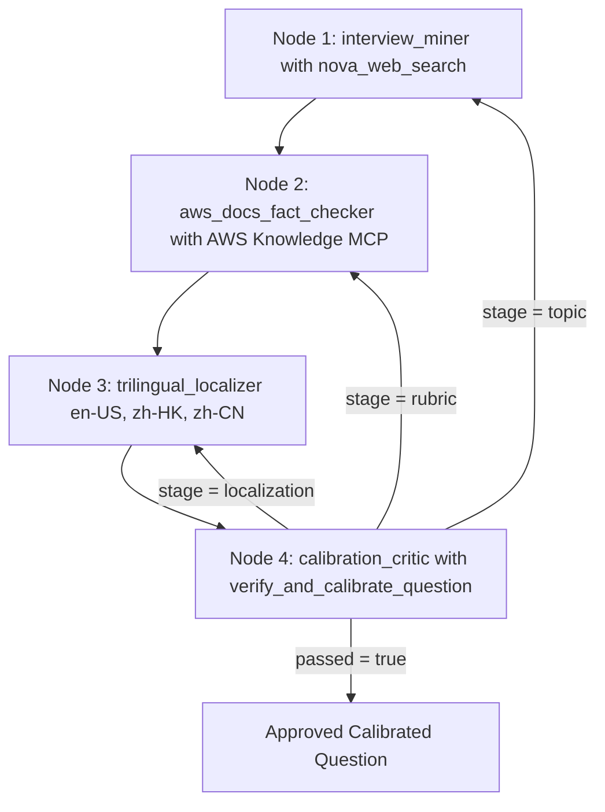

## The Legend of AWS Warrior V2 (Part 3 - Gen Question): Autonomous AWS Question Bank Generation with Loop Engineering, Strands Multi-Agent Graphs, Harness Plugins and Live OpenTelemetry Tracing

**By Cyrus Wong**
*AWS AI Hero | AWS AI User Group Hong Kong Leader | Programme Leader of Higher Diploma in Cloud and Data Centre Administration (IT114115), Hong Kong Institute of Information Technology (HKIIT)*

> 3-Part Technical Blog Series: [Part 1 covers the Game and Pedagogy](https://github.com/wongcyrus/The-Legend-of-AWS-Warrior/blob/main/docs/blog/PART1_THE_GAME.md), [Part 2 covers the AWS Serverless and AgentCore Design](https://github.com/wongcyrus/The-Legend-of-AWS-Warrior/blob/main/docs/blog/PART2_AWS_DESIGN.md), and Part 3 covers Autonomous Question Generation with Loop Engineering and Strands Multi-Agent Graphs.

---

## 1. Introduction: Why Single-Pass Prompting Fails for Production Question Banks

In **[Part 1 - The Game](https://github.com/wongcyrus/The-Legend-of-AWS-Warrior/blob/main/docs/blog/PART1_THE_GAME.md)** and **[Part 2 - The AWS Design](https://github.com/wongcyrus/The-Legend-of-AWS-Warrior/blob/main/docs/blog/PART2_AWS_DESIGN.md)**, we established why **Architectural Q&A** in **The Legend of AWS Warrior V2** never improvises questions at runtime:

- Every Q&A session is strictly backed by a predefined, `status: approved` question in DynamoDB (`PK = QUESTION_BANK`) containing trilingual prompts (`en-US`, `zh-HK`, `zh-CN`), 2-3 atomic concepts whose integer weights sum to `100`, known misconceptions, acceptable answers, and a reference answer.
- However, manually writing, translating, and calibrating questions across **302 AWS service landmarks**—and keeping them accurate as AWS evolves—faces three major hurdles:
  1. **Community Interview Questions Frequently Go Stale**: Popular online AWS interview questions often repeat outdated claims (such as claiming S3 buckets are eventually consistent for new objects, or that S3 buckets are unencrypted by default, when AWS enabled strong read-after-write consistency and default SSE-S3 / Block Public Access years ago).
  2. **Ungrounded Rubrics Fail Live Student Grading**: A rubric that looks reasonable on paper might be phrased too narrowly for our Two-Phase `NFKC` substring verifier (`gradeAnswer`), causing a genuinely good spoken English or Hong Kong Cantonese code-switched student answer to score below `80%`, or allowing a misconception answer to pass (`60%` or higher).
  3. **Multi-Slot Topic Duplication**: If you ask an LLM to generate 2 or 3 questions for Amazon S3 or Amazon RDS, it naturally gravitates toward the exact same headline topic unless a deterministic semantic deduplicator forces it onto an orthogonal architectural scenario.

To solve all three without human bottleneck, we built an autonomous, self-calibrating **4-Agent Question Generator and Refresher** ([src/VoiceAgent/question-generator.mjs](https://github.com/wongcyrus/The-Legend-of-AWS-Warrior/blob/main/src/VoiceAgent/question-generator.mjs) and [src/VoicePractice/question-generator.mjs](https://github.com/wongcyrus/The-Legend-of-AWS-Warrior/blob/main/src/VoicePractice/question-generator.mjs)) powered by **Loop Engineering**, **`@strands-agents/harness` (`^0.3.3`)**, **`@strands-agents/sdk` (`^1.23.0`)**, **Amazon Nova Web Grounding (`nova_grounding`)**, the live **AWS Knowledge MCP Server (`https://knowledge-mcp.global.api.aws`)**, and **Native Strands OpenTelemetry (`@strands-agents/sdk/telemetry`)**.

---

## 2. The Loop Engineering Idea: Moving Beyond Imperative Retry Loops

A common misconception is that **Loop Engineering** simply means wrapping an LLM API call inside an imperative `for` or `while` retry loop in application code:

```javascript
// ANTI-PATTERN: Blind imperative retry loop (NOT Loop Engineering)
for (let attempt = 0; attempt < 3; attempt++) {
  const raw = await callModel(giantMonolithicPrompt);
  if (isValid(raw)) return raw; // Wipes memory on failure; re-runs Web Search & MCP from scratch!
}
```

Why does this anti-pattern fail in production?
1. **Stateless Amnesia**: When an attempt fails on step 4 (for example, a Cantonese localization issue or a rubric weight mismatch), a blind `for` loop discards the entire conversation state and forces the model to re-run expensive web searches and AWS documentation reads from scratch.
2. **No Fault Isolation**: A single monolithic prompt cannot cleanly separate live web discovery, official documentation fact-checking, trilingual localization, and adversarial rubric calibration.
3. **Self-Grading by "Vibes"**: Asking the same LLM that wrote a question *"Is your question good?"* produces rubber-stamp approvals rather than deterministic verification against the actual production grading engine.

### The Three Layers of Modern AI Systems Engineering

In modern AI systems engineering, **Loop Engineering** is the third foundational discipline above **Prompt Engineering** and **Context Engineering**:

| Engineering Layer | Core Question | Primary Focus | Strands Implementation in Our Pipeline |
| - | - | - | - |
| **1. Prompt Engineering** | *"What should we say to the model?"* | Role definitions, rules, and JSON output schemas for a single turn. | Specialist `systemPrompt` per node (`interview_miner`, `aws_docs_fact_checker`, `trilingual_localizer`, `calibration_critic`). |
| **2. Context Engineering** | *"What does the model need to know and access?"* | Curating workspace state, tools, prior questions, and context window limits. | `invocationState` (`targetMeta`, `avoidQuestions`), `McpClient`, `ContextOffloader` (`maxResultTokens: 2500`), and `preserveContext: true`. |
| **3. Loop Engineering** | *"How does the system autonomously perceive, act, verify, route feedback, and terminate?"* | Designing the closed-loop control system (**Perceive -> Reason -> Act -> Observe -> Verify -> Targeted Self-Correction or Terminate**) with deterministic verifiers and multi-layer turn bounds. | Inner agent ReAct + `GoalLoop` (`@strands-agents/sdk/vended-plugins/goal`) nested inside an outer cyclic Strands `Graph` with stage-classified conditional back-edges. |

### How Loop Engineering Maps to `@strands-agents/harness` and `@strands-agents/sdk`

Our implementation realizes **five core Loop Engineering principles** using native Strands primitives:

1. **Autonomous Tool-Calling Loops (`tool()` + `McpClient`)**: Specialist agents autonomously decide what to query via `nova_web_search` and `aws___search_documentation` / `aws___read_documentation`, inspect live citations, and perform multi-turn research before emitting a candidate.
2. **Intra-Node Self-Correction (`GoalLoop` + `ContextOffloader`)**: Every specialist agent runs inside a Strands Harness (`createHarness`) with a vended `GoalLoop` plugin that intercepts `AfterInvocationEvent`. If an agent outputs invalid JSON, `GoalLoop` feeds the parse error back into the agent's preserved conversation context and resumes the node immediately—without triggering an outer graph cycle.
3. **Deterministic Closed-Loop Verifiers (`verifyAndCalibrate`)**: Candidate questions are never approved by LLM opinion. They must pass 5 deterministic code verifiers, including stopword-filtered Jaccard semantic anti-duplication (`findDuplicateOrOverlappingQuestion`) and 3x parallel live grading (`Promise.all` over `goodEn`, `goodZhHk`, and `wrongOutdated`) using our real production Strands grader (`createGraderAgent` + `gradeAnswer`).
4. **Fault-Isolated Graph Routing (`Graph` Conditional Back-Edges + `preserveContext: true`)**: When verification fails, `classifyFailureStage` classifies the defect as `"localization"`, `"rubric"`, or `"topic"`. The Strands `Graph` routes a structured `TextBlock` critique back to the **exact responsible node** (`trilingual_localizer`, `aws_docs_fact_checker`, or `interview_miner`), which repairs its output in-place using its preserved conversation history (`preserveContext: true`).
5. **Defense-in-Depth Turn Governance**: Hard turn caps at four independent layers (`limits: { turns: 1 }` on the grader, `maxAttempts: 2` on `GoalLoop`, `maxTurnsPerNode = 4` via `BeforeModelCallEvent`, and `maxAttempts = 3` / `maxSteps = 12` on `Graph`) mathematically guarantee termination.

---

## 3. Dual-Level Loop Architecture and Complete Strands Implementation

Our question generator ([src/VoiceAgent/question-generator.mjs](https://github.com/wongcyrus/The-Legend-of-AWS-Warrior/blob/main/src/VoiceAgent/question-generator.mjs)) implements **two nested levels** of native Strands loops:

> **[INSERT IMAGE: docs/images/aws_warrior_v2_strands_question_generator_diagram.png — AWS Strands Multi-Agent Question Generator and Dual-Level Loop Engineering]**



### 3.1 Grounding Tools: Amazon Nova Web Grounding (`tool()`) and AWS Knowledge MCP (`McpClient`)

To ground the pipeline in both real-world interview practice and official AWS documentation, we wire two external grounding mechanisms into Strands:

1. **`createNovaWebSearchTool`**: Uses the Strands `tool()` helper to wrap Amazon Bedrock's `ConverseCommand` with `systemTool: { name: "nova_grounding" }`, extracting live search queries and web citations from `citationsContent`.
2. **`loadAwsKnowledgeMcpTools`**: Uses Strands' native `McpClient.loadServers()` to connect directly to the live **AWS Knowledge MCP Server** (`https://knowledge-mcp.global.api.aws`) and filter for `aws___search_documentation` and `aws___read_documentation`.

```javascript
// src/VoiceAgent/question-generator.mjs
import { BedrockRuntimeClient, ConverseCommand } from "@aws-sdk/client-bedrock-runtime";
import { McpClient, tool } from "@strands-agents/sdk";

const defaultClient = new BedrockRuntimeClient({ maxAttempts: 3, retryMode: "adaptive" });

export function extractNovaGroundingResult(response) {
  const blocks = response?.output?.message?.content ?? [];
  const textParts = [];
  const queries = [];
  const citations = [];
  for (const block of blocks) {
    if (typeof block?.text === "string") textParts.push(block.text);
    if (block?.toolUse?.name === "nova_grounding" && block.toolUse.input?.query) {
      queries.push(String(block.toolUse.input.query));
    }
    for (const citation of block?.citationsContent?.citations ?? []) {
      const url = citation?.location?.web?.url;
      if (url) citations.push({ title: citation?.title ?? url, url });
    }
  }
  return {
    answer: textParts.join("").trim(),
    queries,
    citations,
  };
}

export function createNovaWebSearchTool({
  send = command => defaultClient.send(command),
  modelId = process.env.VOICE_MODEL_ID ?? "us.amazon.nova-2-lite-v1:0",
} = {}) {
  return tool({
    name: "nova_web_search",
    description: "Search the live web using Amazon Nova Web Grounding (nova_grounding) for common AWS interview questions, community answers, and recent AWS service changes.",
    inputSchema: {
      type: "object",
      properties: {
        query: {
          type: "string",
          description: "Search query for AWS interview questions or recent AWS service changes.",
        },
      },
      required: ["query"],
    },
    callback: async input => {
      const query = String(input?.query ?? "").trim();
      if (!query) throw new Error("Search query is required");
      const response = await send(new ConverseCommand({
        modelId,
        messages: [{ role: "user", content: [{ text: query }] }],
        toolConfig: { tools: [{ systemTool: { name: "nova_grounding" } }] },
        inferenceConfig: { maxTokens: 1000, temperature: 0 },
      }));
      return extractNovaGroundingResult(response);
    },
  });
}

export async function loadAwsKnowledgeMcpTools({
  url = "https://knowledge-mcp.global.api.aws",
  allowed = ["aws___search_documentation", "aws___read_documentation"],
} = {}) {
  const [mcpClient] = await McpClient.loadServers({
    awsKnowledge: {
      url,
      toolFilters: { allowed },
    },
  });
  const tools = await mcpClient.listTools();
  return {
    tools,
    disconnect: () => mcpClient.disconnect(),
  };
}
```

### 3.2 Level 1 (Inner Loop): Building Each Specialist Node with `createHarness`, `GoalLoop`, and `ContextOffloader`

Every specialist node in the pipeline is created by `createStrandsNodeAgent()`. Notice how three Loop Engineering mechanisms work together inside each node:

1. **Intra-Node `GoalLoop` (`@strands-agents/sdk/vended-plugins/goal`)**: Evaluates `parseJsonFromText(text)` on the node's final response. If a model accidentally wraps its response in conversational prose without valid JSON, `GoalLoop` returns `{ passed: false, feedback: ... }` and resumes the agent in-place (`preserveContext: true`) up to `maxAttempts: 2`.
2. **`ContextOffloader` (`@strands-agents/sdk/vended-plugins/context-offloader`)**: Official AWS documentation pages fetched via `aws___read_documentation` can easily exceed several thousand tokens. `ContextOffloader` automatically offloads tool results larger than `2500` tokens into `InMemoryStorage` while keeping a `1000`-token preview in active context, preventing context overflow across multi-turn tool calls.
3. **Resumption-Aware Turn Cap (`BeforeInvocationEvent` + `BeforeModelCallEvent`)**: Notice `if (!event?.resumed) turnsInCurrentInvocation = 0;`. When `GoalLoop` resumes an agent after a JSON failure, `event.resumed` is `true`, so the turn counter is **not** reset—ensuring that tool calls and `GoalLoop` retries share a single hard ceiling (`boundedMaxTurns = 4`).

```javascript
// src/VoiceAgent/question-generator.mjs
import { createHarness } from "@strands-agents/harness";
import { BedrockModel, BeforeInvocationEvent, BeforeModelCallEvent } from "@strands-agents/sdk";
import { ContextOffloader, InMemoryStorage } from "@strands-agents/sdk/vended-plugins/context-offloader";
import { GoalLoop } from "@strands-agents/sdk/vended-plugins/goal";

async function createStrandsNodeAgent({
  id,
  description,
  systemPrompt,
  tools = [],
  send,
  modelId,
  maxTokens = 2200,
  maxTurns = 4,
  traceAttributes,
}) {
  const boundedMaxTurns = Math.min(10, Math.max(1, Math.trunc(Number(maxTurns) || 4)));
  const model = new BedrockModel({
    modelId,
    maxTokens,
    temperature: 0,
    stream: false,
    clientConfig: { maxAttempts: 3, retryMode: "adaptive" },
  });

  // 1. Intra-Node GoalLoop Plugin: Self-corrects malformed non-JSON output before graph handoff
  const jsonGoalLoop = new GoalLoop({
    name: `${id}:json-goal-loop`,
    maxAttempts: Math.min(2, boundedMaxTurns),
    preserveContext: true,
    goal: response => {
      const text = (response?.content ?? [])
        .map(block => (typeof block?.text === "string" ? block.text : ""))
        .join("\n")
        .trim();
      try {
        parseJsonFromText(text);
        return { passed: true };
      } catch (error) {
        return {
          passed: false,
          feedback: `Output from ${id} was not valid JSON (${error.message}). Return ONLY valid JSON matching your node schema.`,
        };
      }
    },
  });

  // 2. ContextOffloader Plugin: Offloads large MCP documentation reads (>2500 tokens) to InMemoryStorage
  const plugins = [jsonGoalLoop];
  let contextOffloader = null;
  if (tools.length > 0) {
    contextOffloader = new ContextOffloader({
      storage: new InMemoryStorage(),
      maxResultTokens: 2500,
      previewTokens: 1000,
      includeRetrievalTool: false,
    });
    plugins.unshift(contextOffloader);
  }

  // 3. Strands Harness with Large-Tool Offloading and Overflow Protection
  const agent = await createHarness({
    id,
    name: id,
    description,
    model,
    effort: "auto",
    caching: false,
    systemPrompt,
    tools,
    plugins,
    builtinTools: [],
    builtinPlugins: [],
    contextManager: {
      strategies: ["largeToolOffloading", "overflowProtection"],
      stash: false,
    },
    session: false,
    memory: false,
    skills: false,
    backgroundTasks: false,
    printer: false,
    retryStrategy: null,
    ...(traceAttributes ? { traceAttributes } : {}),
  });

  agent.goalLoop = jsonGoalLoop;
  agent.contextOffloader = contextOffloader;

  // 4. Hard Inner Turn Cap (Default 4 turns, shared across tool calls and GoalLoop resumes)
  let turnsInCurrentInvocation = 0;
  agent.addHook(BeforeInvocationEvent, event => {
    if (!event?.resumed) {
      turnsInCurrentInvocation = 0;
    }
  });
  agent.addHook(BeforeModelCallEvent, () => {
    turnsInCurrentInvocation += 1;
    if (turnsInCurrentInvocation > boundedMaxTurns) {
      throw new Error(`Agent "${id}" exceeded maximum inner loop turns (${boundedMaxTurns})`);
    }
  });
  return agent;
}
```

### 3.3 The 4 Specialist Agents and Their Prompt Contracts

Each node in the Strands `Graph` has a single, sharply defined responsibility and JSON contract:

<SimpleTabs>

<SimpleTab name="1. interview_miner">

```javascript
const interviewMiner = await createStrandsNodeAgent({
  id: "interview_miner",
  description: "Mines the most common real-world AWS interview questions using Amazon Nova web grounding.",
  modelId,
  send,
  tools: webSearchTool ? [webSearchTool] : [],
  maxTurns: boundedMaxTurnsPerNode,
  traceAttributes,
  systemPrompt: `You are Agent 1 (InterviewQuestionMinerAgent) in a Strands Multi-Agent AWS Question Bank pipeline.
Your job is to find the most common, practical cloud engineering interview question for the requested AWS service (or audit an existing question if supplied).
1. Always call the nova_web_search tool first to search for the most frequently asked interview questions and typical candidate answers for the target AWS service.
2. If avoidQuestions or avoidQuestionIds is non-empty, or if [node: calibration_critic] reported a previousAttemptCritique, you MUST pick a COMPLETELY DIFFERENT interview question topic, architectural scenario, and AWS capability/feature that does NOT overlap in prompt or grading concepts with any entry in avoidQuestions, and choose a unique candidateId not in avoidQuestionIds.
3. Focus on practical, foundational scenario-based interview questions that a student can answer orally in 20-45 seconds (explaining WHY and HOW, not memorizing obscure quotas).
4. Identify any parts of the popular interview question or traditional candidate answer that might be outdated due to AWS updates.
5. Return ONLY valid JSON:
{
  "serviceId": "...",
  "candidateId": "short-kebab-case-id",
  "interviewTopic": "...",
  "commonQuestion": "...",
  "typicalCommunityAnswer": "...",
  "suspectedOutdatedClaims": ["..."],
  "webCitations": ["..."]
}`,
});
```

</SimpleTab>

<SimpleTab name="2. aws_docs_fact_checker">

```javascript
const awsDocsFactChecker = await createStrandsNodeAgent({
  id: "aws_docs_fact_checker",
  description: "Audits interview questions and answers against official AWS documentation via AWS Knowledge MCP.",
  modelId,
  send,
  tools: activeDocTools,
  maxTurns: boundedMaxTurnsPerNode,
  traceAttributes,
  systemPrompt: `You are Agent 2 (AwsDocsFactCheckerAgent) in a Strands Multi-Agent AWS Question Bank pipeline.
You receive the mined interview question from [node: interview_miner] (and, if a rubric calibration retry occurred, a targeted previousAttemptCritique from [node: calibration_critic]).
Your job is to verify BOTH the question premise and the answer against official AWS documentation using your documentation search tools (such as aws___search_documentation).
1. Call aws___search_documentation to verify current AWS behavior, security defaults, and best practices for this service and topic.
2. If [node: calibration_critic] reported a rubric or grading calibration critique, fix the concepts[], weights, misconceptions[], or prompt clarity to resolve that exact critique.
3. If the mined interview question premise or traditional answer is outdated, rewrite the question and rubric so they are 100% accurate according to current official AWS documentation.
4. Ensure the id, title, enPrompt, and concepts[] do NOT duplicate or overlap with any existing question listed in avoidQuestions or avoidQuestionIds.
5. Place any outdated community belief or common mistake into misconceptions[] (1-3 concise strings).
6. Design 2 or 3 atomic grading concepts in concepts[] whose integer weights MUST sum strictly to 100 (e.g. 60 + 40, or 50 + 50, or 40 + 35 + 25).
7. Each concept description must describe a clear architectural idea in plain English that a student can express in their own spoken words.
8. Never mention voice, pronunciation, accent, or speaking tone anywhere.
9. Return ONLY valid JSON:
{
  "id": "kebab-case-question-id",
  "serviceId": "...",
  "title": "Concise 3-6 word title",
  "enPrompt": "Practical 1-2 sentence scenario interview question in English...",
  "concepts": [
    { "id": "concept-one", "description": "...", "weight": 60 },
    { "id": "concept-two", "description": "...", "weight": 40 }
  ],
  "misconceptions": ["..."],
  "acceptableAnswers": ["..."],
  "referenceAnswer": "Concise 1-2 sentence reference answer grounded in official AWS docs.",
  "awsDocCitations": ["https://docs.aws.amazon.com/..."]
}`,
});
```

</SimpleTab>

<SimpleTab name="3. trilingual_localizer">

```javascript
const trilingualLocalizer = await createStrandsNodeAgent({
  id: "trilingual_localizer",
  description: "Localizes AWS-verified interview questions into English (en-US), Hong Kong Cantonese (zh-HK), and Simplified Chinese Mandarin (zh-CN).",
  modelId,
  send,
  tools: [],
  maxTurns: boundedMaxTurnsPerNode,
  traceAttributes,
  systemPrompt: `You are Agent 3 (TrilingualLocalizationAgent) in a Strands Multi-Agent AWS Question Bank pipeline.
You receive the AWS-documentation-verified question and rubric from [node: aws_docs_fact_checker] (and, if a localization retry occurred, a targeted previousAttemptCritique from [node: calibration_critic]).
Your job is to produce the complete trilingual question object with prompts in "en-US", "zh-HK", and "zh-CN".
Rules:
1. If [node: calibration_critic] reported a localization critique (such as Cantonese characters in "zh-CN" or a mismatch in "zh-HK"), fix the localized prompts while keeping the verified rubric intact.
2. "en-US": Keep the clear, conversational English scenario interview prompt.
3. "zh-HK": Translate into authentic spoken Hong Kong Cantonese (using natural HK Cantonese phrasing such as 你嘅、點解、點樣、入面、邊啲) while keeping official English AWS service/feature terms (e.g., Amazon S3, IAM role, Security Group) where HK cloud engineers naturally code-switch.
4. "zh-CN": Translate into natural Simplified Chinese Mandarin. NEVER use Cantonese characters (嘅, 喺, 唔, 畀, 佢, 哋, 乜, 啲, 揀, 嚟) in "zh-CN".
5. Preserve id, serviceId, version, status, expectedRevision, title, concepts, misconceptions, acceptableAnswers, and referenceAnswer exactly as required by the schema.
6. Return ONLY valid JSON: ...`,
});
```

</SimpleTab>

<SimpleTab name="4. calibration_critic">

```javascript
const calibrationCritic = await createStrandsNodeAgent({
  id: "calibration_critic",
  description: "Generates synthetic spoken student transcripts (Good English, Good HK Cantonese code-switched, and Outdated/Misconception) and invokes verify_and_calibrate_question to calibrate the rubric.",
  modelId,
  send,
  tools: [calibrationTool],
  maxTurns: boundedMaxTurnsPerNode,
  traceAttributes,
  systemPrompt: `You are Agent 4 (CalibrationCriticAgent) in a Strands Multi-Agent AWS Question Bank pipeline.
You receive the localized trilingual question from [node: trilingual_localizer].
Your job is to construct three realistic spoken student transcripts to test-grade the rubric, call the verify_and_calibrate_question tool to verify schema + live grading, and output the final JSON:
1. "goodEn": A natural 1-2 sentence spoken English answer that clearly states every concept in question.concepts[].
2. "goodZhHk": A natural 1-2 sentence spoken Hong Kong Cantonese + English code-switched answer that clearly states every concept in question.concepts[].
3. "wrongOutdated": A plausible 1-2 sentence spoken English answer that states the misconception in question.misconceptions[0] and misses the required concepts.
4. Call verify_and_calibrate_question with { question, syntheticTranscripts } to validate the rubric. If verify_and_calibrate_question reports a transcript issue, refine syntheticTranscripts and re-verify; if the question or rubric itself is flawed, output the JSON so the Strands Graph conditional loop routes the critique back to [node: interview_miner].
5. Never mention pronunciation, voice quality, or accent in any field.`,
});
```

</SimpleTab>

</SimpleTabs>

### 3.4 Deterministic Verifiers, Semantic Deduplication, and `toolContext.invocationState`

The heart of **Loop Engineering** is replacing subjective LLM self-review with deterministic verification. When `calibration_critic` calls `verify_and_calibrate_question`, Strands passes `toolContext.invocationState` into the tool callback.

This allows the tool to run **five deterministic verification gates** in `verifyAndCalibrate()` and write the outcome (`calibratedResult`, `lastCritique`, `lastFailureStage`) directly into `invocationState` for the outer Strands `Graph` to inspect:

1. **Gate 1 (`validateQuestion`)**: Verifies trilingual prompts, 2-3 concepts whose integer weights sum strictly to `100`, non-empty `misconceptions`, `acceptableAnswers`, and `referenceAnswer`.
2. **Gate 2 (`findDuplicateOrOverlappingQuestion`)**: Normalizes tokens via `NFKC`, strips stopwords and the service name, and computes **Jaccard token similarity** against every existing question for that service. Rejects `overlapping_prompt` (`>= 0.55`) and `overlapping_concepts` (`>= 0.60`).
3. **Gate 3 (`cantoneseOnlyChars`)**: Rejects `zh-CN` prompts that accidentally contain Cantonese-specific characters (`/[嘅喺唔畀佢哋乜啲揀嚟]/u`).
4. **Gate 4 (`forbiddenVoiceClaim`)**: Ensures no prompt or rubric ever mentions pronunciation, voice tone, or accent.
5. **Gate 5 (3x Parallel Live Grader Calibration)**: Invokes the real production Strands grader (`grader` from `src/VoiceAgent/agent.mjs`, running with `limits: { turns: 1 }`) and our Two-Phase `NFKC` substring verifier (`gradeAnswer`) in parallel via `Promise.all`:
   - `goodEn` must pass with `score >= 80`.
   - `goodZhHk` (Cantonese + English code-switched) must pass with `score >= 80`.
   - `wrongOutdated` (stating `misconceptions[0]`) must fail with `score < 60`.

```javascript
// src/VoiceAgent/question-generator.mjs
export function findDuplicateOrOverlappingQuestion(question, avoidQuestions = [], avoidIds = []) {
  const blockedIds = new Set(avoidIds.map(id => String(id).trim()).filter(Boolean));
  if (blockedIds.has(question.id)) {
    return { reason: "duplicate_id", matchId: question.id };
  }
  const normalizedTitle = String(question.title ?? "").normalize("NFKC").trim().toLowerCase();
  const normalizedPrompt = String(question.prompts?.["en-US"] ?? "").normalize("NFKC").trim().toLowerCase();
  const candidatePromptTokens = tokenizeTopicText(`${question.title ?? ""} ${question.prompts?.["en-US"] ?? ""}`, question.serviceId);
  const candidateConceptTokens = tokenizeTopicText(
    (question.concepts ?? []).map(c => `${c.id} ${c.description}`).join(" "),
    question.serviceId
  );

  for (const rawExisting of avoidQuestions) {
    const existing = summarizeExistingQuestion(rawExisting);
    if (!existing) continue;
    if (existing.id === question.id) {
      return { reason: "duplicate_id", matchId: existing.id, matchTitle: existing.title };
    }
    const existingTitle = existing.title.normalize("NFKC").trim().toLowerCase();
    const existingPrompt = existing.enPrompt.normalize("NFKC").trim().toLowerCase();
    if (normalizedTitle && existingTitle && normalizedTitle === existingTitle) {
      return { reason: "duplicate_title", matchId: existing.id, matchTitle: existing.title };
    }
    if (normalizedPrompt && existingPrompt && normalizedPrompt === existingPrompt) {
      return { reason: "duplicate_prompt", matchId: existing.id, matchTitle: existing.title };
    }
    const existingPromptTokens = tokenizeTopicText(`${existing.title} ${existing.enPrompt}`, question.serviceId);
    const promptSim = jaccardSimilarity(candidatePromptTokens, existingPromptTokens);
    if (promptSim >= 0.55) {
      return { reason: "overlapping_prompt", similarity: promptSim, matchId: existing.id, matchTitle: existing.title };
    }
    const existingConceptTokens = tokenizeTopicText(existing.concepts.join(" "), question.serviceId);
    const conceptSim = jaccardSimilarity(candidateConceptTokens, existingConceptTokens);
    if (conceptSim >= 0.6) {
      return { reason: "overlapping_concepts", similarity: conceptSim, matchId: existing.id, matchTitle: existing.title };
    }
  }
  return null;
}

export function classifyFailureStage(errorOrMessage) {
  if (errorOrMessage && typeof errorOrMessage === "object" && typeof errorOrMessage.failureStage === "string") {
    return errorOrMessage.failureStage;
  }
  const msg = String(errorOrMessage?.message ?? errorOrMessage ?? "");
  if (
    /already used|overlaps too closely|duplicate_id|duplicate_title|duplicate_prompt|overlapping_prompt|overlapping_concepts|Question id is required|Question serviceId is required/i.test(msg)
  ) {
    return "topic";
  }
  if (
    /Mandarin prompt \(zh-CN\) contains Cantonese-only characters|Synthetic goodZhHk failed calibration|Question prompt for zh-HK is required|Question prompt for zh-CN is required/i.test(msg)
  ) {
    return "localization";
  }
  return "rubric";
}

const calibrationTool = tool({
  name: "verify_and_calibrate_question",
  description: "Run deterministic schema validation, semantic duplicate detection, and 3-way synthetic student grading (goodEn, goodZhHk, wrongOutdated) on the candidate question and rubric.",
  inputSchema: {
    type: "object",
    properties: {
      question: { type: "object", description: "Complete localized trilingual question object." },
      syntheticTranscripts: {
        type: "object",
        properties: {
          goodEn: { type: "string" },
          goodZhHk: { type: "string" },
          wrongOutdated: { type: "string" },
        },
        required: ["goodEn", "goodZhHk", "wrongOutdated"],
      },
    },
    required: ["question", "syntheticTranscripts"],
  },
  callback: async (input, toolContext) => {
    const state = toolContext?.invocationState ?? {};
    if (!state.targetMeta) throw new Error("Missing targetMeta in invocationState");
    try {
      const verified = await verifyAndCalibrate(input, state.targetMeta);
      state.calibratedResult = verified;
      state.lastCritique = null;
      state.lastFailureStage = null;
      return {
        passed: true,
        questionId: verified.question.id,
        calibration: verified.calibration,
      };
    } catch (error) {
      state.calibratedResult = null;
      state.lastCritique = error.message;
      state.lastFailureStage = classifyFailureStage(error);
      return {
        passed: false,
        failureStage: state.lastFailureStage,
        critique: error.message,
      };
    }
  },
});
```

### 3.5 Level 2 (Outer Loop): Cyclic Strands `Graph` Engineering and Targeted Feedback Routing

Building a **cyclic multi-agent graph** in `@strands-agents/sdk` where a terminal critic node (`calibration_critic`) can conditionally route execution back to any upstream node (`trilingual_localizer`, `aws_docs_fact_checker`, or `interview_miner`) requires three crucial engineering techniques in `buildGraph()`:

1. **Enabling Forward Progress in a Cyclic Graph (`BeforeMultiAgentInvocationEvent`)**:
   - In Strands `Graph`, a target node becomes ready when its incoming dependencies have completed. Because `trilingual_localizer`, `aws_docs_fact_checker`, and `interview_miner` have incoming conditional back-edges from `calibration_critic`, we register a `BeforeMultiAgentInvocationEvent` hook that marks `calibration_critic.status = Status.COMPLETED` when `results.length === 0`.
   - Meanwhile, on the edges into `aws_docs_fact_checker` and `trilingual_localizer`, the handler checks `const lastNodeId = state.results.at(-1)?.nodeId;`. When `lastNodeId === "interview_miner"`, the forward handoff to `aws_docs_fact_checker` returns `true`; when `lastNodeId === "calibration_critic"`, `evaluateCriticOutcome(state)` runs and routes only to the node matching `invocationState.lastFailureStage`.
2. **Injecting Structured Error Feedback into Stateful Node Memory (`evaluateCriticOutcome` + `TextBlock`)**:
   - When `calibration_critic` finishes without a `calibratedResult`, `evaluateCriticOutcome()` increments `invocationState.cycleCount`, classifies `lastFailureStage`, and pushes a `new TextBlock(critiqueMessage)` containing `{ previousAttemptCritique, failureStage, targetNode, cycle }` onto `lastCriticResult.content`.
   - Because every node in `new Graph({ nodes: [...] })` is configured with `preserveContext: true`, the target specialist node receives this exact `TextBlock` critique on top of its prior conversation memory—so it knows what it generated previously and why `verifyAndCalibrate` rejected it.
3. **Ephemeral Critique Cleanup (`BeforeNodeCallEvent`)**:
   - Once the critique `TextBlock` has been delivered to the target node, a `BeforeNodeCallEvent` hook clears `lastCriticResult.content = []` so downstream nodes in the repaired cycle do not re-ingest stale critique messages.

```javascript
// src/VoiceAgent/question-generator.mjs
const evaluateCriticOutcome = async state => {
  const criticResults = state.node("calibration_critic")?.results ?? [];
  const turnNumber = criticResults.length;
  if (invocationState.evaluatedCriticTurn === turnNumber) {
    return;
  }
  invocationState.evaluatedCriticTurn = turnNumber;
  if (!invocationState.calibratedResult) {
    const criticNode = state.node("calibration_critic");
    const finalText = (criticNode?.content ?? [])
      .map(block => (typeof block?.text === "string" ? block.text : ""))
      .join("\n")
      .trim();
    try {
      const parsed = parseJsonFromText(finalText);
      invocationState.calibratedResult = await verifyAndCalibrate(parsed, invocationState.targetMeta);
      invocationState.lastCritique = null;
      invocationState.lastFailureStage = null;
    } catch (error) {
      invocationState.lastCritique = error.message;
      invocationState.lastFailureStage = classifyFailureStage(error);
    }
  }
  if (invocationState.calibratedResult) {
    invocationState.shouldRetry = false;
    return;
  }
  invocationState.cycleCount = (invocationState.cycleCount ?? 0) + 1;
  invocationState.lastFailureStage = invocationState.lastFailureStage ?? classifyFailureStage(invocationState.lastCritique);
  invocationState.shouldRetry = invocationState.cycleCount < boundedMaxAttempts;
  const targetByStage = {
    localization: "trilingual_localizer",
    rubric: "aws_docs_fact_checker",
    topic: "interview_miner",
  };
  const critiqueMessage = JSON.stringify({
    previousAttemptCritique: invocationState.lastCritique,
    failureStage: invocationState.lastFailureStage,
    targetNode: targetByStage[invocationState.lastFailureStage] ?? "interview_miner",
    cycle: invocationState.cycleCount,
  });
  const lastCriticResult = criticResults[criticResults.length - 1];
  if (lastCriticResult && Array.isArray(lastCriticResult.content)) {
    lastCriticResult.content.push(new TextBlock(critiqueMessage));
  }
};

const graph = new Graph({
  id: "aws-interview-question-pipeline",
  sources: ["interview_miner"],
  ...(traceAttributes ? { traceAttributes } : {}),
  nodes: [
    { agent: interviewMiner, preserveContext: true },
    { agent: awsDocsFactChecker, preserveContext: true },
    { agent: trilingualLocalizer, preserveContext: true },
    { agent: calibrationCritic, preserveContext: true },
  ],
  edges: [
    ["interview_miner", "aws_docs_fact_checker"],
    ["aws_docs_fact_checker", "trilingual_localizer"],
    ["trilingual_localizer", "calibration_critic"],
    {
      source: "calibration_critic",
      target: "trilingual_localizer",
      handler: async state => {
        const lastNodeId = state.results.at(-1)?.nodeId;
        if (lastNodeId === "aws_docs_fact_checker") return true;
        if (lastNodeId !== "calibration_critic") return false;
        await evaluateCriticOutcome(state);
        return Boolean(invocationState.shouldRetry && invocationState.lastFailureStage === "localization");
      },
    },
    {
      source: "calibration_critic",
      target: "aws_docs_fact_checker",
      handler: async state => {
        const lastNodeId = state.results.at(-1)?.nodeId;
        if (lastNodeId === "interview_miner") return true;
        if (lastNodeId !== "calibration_critic") return false;
        await evaluateCriticOutcome(state);
        return Boolean(invocationState.shouldRetry && invocationState.lastFailureStage === "rubric");
      },
    },
    {
      source: "calibration_critic",
      target: "interview_miner",
      handler: async state => {
        const lastNodeId = state.results.at(-1)?.nodeId;
        if (lastNodeId !== "calibration_critic") return false;
        await evaluateCriticOutcome(state);
        return Boolean(invocationState.shouldRetry && invocationState.lastFailureStage === "topic");
      },
    },
  ],
  maxConcurrency: 1,
  maxSteps: boundedMaxSteps,
});

// Allow forward edges to fire on cycle 1 before calibration_critic has been visited
graph.addHook(BeforeMultiAgentInvocationEvent, event => {
  const criticNodeState = event.state.node("calibration_critic");
  if (criticNodeState && criticNodeState.results.length === 0) {
    criticNodeState.status = Status.COMPLETED;
  }
});

// Clear the temporary critique TextBlock once delivered to the target node
graph.addHook(BeforeNodeCallEvent, event => {
  if (event.nodeId !== "calibration_critic") {
    const criticResults = event.state.node("calibration_critic")?.results ?? [];
    const lastCriticResult = criticResults[criticResults.length - 1];
    if (lastCriticResult && Array.isArray(lastCriticResult.content) && lastCriticResult.content.length > 0) {
      lastCriticResult.content = [];
    }
  }
});
```

### 3.6 Streaming Graph Execution (`graph.stream`) and Multi-Slot Batch Accumulation

To execute the pipeline and capture live node/tool telemetry, `generateOrRefreshQuestion()` consumes `graph.stream(taskPrompt, { invocationState })` as an async generator, recording every `beforeNodeCallEvent`, `nodeStreamUpdateEvent` (`beforeToolCallEvent`, `afterToolCallEvent`, `agentResultEvent`), `nodeResultEvent`, and `multiAgentHandoffEvent`:

```javascript
// src/VoiceAgent/question-generator.mjs
const streamGen = graph.stream(taskPrompt, { invocationState });
let next = await streamGen.next();
while (!next.done) {
  const event = next.value;
  if (typeof onTraceEvent === "function") onTraceEvent(event);
  if (event.type === "beforeNodeCallEvent") {
    stepCounter++;
    inFlightByNode.set(event.nodeId, {
      stepIndex: stepCounter,
      nodeId: event.nodeId,
      startTime: Date.now(),
      toolCalls: [],
      agentTraces: [],
    });
  } else if (event.type === "nodeStreamUpdateEvent" && event.inner?.source === "agent") {
    const current = inFlightByNode.get(event.nodeId);
    const agentEvent = event.inner.event;
    if (current && agentEvent?.type === "beforeToolCallEvent" && agentEvent.toolUse) {
      current.toolCalls.push({
        toolUseId: agentEvent.toolUse.toolUseId,
        name: agentEvent.toolUse.name,
        input: agentEvent.toolUse.input,
        status: "running",
      });
    }
  } else if (event.type === "multiAgentHandoffEvent") {
    const isLoopBack = event.source === "calibration_critic" && (event.targets ?? []).length > 0;
    handoffs.push({
      source: event.source,
      targets: [...(event.targets ?? [])],
      timestamp: Date.now(),
      isLoopBack,
      failureStage: isLoopBack ? invocationState.lastFailureStage : null,
    });
  }
  next = await streamGen.next();
}
```

When generating multiple questions per service in [src/VoicePractice/question-generator.mjs](https://github.com/wongcyrus/The-Legend-of-AWS-Warrior/blob/main/src/VoicePractice/question-generator.mjs), `runQuestionBatchJob` feeds each newly approved question directly into `existingQuestionsById` (`avoidQuestions`) before starting the next slot—so Slot 2 and Slot 3 are deterministically forced onto orthogonal AWS capabilities:

```javascript
// src/VoicePractice/question-generator.mjs
for (let i = 0; i < countPerService; i++) {
  const avoidQuestions = [...existingQuestionsById.values()];
  const { question, trace } = await generator.generateOrRefreshQuestion({
    serviceId,
    label: meta.label,
    passage: meta.passage,
    existingQuestion: null,
    avoidIds: [...existingIds],
    avoidQuestions,
    slotIndex: i + 1,
    status,
  });
  existingIds.add(question.id);
  existingQuestionsById.set(question.id, question);
  generatedForService.push(question);
}
```

### 3.7 Multi-Layer Maximum Turn Limits (Preventing Infinite Loops)

To guarantee that no agent or graph can ever enter an infinite loop, turn caps are enforced at **four independent layers**:

| Layer | Component | Bound | Enforcement Mechanism |
| - | - | - | - |
| **Layer 1** | Live Spoken Answer Grader (`src/VoiceAgent/agent.mjs`) | `limits: { turns: 1 }` | Passed directly to `strandsAgent.invoke(..., { limits: { turns: 1 } })` |
| **Layer 2** | Intra-Node JSON `GoalLoop` (`@strands-agents/sdk/vended-plugins/goal`) | `maxAttempts: 2` | Bounded `AfterInvocationEvent` JSON self-correction per node |
| **Layer 3** | Inner Specialist Agent ReAct Loop (`createStrandsNodeAgent`) | `maxTurnsPerNode = 4` (clamped `1..10`) | `BeforeInvocationEvent` + `BeforeModelCallEvent` hook throws if model calls exceed `boundedMaxTurns` |
| **Layer 4** | Outer Multi-Agent `Graph` (`aws-interview-question-pipeline`) | `maxAttempts = 3` / `maxSteps = 12` (clamped `4..40`) | Conditional back-edges require `cycleCount < boundedMaxAttempts` and `Graph` enforces `maxSteps` |

---

## 4. Native Strands Observability and Live UI Tracing in Jaeger

Instead of writing custom trace wrappers or monkey-patching SDK clients, we rely strictly on **Strands' native OpenTelemetry instrumentation** (`@strands-agents/sdk/telemetry` `setupTracer` + `@strands-agents/harness` `OTEL_TRACES_EXPORTER=otlp`).

In [src/VoiceAgent/question-generator.mjs](https://github.com/wongcyrus/The-Legend-of-AWS-Warrior/blob/main/src/VoiceAgent/question-generator.mjs):

```javascript
let tracerProvider = null;

export async function enableStrandsTelemetry({
  otlp = Boolean(process.env.OTEL_EXPORTER_OTLP_ENDPOINT || process.env.OTEL_EXPORTER_OTLP_TRACES_ENDPOINT || process.env.LANGFUSE_BASE_URL),
  console: consoleExporter = process.env.STRANDS_TRACE_CONSOLE === "1",
} = {}) {
  if (tracerProvider) return true;
  if (!otlp && !consoleExporter) return false;
  const telemetry = await import("@strands-agents/sdk/telemetry");
  tracerProvider = telemetry.setupTracer({ exporters: { otlp, console: consoleExporter } });
  return true;
}
```

When `generateOrRefreshQuestion` completes, its `finally` block calls `await tracerProvider.forceFlush()` so all batched OTLP spans are immediately flushed to the collector before the CLI exits.

### 4.1 Running a Live Single-Service (`s3`) Generation with Jaeger UI Tracing

1. **Start the Official Jaeger All-in-One OTLP Collector and Web UI**:

```bash
docker run -d --rm --name strands-jaeger \
  -e COLLECTOR_OTLP_ENABLED=true \
  -p 16686:16686 \
  -p 4317:4317 \
  -p 4318:4318 \
  jaegertracing/all-in-one:latest
```

2. **Run Single-Service `s3` Generation with Strands OTLP Export**:

```bash
OTEL_TRACES_EXPORTER=otlp \
OTEL_EXPORTER_OTLP_ENDPOINT=http://localhost:4318 \
OTEL_SERVICE_NAME=aws-warrior-question-generator \
node src/VoicePractice/question-bank.mjs generate \
  /tmp/s3-single-question.json s3 \
  --count=1 \
  --no-publish \
  --force \
  --otel \
  --trace-console \
  --trace-json=/tmp/s3-single-trace.json
```

### 4.2 Inspecting the 41 Live OpenTelemetry Spans in Jaeger (`http://localhost:16686`)

Opening `http://localhost:16686` in the browser reveals the complete **41-span trace hierarchy** (`traceId: ca1e8feaead2c97eb97c5f3380747da7`, total duration `34.29s`, `35,711` total tokens across `us.amazon.nova-2-lite-v1:0`):

> **[INSERT IMAGE: docs/images/strands_otel_jaeger_trace_s3.png — Live Strands OpenTelemetry 41-Span Trace Waterfall in Jaeger UI]**

Clicking into the root `invoke_graph aws-interview-question-pipeline` span (or any child `node`, `invoke_agent`, `chat`, or `execute_tool` span) in Jaeger displays Strands' native GenAI OpenTelemetry tags (`aws.service.id: s3`, `gen_ai.agent.execution_time: 34287`, `gen_ai.agent.input` with `avoidQuestions`, `service.namespace: strands`, and token usage):

> **[INSERT IMAGE: docs/images/strands_otel_jaeger_spans_detail_s3.png — Expanded Strands GenAI Span Attributes in Jaeger UI]**

```
invoke_graph aws-interview-question-pipeline (34,286.7ms | 35,711 tokens)
├── node interview_miner (7,934.9ms)
│   └── invoke_agent interview_miner (7,931.2ms)
│       ├── execute_agent_loop_cycle cycle-1 (6,065.8ms)
│       │   ├── chat us.amazon.nova-2-lite-v1:0 (1,227.4ms)
│       │   └── execute_tool nova_web_search (4,833.2ms)
│       └── execute_agent_loop_cycle cycle-2 (1,864.2ms)
│           └── chat us.amazon.nova-2-lite-v1:0 (1,863.2ms)
├── node aws_docs_fact_checker (12,997.6ms)
│   └── invoke_agent aws_docs_fact_checker (12,996.5ms)
│       ├── execute_agent_loop_cycle cycle-1 (3,971.5ms)
│       │   ├── chat us.amazon.nova.2-lite-v1:0 (2,250.8ms)
│       │   └── execute_tool aws___search_documentation (1,718.1ms)
│       ├── execute_agent_loop_cycle cycle-2 (6,543.3ms)
│       │   ├── chat us.amazon.nova-2-lite-v1:0 (3,940.2ms)
│       │   ├── execute_tool aws___read_documentation (1,561.0ms)
│       │   └── execute_tool aws___read_documentation (992.6ms)
│       └── execute_agent_loop_cycle cycle-3 (2,115.1ms)
│           └── chat us.amazon.nova-2-lite-v1:0 (1,117.2ms)
├── node trilingual_localizer (3,414.3ms)
│   └── invoke_agent trilingual_localizer (3,412.8ms)
│       └── execute_agent_loop_cycle cycle-1 (3,412.4ms)
│           └── chat us.amazon.nova-2-lite-v1:0 (3,410.7ms)
└── node calibration_critic (9,937.3ms)
    └── invoke_agent calibration_critic (9,936.3ms)
        ├── execute_agent_loop_cycle cycle-1 (6,544.2ms)
        │   ├── chat us.amazon.nova-2-lite-v1:0 (4,533.0ms)
        │   └── execute_tool verify_and_calibrate_question (2,007.5ms)
        │       ├── invoke_agent Strands Agent [goodEn -> 100/100] (2,001.8ms)
        │       ├── invoke_agent Strands Agent [goodZhHk -> 100/100] (1,706.8ms)
        │       └── invoke_agent Strands Agent [wrongOutdated -> 50/100] (1,742.7ms)
        └── execute_agent_loop_cycle cycle-2 (3,392.1ms)
            └── chat us.amazon.nova-2-lite-v1:0 (3,388.7ms)
```

### 4.3 The Resulting Calibrated S3 Question (`s3-lifecycle-optimization`)

Because the two baseline S3 questions (`private-screenshots` and `asset-storage`) were passed in `avoidQuestions`, `interview_miner` automatically selected a distinct real-world S3 interview scenario—**S3 Lifecycle Cost Optimization**—verified its storage class transitions (`S3 Standard -> S3 Standard-IA` after 30 days `-> S3 Glacier` after 90 days) against official AWS documentation via MCP, localized it into `en-US`, `zh-HK`, and `zh-CN`, and calibrated it against the live grader (`goodEnScore: 100`, `goodZhHkScore: 100`, `wrongOutdatedScore: 50`):

```json
{
  "id": "s3-lifecycle-optimization",
  "serviceId": "s3",
  "version": 1,
  "status": "approved",
  "title": "S3 lifecycle cost optimization",
  "prompts": {
    "en-US": "Your application stores user-generated content in Amazon S3 and needs to reduce storage costs while maintaining quick access to recently used files. How would you configure S3 lifecycle policies to achieve this?",
    "zh-HK": "你嘅應用程序將用戶產生嘅內容儲存喺 Amazon S3，而需要減少儲存成本，同時保持近期使用嘅文件快速存取。你點樣設定 S3 生命週期策略嚟達到呢個目標？",
    "zh-CN": "您的应用程序将用户生成的内容存储在 Amazon S3 中，需要降低存储成本，同时保持最近使用文件的快速访问。您将如何配置 S3 生命周期策略来实现这一目标？"
  },
  "concepts": [
    {
      "id": "lifecycle-transition-rules",
      "description": "Create lifecycle rules that transition objects to lower-cost storage classes like S3 Standard-IA, S3 One Zone-IA, or S3 Glacier after a defined period of inactivity, balancing cost savings with access performance requirements.",
      "weight": 50
    },
    {
      "id": "storage-class-selection",
      "description": "Select appropriate storage classes based on access patterns: S3 Standard for frequently accessed data, S3 Standard-IA for infrequent access with lower costs, and S3 Glacier for long-term archival with retrieval fees and time constraints.",
      "weight": 30
    },
    {
      "id": "rule-scope-and-prefixes",
      "description": "Define precise prefixes or tags in lifecycle rules to target specific object sets, avoiding unintended transitions and ensuring only appropriate data moves to lower-cost tiers.",
      "weight": 20
    }
  ]
}
```

---

## 5. Series Conclusion and Key Takeaways

Across this 3-part series on **The Legend of AWS Warrior V2**, we showed how modern cloud education and generative AI engineering reinforce one another:

1. **[Part 1 - The Game](https://github.com/wongcyrus/The-Legend-of-AWS-Warrior/blob/main/docs/blog/PART1_THE_GAME.md)**: Turning trilingual AWS oral interview practice into the Magic Power (MP) source for **19 Anime x AWS Cloud Arts** in a 4-region Three.js 3D Action RPG—paired with **Mobile QR-Code Wireless Microphone Handoff** for mic-less lab PCs—defeats the "Copy-to-AI, Paste-Back" reflex and makes students want to practice speaking cloud architecture aloud.
2. **[Part 2 - The AWS Design](https://github.com/wongcyrus/The-Legend-of-AWS-Warrior/blob/main/docs/blog/PART2_AWS_DESIGN.md)**: Placing a **Zero-Trust Referee Lambda** in front of an IAM-isolated **Amazon Bedrock AgentCore Runtime** (`@strands-agents/harness` + `BedrockModel`), backed by **Two-Phase `NFKC` Verbatim Substring Verification** and **Single-Table DynamoDB Transactions**, eliminates hallucinated evidence, score drift, and prompt-injection reward theft.
3. **Part 3 - Gen Question**: Applying **Dual-Level Loop Engineering** with `@strands-agents/harness` (`createHarness`, `GoalLoop`, `ContextOffloader`), `@strands-agents/sdk` (`Graph`, `McpClient`, `tool`, `invocationState`), **Amazon Nova Web Grounding**, the **AWS Knowledge MCP Server**, and **Native Strands OpenTelemetry Tracing** lets educators autonomously scale and refresh a 100% documentation-grounded, live-calibrated question bank across all 302 AWS services.
